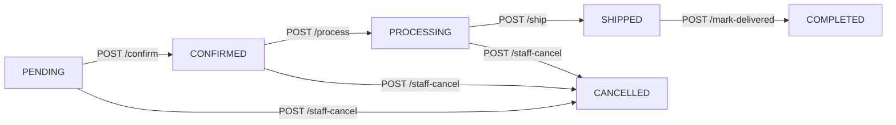
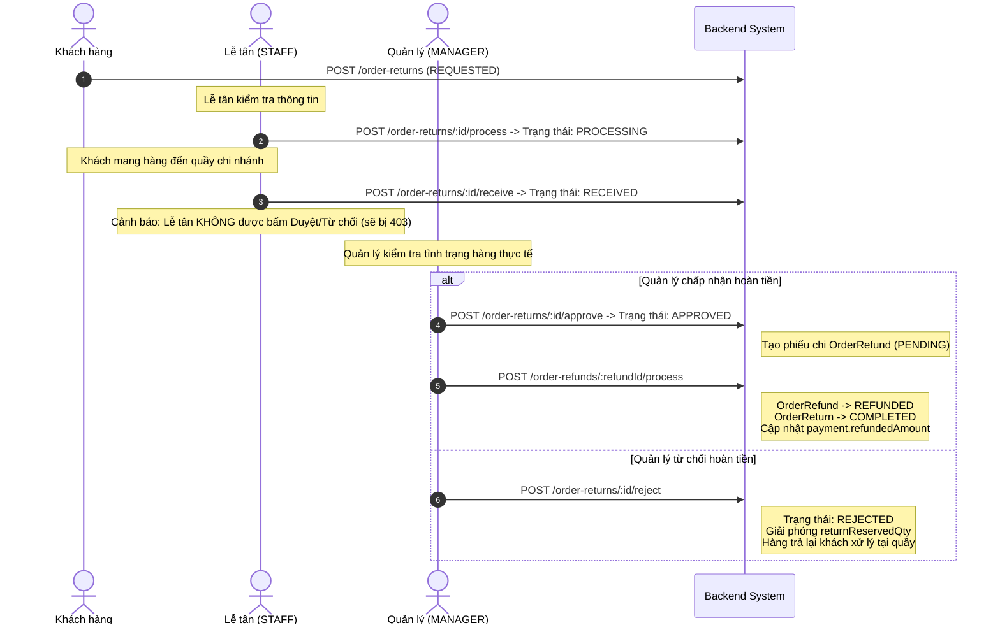

# HƯỚNG DẪN KẾT NỐI & TÍCH HỢP TOÀN DIỆN: LUỒNG ORDER, THANH TOÁN & TRẢ HÀNG E2E (DÀNH CHO FRONTEND)

> **Dành cho:** Frontend Developers (Web Admin, Web Customer, Mobile App)  
> **Hệ thống:** PET CLINIC BACKEND  
> **Base URL Live (Render - CHÍNH THỨC):** `https://pet-clinic-backend-a4lj.onrender.com/api/v1`  
> **Base URL Local:** `http://localhost:8080/api/v1`  
> **Chuẩn Content-Type:** `application/json`  
> **Chuẩn Error Response:** RFC 9457 Problem Details (`application/problem+json`)

> [!IMPORTANT]
> **HÀNH ĐỘNG CẦN LÀM NGAY (QUICK START DÀNH CHO FRONTEND):**
> 1. **Đổi Base URL sang:** `https://pet-clinic-backend-a4lj.onrender.com/api/v1` (tuyệt đối không gọi vào `api.drpetshouse.lat` nữa do domain này chưa cấu hình DNS trên Render).
> 2. **Đăng nhập bằng tài khoản:**
>    - **Admin (Quản lý toàn bộ đơn hàng/nhân sự/duyệt hoàn tiền):** `admin` (mật khẩu: `K9#mQ$8xL!2vW*7z`)
>    - **Khách hàng (Xem và tạo 12 đơn UAT, áp voucher, yêu cầu đổi trả):** `customer` (mật khẩu: `cT6$vM2!pL9#zR8&`)

> [!WARNING]
> **LƯU Ý QUAN TRỌNG VỀ DOMAIN:**
> Domain `https://api.drpetshouse.lat` hiện **CHƯA được cấu hình DNS/CNAME** trên Render Custom Domains.
> FE vui lòng kết nối trực tiếp vào URL chính thức của Render:
> **`https://pet-clinic-backend-a4lj.onrender.com/api/v1`** để tránh hoàn toàn lỗi DNS `Could not resolve host` hoặc spam login gây 429 Rate Limit.

---

## 📑 MỤC LỤC
1. [Thông Tin Kết Nối & Danh Sách Tài Khoản Test Demo](#1-thông-tin-kết-nối--danh-sách-tài-khoản-test-demo)
2. [Bộ Dữ Liệu UAT Mẫu (12 Đơn Hàng, 9 Voucher, Nhân Sự)](#2-bộ-dữ-liệu-uat-mẫu-12-đơn-hàng-9-voucher-nhân-sự)
3. [Các Điểm Thay Đổi Mới Cần Lưu Ý & Phạm Vi Tính Năng](#3-các-điểm-thay-đổi-mới-cần-lưu-ý--phạm-vi-tính-năng)
4. [Cơ Chế Tính Giá & Chiết Khấu 2 Tầng (Two-Tier Pricing)](#4-cơ-chế-tính-giá--chiết-khấu-2-tầng-two-tier-pricing)
5. [Headers Bắt Buộc & Authentication](#5-headers-bắt-buộc--authentication)
6. [Luồng Khách Hàng: Đặt Hàng & Thanh Toán (Checkout)](#6-luồng-khách-hàng-đặt-hàng--thanh-toán-checkout)
7. [Luồng Vận Hành Nhân Sự: Xử Lý Đơn Hàng (Order Fulfillment)](#7-luồng-vận-hành-nhân-sự-xử-lý-đơn-hàng-order-fulfillment)
8. [Luồng Đổi Trả & Hoàn Tiền Đa Cấp (Return & Refund)](#8-luồng-đổi-trả--hoàn-tiền-đa-cấp-return--refund)
9. [Bảng Tra Cứu Mã Lỗi RFC 9457 Phổ Biến & Cách Bắt Lỗi Trên UI](#9-bảng-tra-cứu-mã-lỗi-rfc-9457-phổ-biến--cách-bắt-lỗi-trên-ui)
10. [Code Mẫu Tích Hợp (TypeScript / Axios / Angular)](#10-code-mẫu-tích-hợp-typescript--axios--angular)

---

## 1. THÔNG TIN KẾT NỐI & DANH SÁCH TÀI KHOẢN TEST DEMO

### 1.1 Thông Tin Server & Base URL
- **Base URL Live (Render):** `https://pet-clinic-backend-a4lj.onrender.com/api/v1`
- **Base URL Local:** `http://localhost:8080/api/v1`
- **Tình trạng Custom Domain (`api.drpetshouse.lat`):** Hiện chưa cấu hình bản ghi DNS/CNAME trên Render. FE vui lòng chỉ dùng URL Render trên.
- **Cơ chế chống 429:** Backend đã áp dụng bypass Rate Limit cho hệ thống probe của Render, đảm bảo không còn tình trạng sập instance khi test.

### 1.2 Bảng Tài Khoản Test Đã Tạo Sẵn (Mật Khẩu Chuẩn)

| Username | Role | SubRole | Mật khẩu (Password) | Quyền hạn chính |
| :--- | :--- | :--- | :--- | :--- |
| `admin` | `ADMIN` | - | `K9#mQ$8xL!2vW*7z` | Toàn quyền hệ thống, xem mọi đơn, duyệt hoàn tiền |
| `manager` | `MANAGER` | - | `tR5*bY9#fP2!sM7&` | Quản lý chi nhánh Q1, Q3, Bình Thạnh, duyệt hoàn tiền |
| `receptionist` | `STAFF` | `RECEPTIONIST` | `rC4!mZ7#bX9$vT2&` | Tiếp nhận đơn, xác nhận nhận hàng trả (`/process`, `/receive`) |
| `doctor` | `STAFF` | `VETERINARIAN` | `vE8$dK2#zL6!pQ9@` | Bác sĩ thú y chi nhánh Quận 1 |
| `nurse` | `STAFF` | `NURSE` | `nS4#yP8!vQ2$kM7@` | Y tá thú y chi nhánh Quận 1 |
| `groomer` | `STAFF` | `CARE_STAFF_GROOMER`| `gM9$kL3@sY7!bN2#` | Chăm sóc spa thú cưng |
| `customer` | `CUSTOMER` | - | `cT6$vM2!pL9#zR8&` | Khách hàng (SĐT: `0905555555`) sở hữu 12 đơn UAT |
| `pending_user` | `CUSTOMER` | - | `pU3#zK8!vQ5$mY2@` | Khách hàng chờ kích hoạt (SĐT: `0907777777`) |
| `blocked_user` | `CUSTOMER` | - | `bL9$rM2#vK4!zQ7@` | Khách hàng bị khóa (SĐT: `0906666666`) |

> [!TIP]
> **API Đăng nhập:** `POST /api/v1/auth/login` với body: `{"identifier": "<username hoặc sdt>", "password": "<password>"}`.
> Token nhận về được lưu vào header `Authorization: Bearer <accessToken>`.

---

## 2. BỘ DỮ LIỆU UAT MẪU SẴN SÀNG TRÊN DATABASE (12 ĐƠN, 9 VOUCHER, NHÂN SỰ)

### 2.1 Danh Sách 12 Đơn Hàng UAT Đầy Đủ Trạng Thái (Test Mọi Kịch Bản)
Tất cả đơn hàng dưới đây đã được tạo sẵn trong database và thuộc sở hữu của khách hàng `customer` (hoặc tra cứu được qua SĐT `0905555555`):

| Mã Đơn Hàng (code) | Trạng thái (status) | Phương thức | Tổng tiền | Trạng thái Đổi trả / Hoàn tiền | Mục đích kiểm thử |
| :--- | :--- | :--- | :--- | :--- | :--- |
| `ORD-UAT-01-PENDING-COD` | `PENDING` | `COD` | 380.000đ | Không áp dụng | Test nút "Xác nhận đơn" (Staff/Receptionist) & "Huỷ đơn" (Customer) |
| `ORD-UAT-02-PENDING-ONLINE` | `PENDING` | `ONLINE_MOCK` | 270.000đ | Không áp dụng | Test thanh toán Online (`POST /payments/:id/process`) |
| `ORD-UAT-03-CONFIRMED` | `CONFIRMED` | `COD` | 310.000đ | Không áp dụng | Test chuyển sang `PROCESSING` (Đang đóng gói) |
| `ORD-UAT-04-PROCESSING` | `PROCESSING` | `COD` | 430.000đ | Không áp dụng | Test chuyển sang `SHIPPED` (Giao cho đơn vị vận chuyển) |
| `ORD-UAT-05-SHIPPED` | `SHIPPED` | `COD` | 220.000đ | Không áp dụng | Test nút "Giao thành công" $\rightarrow$ tự động chuyển thanh toán COD sang `PAID` |
| `ORD-UAT-06-DELIVERED-RECENT` | `COMPLETED` | `COD` | 650.000đ | **HỢP LỆ ĐỔI TRẢ** (Giao 2 ngày trước) | Test khách gửi yêu cầu trả hàng (`POST /order-returns`), báo giá trả hàng |
| `ORD-UAT-07-DELIVERED-EXPIRED`| `COMPLETED` | `COD` | 250.000đ | **HẾT HẠN** (Giao 10 ngày trước) | Test kiểm tra chặn trả hàng quá cửa sổ 7 ngày (`RETURN_WINDOW_EXPIRED`) |
| `ORD-UAT-08-COMPLETED-ONLINE` | `COMPLETED` | `ONLINE_MOCK` | 390.000đ | Đã hoàn tất | Test hiển thị chi tiết đơn hàng Online hoàn tất thành công |
| `ORD-UAT-09-CANCELLED-CUSTOMER`| `CANCELLED` | `COD` | 115.000đ | Đã huỷ | Test hiển thị đơn huỷ bởi khách hàng |
| `ORD-UAT-10-CANCELLED-EXPIRED` | `CANCELLED` | `ONLINE_MOCK` | 380.000đ | Đã huỷ | Test đơn Online tự động huỷ khi hết hạn thanh toán |
| `ORD-UAT-11-RETURN-REQUESTED` | `COMPLETED` | `COD` | 310.000đ | **Đang yêu cầu (`RET-UAT-11`)** | Test Lễ tân tiếp nhận (`/process`) và nhận hàng (`/receive`) |
| `ORD-UAT-12-RETURN-REFUNDED`  | `COMPLETED` | `ONLINE_MOCK` | 220.000đ | **Đã hoàn tiền (`REF-UAT-12`)** | Test xem lịch sử đổi trả & số tiền đã hoàn trả 95.000đ |

### 2.2 Danh Sách 9 Voucher UAT & Điều Kiện Áp Dụng Thực Tế

| Mã Voucher | Phạm vi (Scope) | Hình thức giảm | Mức giảm | Đơn tối thiểu | Lưu ý tích hợp cho FE |
| :--- | :--- | :--- | :--- | :--- | :--- |
| `FREESHIP` | `ORDER` | `FIXED` | **0đ Phí Ship** | 0đ | **Miễn phí ship 100%** (Phí vận chuyển hiển thị 0đ) |
| `GIAM40K_DON150K` | `ORDER` | `FIXED` | 40.000đ | 150.000đ | Giảm cố định 40k trên tiền hàng |
| `GIAM10_CAP50` | `ORDER` | `PERCENTAGE` | 10% (Tối đa 50k) | 100.000đ | Giảm theo %, chặn trần tối đa 50.000đ |
| `VIP100K_DON500K` | `ORDER` | `FIXED` | 100.000đ | 500.000đ | Áp dụng cho đơn giá trị cao |
| `THUNHO20` | `PRODUCT` | `PERCENTAGE` | 20% (Tối đa 100k) | 0đ | Chỉ áp dụng cho các sản phẩm Thú nhỏ & Phụ kiện |
| `SUMMER20` | `SERVICE` | `PERCENTAGE` | 20% (Tối đa 100k) | 0đ | Áp dụng khi đặt dịch vụ Spa / Khám |
| `PETCLINIC50K` | `SERVICE` | `FIXED` | 50.000đ | 200.000đ | Áp dụng khi đặt dịch vụ từ 200k |
| `EXPIRED_TEST` | `ORDER` | `PERCENTAGE` | 15% | 0đ | **Voucher hết hạn** $\rightarrow$ test bắt lỗi UI `VOUCHER_EXPIRED` |
| `MAXOUT_TEST` | `ORDER` | `FIXED` | 20.000đ | 0đ | **Voucher hết lượt** $\rightarrow$ test bắt lỗi UI `VOUCHER_QUOTA_EXCEEDED` |

### 2.3 Phân Định Rõ Phạm Vi Nghiệp Vụ (Supported vs Out-of-Scope)
Để FE phát triển đúng spec và không bị nhầm lẫn giữa các màn hình:
- **TÍNH NĂNG ĐÃ HỖ TRỢ ĐẦY ĐỦ (PRODUCTION READY):**
  - Khách hàng (hoặc Guest) mua hàng qua Web/App Customer $\rightarrow$ Checkout chọn COD/Online $\rightarrow$ Áp Voucher $\rightarrow$ Backend tự động điều phối chi nhánh còn hàng.
  - Quản lý / Lễ tân / Admin xem danh sách đơn hàng, lọc theo trạng thái, tìm kiếm mã đơn, SĐT.
  - Luồng duyệt đơn: `PENDING` $\rightarrow$ `CONFIRMED` $\rightarrow$ `PROCESSING` $\rightarrow$ `SHIPPED` $\rightarrow$ `COMPLETED`.
  - Khách hàng yêu cầu đổi trả trong vòng 7 ngày kể từ lúc nhận hàng (`DELIVERED`/`COMPLETED`).
  - Lễ tân tiếp nhận và nhận hàng tại quầy $\rightarrow$ Quản lý/Admin duyệt hoàn tiền.
- **TÍNH NĂNG CHƯA NẰM TRONG ĐỢT NÀY (NOT_SUPPORTED - SẼ TRIỂN KHAI ĐỢT SAU):**
  - Nhân viên Admin/Lễ tân tự bấm tạo đơn hàng hộ khách từ màn hình quản trị POS.
  - Phục hồi tồn kho chi tiết theo từng SKU khi khách hủy hàng sau khi đã xuất kho.
  - Tùy chọn "Nhận hàng tại quầy (Store Pickup)" trong lúc thanh toán.

---

## 3. CÁC ĐIỂM THAY ĐỔI MỚI CẦN LƯU Ý

1. **4 Nhóm Danh Mục Sản Phẩm Mới (Category Taxonomy):**
   - `Thức ăn & Dinh dưỡng` (`thuc-an-va-dinh-duong`)
   - `Vệ sinh & Chăm sóc` (`ve-sinh-va-cham-soc`)
   - `Phụ kiện & Chuồng trại` (`phu-kien-va-chuong-trai`)
   - `Y tế & Thực phẩm chức năng` (`y-te-va-thuc-pham-chuc-nang`)
2. **Hỗ Trợ Đa Dạng 4 Nhóm Loài Thú Cưng:**
   - 🐶 Chó (Dog) | 🐱 Mèo (Cat) | 🐹 Thú nhỏ (Hamster, Thỏ, Bọ ú) | 🦜 Chim cảnh (Birds).
3. **Phân Bổ Chi Nhánh Tự Động (Fulfillment Resolver):**
   - FE **không cần gửi chi nhánh** khi checkout. Backend tự động quét thứ tự ưu tiên: `Chi nhánh Quận 1` $\rightarrow$ `Chi nhánh Quận 3` $\rightarrow$ `Chi nhánh Bình Thạnh`.
   - **Lưu ý UI:** Nếu toàn bộ chi nhánh không có nơi nào chứa đủ toàn bộ giỏ hàng, BE sẽ ném lỗi `422 INSUFFICIENT_INVENTORY` ("*No active branch can fulfill the entire cart*"). Hệ thống **không tự tách đơn (no split order)**.
4. **Vòng Đời Thanh Toán COD:**
   - Đơn COD khi tạo sẽ có thanh toán `PENDING`. Trạng thái này giữ nguyên qua các bước Confirm, Process, Ship. **Chỉ khi nhân viên bấm "Giao thành công" (`mark-delivered`), thanh toán mới tự động nhảy sang `PAID`**.
5. **Phân Quyền Đổi Trả Nghiêm Ngặt (RBAC):**
   - Lễ tân (`RECEPTIONIST`): Chỉ được phép **Tiếp nhận hồ sơ** (`/process`) và **Xác nhận đã nhận hàng tại quầy** (`/receive`).
   - Quản lý / Admin (`MANAGER` / `ADMIN`): Mới có quyền **Duyệt hoàn tiền** (`/approve`), **Từ chối** (`/reject`) và **Xử lý hoàn tiền** (`/processOrderRefund`).
   - *Nếu Lễ tân bấm Duyệt/Từ chối trên màn hình $\rightarrow$ BE sẽ trả `403 Forbidden`.*

---

## 2. CƠ CHẾ TÍNH GIÁ & CHIẾT KHẤU 2 TẦNG (TWO-TIER PRICING)

Để hiển thị UI giỏ hàng và hóa đơn chính xác từng đồng, FE cần tuân thủ thứ tự tính toán:

```
[Giá gốc niêm yết: price]
        │
        ▼ (Tầng 1: Product Discount: discountPercent)
[Giá bán thực tế: finalPrice = round(price * (100 - discountPercent) / 100)]
        │
        ▼ (Đơn giá từng món: unitPrice = finalPrice)
[Tổng tiền hàng: merchandiseSubtotal = sum(unitPrice * quantity)]
        │
        ▼ (Tầng 2: Voucher Discount: voucherDiscount áp dụng trên merchandiseSubtotal)
[Tiền hàng thực trả sau voucher: merchandiseNet = merchandiseSubtotal - voucherDiscount]
        │
        ▼ (+ Phí vận chuyển: shippingFee. Miễn phí nếu merchandiseSubtotal >= 500,000đ)
[Tổng thanh toán: totalAmount = merchandiseNet + shippingFee]
```

### 💡 Quy tắc hiển thị trên UI:
- **Tại trang danh sách / chi tiết sản phẩm:**
  - Nếu `variant.discountPercent > 0`: Hiển thị giá gốc gạch ngang (`variant.price`) và giá bán nổi bật (`variant.finalPrice`).
  - Đơn giá đưa vào giỏ hàng luôn là `variant.finalPrice`.
- **Tại trang Thanh toán (Checkout):**
  - Tạm tính hàng hóa: `merchandiseSubtotal = sum(item.unitPrice * item.quantity)` (với `unitPrice` là `finalPrice`).
  - Điều kiện áp voucher (ví dụ đơn từ 150.000đ): So sánh với `merchandiseSubtotal` (đã giảm tầng 1), không dùng giá gốc.
  - Mỗi dòng sản phẩm được backend lưu snapshot: `lineNet` (tiền thực trả sau voucher).
- **Khi Hoàn tiền (Return/Refund):**
  - Đơn giá hoàn tính trên `lineNet`: $\text{unitNet} = \text{Math.floor}(\text{lineNet} / \text{quantity})$.
  - **Phí vận chuyển không bao giờ được hoàn** (`shippingRefunded: 0`).

---

## 3. HEADERS BẮT BUỘC & AUTHENTICATION

| Header Key | Bắt buộc khi nào? | Ví dụ giá trị | Ý nghĩa |
|---|---|---|---|
| `Authorization` | Khi đã đăng nhập (Customer / Staff / Manager / Admin) | `Bearer eyJhbGciOi...` | Token xác thực JWT |
| `Idempotency-Key` | **Bắt buộc** với các lệnh POST tạo Order, huỷ đơn, tạo Return, hoàn tiền | `uuid-v4` (vd: `9b1deb4d-3b7d-4bad-9bdd-2b0d7b3dcb6d`) | Chống đặt trùng / trừ tiền 2 lần khi mạng lag |
| `x-guest-cart-token` | Bắt buộc khi khách vãng lai (chưa đăng nhập) checkout giỏ hàng | Chuỗi ngẫu nhiên lưu tại `localStorage` | Định danh giỏ hàng của Guest |
| `x-guest-lookup-token` | Bắt buộc khi khách vãng lai tra cứu đơn hàng | Chuỗi token cấp lúc checkout | Cho phép Guest xem lại đơn của mình |

---

## 4. LUỒNG KHÁCH HÀNG: ĐẶT HÀNG & THANH TOÁN (CHECKOUT)

### 4.1 Endpoint Checkout Đơn Hàng
- **Method:** `POST`
- **URL:** `/api/v1/checkout` (hoặc `/api/v1/orders/checkout`)
- **Headers:**
  ```http
  Content-Type: application/json
  Authorization: Bearer <customerToken> (nếu là Customer)
  x-guest-cart-token: <guestCartToken> (nếu là Guest)
  Idempotency-Key: c9b8e21a-4d2a-43c2-a72e-132d78f21e01
  ```
- **Request Body mẫu:**
  ```json
  {
    "cartId": "60c72b2f9b1d8b2bad000099",
    "paymentMethod": "COD", // Hoặc "ONLINE_MOCK"
    "voucherCode": "GIAM40K_DON150K", // Không bắt buộc, bỏ trống nếu không dùng
    "shippingAddress": {
      "recipientName": "Nguyễn Văn A",
      "phone": "0901234567",
      "line1": "123 Lê Lợi, Phường Bến Thành",
      "city": "Thành phố Hồ Chí Minh"
    },
    "note": "Giao giờ hành chính giúp mình"
  }
  ```

- **Response thành công (`201 Created`):**
  ```json
  {
    "id": "60c72b2f9b1d8b2bad000088",
    "code": "ORD-1730000000-A1B2C3",
    "status": "PENDING",
    "paymentMethod": "COD",
    "fulfillmentBranchId": "60c72b2f9b1d8b2bad000001",
    "items": [
      {
        "orderItemId": "60c72b2f9b1d8b2bad000081",
        "productId": "60c72b2f9b1d8b2bad000021",
        "nameSnapshot": "Hạt hữu cơ cún con Royal Canin Mini Puppy - Túi 1.5kg",
        "skuSnapshot": "SP-000101-001",
        "quantity": 2,
        "unitPrice": 135000,
        "lineSubtotal": 270000,
        "allocatedDiscount": 30000,
        "lineNet": 240000,
        "returnableQty": 0
      },
      {
        "orderItemId": "60c72b2f9b1d8b2bad000082",
        "productId": "60c72b2f9b1d8b2bad000041",
        "nameSnapshot": "Cỏ nén hữu cơ Timothy Mini Pets - Túi 1kg",
        "skuSnapshot": "SP-000103-001",
        "quantity": 1,
        "unitPrice": 90000,
        "lineSubtotal": 90000,
        "allocatedDiscount": 10000,
        "lineNet": 80000,
        "returnableQty": 0
      }
    ],
    "pricing": {
      "merchandiseSubtotal": 360000,
      "voucherDiscount": 40000,
      "shippingFee": 30000,
      "totalAmount": 350000
    },
    "payment": {
      "paymentId": "60c72b2f9b1d8b2bad000077",
      "status": "PENDING"
    },
    "allowedActions": ["CANCEL"]
  }
  ```

### 4.2 Lưu ý về Phương Thức Thanh Toán:
- **Nếu chọn `COD`:** Đơn hàng được tạo thành công, điều hướng khách sang trang "Đặt hàng thành công".
- **Nếu chọn `ONLINE_MOCK`:**
  - FE hiển thị modal/màn hình thanh toán giả lập với 3 lựa chọn: **Thành công (Paid)**, **Hủy bỏ (Cancel)**, hoặc **Thất bại (Fail)**.
  - *Nếu thanh toán thất bại/hủy:* Backend sẽ tự động hủy đơn (`CANCELLED`), hoàn lại hàng vào kho và khôi phục voucher cho khách.
  - *Nếu thanh toán thành công:* Đơn hàng chuyển sang sẵn sàng để nhân viên xác nhận.

---

## 5. LUỒNG VẬN HÀNH NHÂN SỰ: XỬ LÝ ĐƠN HÀNG (ORDER FULFILLMENT)

Dành cho Web Admin / Portal Chi Nhánh (Role: `STAFF` - Lễ tân, `MANAGER`, `ADMIN`):



### Các API chuyển trạng thái:

1. **Xác nhận đơn hàng:**
   - `POST /api/v1/orders/:id/confirm`
   - *Lưu ý:* Với đơn `ONLINE_MOCK`, nếu khách chưa thanh toán, API sẽ trả lỗi `422 PAYMENT_REQUIRED`.
2. **Bắt đầu đóng gói chuẩn bị hàng:**
   - `POST /api/v1/orders/:id/process`
3. **Bàn giao cho đơn vị vận chuyển:**
   - `POST /api/v1/orders/:id/ship`
   - Body:
     ```json
     {
       "carrier": "GiaoHangNhanh",
       "trackingNumber": "GHN888999111"
     }
     ```
4. **Xác nhận giao hàng thành công:**
   - `POST /api/v1/orders/:id/mark-delivered`
   - **Tác động tự động của hệ thống:**
     - `order.status` chuyển thành `COMPLETED`.
     - Lưu mốc thời gian `deliveredAt` (bắt đầu tính cửa sổ 7 ngày đổi trả).
     - **Nếu là đơn COD:** `payment.status` tự động chuyển sang `PAID` và ghi nhận `paidAt`.

---

## 6. LUỒNG ĐỔI TRẢ & HOÀN TIỀN ĐA CẤP (RETURN & REFUND)

### 6.1 Điều Kiện Đổi Trả Hợp Lệ
- Đơn hàng phải ở trạng thái `COMPLETED`.
- Thời gian hiện tại không quá **7 ngày** kể từ `deliveredAt`. (Nếu quá 7 ngày, BE chặn với mã `422 RETURN_WINDOW_EXPIRED`).

### 6.2 Bước 1: Khách Kiểm Tra Mặt Hàng Có Thể Trả
- **API:** `GET /api/v1/orders/:id/returnable-items`
- **Response trả về:**
  ```json
  {
    "orderId": "60c72b2f9b1d8b2bad000088",
    "eligible": true,
    "returnWindowEndsAt": "2026-11-02T10:00:00.000Z",
    "items": [
      {
        "orderItemId": "60c72b2f9b1d8b2bad000081",
        "name": "Hạt hữu cơ cún con Royal Canin Mini Puppy",
        "orderedQty": 2,
        "alreadyReturnedQty": 0,
        "returnableQty": 2,
        "unitRefundEstimate": 120000,
        "maxRefundEstimate": 240000
      }
    ]
  }
  ```

### 6.3 Bước 2: Khách Xem Báo Giá Hoàn Tiền Tạm Tính
- **API:** `POST /api/v1/orders/:id/return-quote`
- **Body:**
  ```json
  {
    "items": [
      {
        "orderItemId": "60c72b2f9b1d8b2bad000081",
        "quantity": 1
      }
    ]
  }
  ```
- **Response:**
  ```json
  {
    "refundBreakdown": {
      "merchandiseNet": 120000,
      "shippingRefunded": 0,
      "total": 120000
    }
  }
  ```

### 6.4 Bước 3: Khách Gửi Yêu Cầu Trả Hàng (Create Return)
- **API:** `POST /api/v1/order-returns`
- **Headers:** `Idempotency-Key: <uuid-v4>`
- **Body:**
  ```json
  {
    "orderId": "60c72b2f9b1d8b2bad000088",
    "items": [
      {
        "orderItemId": "60c72b2f9b1d8b2bad000081",
        "quantity": 1
      }
    ],
    "reason": "Bao bì bị rách trong lúc vận chuyển"
  }
  ```
- Trạng thái trả về: `status: "REQUESTED"`. Backend tự động khóa số lượng tạm giữ (`returnReservedQty += 1`) trên dòng hàng để tránh khách bấm gửi trùng.

### 6.5 Bước 4 & 5: Quy Trình Xử Lý Tại Chi Nhánh (Lễ Tân & Quản Lý)



#### Chi tiết các API vận hành đổi trả:
1. **Lễ tân tiếp nhận:** `POST /api/v1/order-returns/:id/process` (Role: `STAFF`, `MANAGER`, `ADMIN`)
2. **Lễ tân xác nhận đã nhận hàng tại quầy:** `POST /api/v1/order-returns/:id/receive` (Role: `STAFF`, `MANAGER`, `ADMIN`)
3. **Quản lý phê duyệt khoản hoàn:** `POST /api/v1/order-returns/:id/approve` (Chỉ dành cho `MANAGER`, `ADMIN`)
   - Body: `{"note": "Đã kiểm tra bao bì đạt yêu cầu"}`
   - Trả về `refundId`.
4. **Quản lý thực thi hoàn tiền (chuyển tiền cho khách):** `POST /api/v1/order-refunds/:refundId/process` (Chỉ dành cho `MANAGER`, `ADMIN`)
   - Header: `Idempotency-Key: <uuid-v4>`
   - Body: `{"note": "Đã chuyển khoản ngân hàng hoàn tiền"}`
5. **Quản lý từ chối yêu cầu:** `POST /api/v1/order-returns/:id/reject` (Chỉ dành cho `MANAGER`, `ADMIN`)
   - Body: `{"reason": "Sản phẩm đã bị thú cưng cắn rách tem"}`

---

## 7. BẢNG TRA CỨU MÃ LỖI RFC 9457 PHỔ BIẾN & CÁCH BẮT LỖI TRÊN UI

Khi Backend trả mã lỗi (HTTP 4xx / 5xx), response luôn tuân thủ chuẩn RFC 9457:
```json
{
  "type": "https://api.petclinic.com/errors/INSUFFICIENT_INVENTORY",
  "title": "Unprocessable Entity",
  "status": 422,
  "code": "INSUFFICIENT_INVENTORY",
  "detail": "No active branch can fulfill the entire cart",
  "instance": "/api/v1/checkout",
  "correlationId": "f7d9a1-..."
}
```

FE bắt thuộc tính `error.response.data.code` để hiển thị Toast thông báo thân thiện:

| HTTP Status | Mã lỗi (`code`) | Ý nghĩa chi tiết | Gợi ý hiển thị Toast UI |
|:---:|---|---|---|
| **400** | `EMPTY_CART` | Giỏ hàng rỗng khi bấm checkout | *"Giỏ hàng của bạn đang trống. Vui lòng chọn sản phẩm."* |
| **400** | `VALIDATION_ERROR` | Thiếu địa chỉ, số điện thoại hoặc thiếu `Idempotency-Key` | *"Vui lòng điền đầy đủ thông tin giao hàng hợp lệ."* |
| **401** | `AUTHENTICATION_ERROR` | Token JWT hết hạn hoặc chưa đăng nhập | Điều hướng người dùng về màn hình Đăng nhập. |
| **403** | `FORBIDDEN` | Lễ tân cố tình bấm duyệt hoàn tiền hoặc thao tác ngoài quyền | *"Bạn không có quyền thực hiện hành động này. Cần tài khoản Quản lý chi nhánh."* |
| **409** | `CONFLICT` | Trùng lặp `Idempotency-Key` hoặc giỏ hàng đã thanh toán | *"Yêu cầu đang được xử lý, vui lòng không nhấn gửi liên tiếp."* |
| **422** | `INSUFFICIENT_INVENTORY` | Không có chi nhánh nào có đủ toàn bộ số lượng trong giỏ | *"Một số sản phẩm trong giỏ hàng đã hết tại các chi nhánh. Vui lòng giảm số lượng."* |
| **422** | `PAYMENT_REQUIRED` | Xác nhận đơn `ONLINE_MOCK` khi chưa thanh toán | *"Đơn hàng chưa hoàn tất thanh toán trực tuyến."* |
| **422** | `RETURN_WINDOW_EXPIRED` | Đã quá 7 ngày kể từ ngày giao hàng | *"Đã hết thời hạn đổi trả sản phẩm (tối đa 7 ngày kể từ khi nhận hàng)."* |
| **422** | `REFUND_EXCEEDS_NET_PAID`| Tổng số tiền yêu cầu hoàn vượt quá số tiền thực trả | *"Số tiền yêu cầu hoàn tiền vượt quá số tiền thực tế bạn đã thanh toán cho món hàng."* |
| **422** | `VOUCHER_INVALID` | Voucher hết hạn, không đủ điều kiện chi tiêu tối thiểu | *"Mã giảm giá không hợp lệ hoặc chưa đạt giá trị đơn hàng tối thiểu."* |

---

## 8. CODE MẪU TÍCH HỢP (TYPESCRIPT / AXIOS / ANGULAR)

### 8.1 Axios Service Helper (React / Vue / Next.js)

```typescript
import axios, { AxiosError } from 'axios';
import { v4 as uuidv4 } from 'uuid';

const apiClient = axios.create({
  baseURL: process.env.NEXT_PUBLIC_API_URL || 'http://localhost:8080/api/v1',
  headers: {
    'Content-Type': 'application/json'
  }
});

// Interceptor tự động thêm Idempotency-Key cho các request nhạy cảm
apiClient.interceptors.request.use((config) => {
  const token = localStorage.getItem('access_token');
  if (token) {
    config.headers.Authorization = `Bearer ${token}`;
  }

  // Tự động sinh Idempotency-Key cho POST checkout và returns nếu chưa có
  if (config.method === 'post' && (config.url?.includes('/checkout') || config.url?.includes('/order-returns'))) {
    if (!config.headers['Idempotency-Key']) {
      config.headers['Idempotency-Key'] = uuidv4();
    }
  }

  return config;
});

// Hàm đặt hàng Checkout
export async function checkoutOrder(payload: {
  cartId: string;
  paymentMethod: 'COD' | 'ONLINE_MOCK';
  voucherCode?: string;
  shippingAddress: { recipientName: string; phone: string; line1: string; city: string };
  note?: string;
}) {
  try {
    const response = await apiClient.post('/checkout', payload);
    return response.data;
  } catch (err) {
    const error = err as AxiosError<any>;
    if (error.response?.data) {
      const problem = error.response.data;
      console.error(`[API Error ${problem.code}]:`, problem.detail);
      throw new Error(problem.detail || 'Không thể tạo đơn hàng');
    }
    throw err;
  }
}

// Hàm gửi yêu cầu trả hàng
export async function requestOrderReturn(payload: {
  orderId: string;
  items: Array<{ orderItemId: string; quantity: number }>;
  reason: string;
}) {
  try {
    const response = await apiClient.post('/order-returns', payload);
    return response.data;
  } catch (err) {
    const error = err as AxiosError<any>;
    throw new Error(error.response?.data?.detail || 'Không thể tạo yêu cầu trả hàng');
  }
}
```

### 8.2 Angular Service (HttpClient)

```typescript
import { Injectable } from '@angular/core';
import { HttpClient, HttpHeaders } from '@angular/common/http';
import { Observable } from 'rxjs';
import { v4 as uuidv4 } from 'uuid';

@Injectable({
  providedIn: 'root'
})
export class OrderService {
  // URL Live: https://pet-clinic-backend-a4lj.onrender.com/api/v1 (hoặc 'http://localhost:8080/api/v1' cho local)
  private baseUrl = 'https://pet-clinic-backend-a4lj.onrender.com/api/v1';

  constructor(private http: HttpClient) {}

  checkout(orderData: any): Observable<any> {
    const headers = new HttpHeaders({
      'Idempotency-Key': uuidv4()
    });
    return this.http.post(`${this.baseUrl}/checkout`, orderData, { headers });
  }

  getReturnableItems(orderId: string): Observable<any> {
    return this.http.get(`${this.baseUrl}/orders/${orderId}/returnable-items`);
  }

  getReturnQuote(orderId: string, items: any[]): Observable<any> {
    return this.http.post(`${this.baseUrl}/orders/${orderId}/return-quote`, { items });
  }

  createOrderReturn(returnData: any): Observable<any> {
    const headers = new HttpHeaders({
      'Idempotency-Key': uuidv4()
    });
    return this.http.post(`${this.baseUrl}/order-returns`, returnData, { headers });
  }
}
```

---

## 9. CHECKLIST DÀNH CHO FRONTEND TRƯỚC KHI BÀN GIAO SẢN PHẨM

- [ ] Đã thêm header `Idempotency-Key` (UUID v4) cho `POST /checkout` và `POST /order-returns`.
- [ ] Giỏ hàng hiển thị đúng đơn giá `unitPrice` (chính là `finalPrice` đã giảm giá sản phẩm).
- [ ] Voucher được tính trên `merchandiseSubtotal` (tổng tiền sau giảm giá sản phẩm), không tính trên giá gốc niêm yết.
- [ ] Phía Admin: Đã ẩn hoặc vô hiệu hóa nút "Duyệt hoàn tiền" / "Từ chối" đối với tài khoản Lễ tân (`RECEPTIONIST`) để tránh lỗi 403 Forbidden.
- [ ] Trang chi tiết đơn hàng: Đã kiểm tra `allowedActions` từ BE để hiển thị đúng nút "Huỷ đơn" hoặc "Yêu cầu đổi trả".
- [ ] Xử lý thông báo Toast theo đúng mã lỗi RFC 9457 (`code`) thay vì hiển thị lỗi chung chung `Internal Server Error`.

---
*Tài liệu được biên soạn bởi Backend Development Team. Nếu có bất kỳ thắc mắc hoặc trường hợp cần hỗ trợ, vui lòng liên hệ nhóm Backend để được phối hợp tức thì.*
