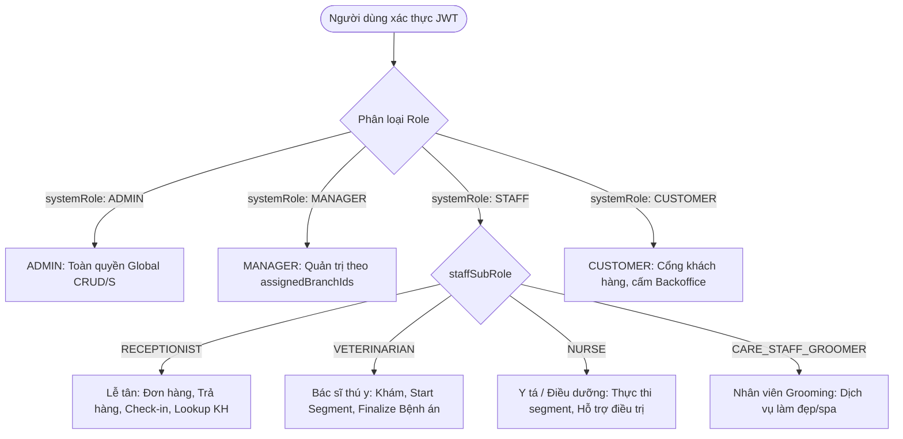

# TÀI LIỆU BÀN GIAO FRONTEND (FE HANDOFF)
## Chuẩn Hóa Phân Quyền Ma Trận 6 Vai Trò Cố Định & Vá Toàn Diện Lỗ Hổng RBAC Backend

> **Kính gửi:** Đội ngũ Kỹ sư Frontend (`DR_PETS_HOUSE_ANGULAR` / Web Admin / Customer Portal) & QA  
> **Tài liệu nghiệp vụ căn cứ:** [`docs/WEB2-RBAC-FIXED-ROLES-BE-GAPS-2026-11-14.md`](file:///d:/A1.%20Lap%20Trinh%20Web/Group_Project_Pet_Clinic/PET_CLINIC_BACKEND/docs/WEB2-RBAC-FIXED-ROLES-BE-GAPS-2026-11-14.md) (từ Sheet `feature` Workspace 13) & [`implementation_plan.md`](file:///C:/Users/Ly%20Le%20Minh/.gemini/antigravity/brain/e3863087-c00e-4ede-bfc9-06579a4c06da/implementation_plan.md)  
> **Trạng thái:** ✅ **HOÀN TẤT TRIỂN KHAI & NGHIỆM THU – ĐÃ COMMIT & PUSH GIT – 14/14 MATRIX TEST PASS – 199/199 REGRESSION TEST PASS – OPENAPI V6/V7 ĐỒNG BỘ**  
> **Commit Hash:** `18b48b6` trên nhánh `feat/foundation-v6`  
> **Ngày bàn giao:** 15/11/2026  
> **OpenAPI Specs:** [`docs/07-openapi-v6.yaml`](file:///d:/A1.%20Lap%20Trinh%20Web/Group_Project_Pet_Clinic/PET_CLINIC_BACKEND/docs/07-openapi-v6.yaml) & [`docs/Task-2.8-v7-confirmed/07-openapi-v7.yaml`](file:///d:/A1.%20Lap%20Trinh%20Web/Group_Project_Pet_Clinic/PET_CLINIC_BACKEND/docs/Task-2.8-v7-confirmed/07-openapi-v7.yaml)  

---

### MỤC LỤC
1. [Tổng Quan Kiến Trúc Phân Quyền 6 Vai Trò Cố Định](#1-tổng-quan-kiến-trúc-phân-quyền-6-vai-trò-cố-định)
2. [Chi Tiết 5 API Gaps Đã Được Mở Rộng Quyền (G1 → G5)](#2-chi-tiết-5-api-gaps-đã-được-mở-rộng-quyền-g1--g5)
3. [Chi Tiết 5 Lỗ Hổng Bảo Mật & Ràng Buộc Phạm Vi Chi Nhánh / Phân Công (B1 → B5)](#3-chi-tiết-5-lỗ-hổng-bảo-mật--ràng-buộc-phạm-vi-chi-nhánh--phân-công-b1--b5)
4. [Bảng Ma Trận Phân Quyền Chi Tiết Giữa 6 Vai Trò Cố Định](#4-bảng-ma-trận-phân-quyền-chi-tiết-giữa-6-vai-trò-cố-định)
5. [Chuẩn Hóa Mã Lỗi RFC 9457 & Nguyên Tắc Xử Lý Tại Frontend](#5-chuẩn-hóa-mã-lỗi-rfc-9457--nguyên-tắc-xử-lý-tại-frontend)
6. [Hướng Dẫn Tích Hợp Frontend (`core/guards`, UI State & Action Buttons)](#6-hướng-dẫn-tích-hợp-frontend-coreguards-ui-state--action-buttons)
7. [Bằng Chứng Kiểm Thử Tự Động & Đối Soát Hồi Quy](#7-bằng-chứng-kiểm-thử-tự-động--đối-soát-hồi-quy)

---

## 1. Tổng Quan Kiến Trúc Phân Quyền 6 Vai Trò Cố Định

Hệ thống tuân thủ mô hình **6 Vai Trò Cố Định (Fixed Roles Matrix)**, không hỗ trợ custom permission per user:



### Nguyên tắc bất biến:
1. **Token Payload:**
   - `systemRole`: `'ADMIN'` | `'MANAGER'` | `'STAFF'` | `'CUSTOMER'`
   - `staffSubRole`: Khi `systemRole === 'STAFF'`, bắt buộc là một trong 4 giá trị: `'RECEPTIONIST'` | `'VETERINARIAN'` | `'NURSE'` | `'CARE_STAFF_GROOMER'`.
   - `assignedBranchIds`: Mảng ObjectId chi nhánh mà `MANAGER` hoặc `STAFF` được gán.
2. **Nguyên tắc Fail-Closed:**
   - Mọi truy cập vào endpoint nội bộ không có token đều trả về `401 AUTHENTICATION_ERROR`.
   - Sai vai trò trả về `403 AUTHORIZATION_ERROR`.
   - Truy cập dữ liệu ngoài phạm vi chi nhánh được gán trả về `403 BRANCH_SCOPE_ERROR`.
   - Nhân viên truy cập dữ liệu ca khám/hồ sơ không được phân công trả về `403 ASSIGNMENT_SCOPE_ERROR`.
   - Frontend không thể ghi đè logic bảo mật của Backend; nếu FE bypass guard thì BE sẽ chặn tại lớp API.

---

## 2. Chi Tiết 5 API Gaps Đã Được Mở Rộng Quyền (G1 → G5)

Các endpoint trước đây bị khóa cứng `ADMIN` hoặc `ADMIN, MANAGER`, nay đã mở rộng chính xác theo ma trận nghiệp vụ:

| Gap ID | Endpoint | Method | Vai trò được phép mới | Ghi chú & Giới hạn an toàn |
| :--- | :--- | :---: | :--- | :--- |
| **G1** | `/api/v1/vouchers`<br>`/api/v1/vouchers/:id` | `GET` | `STAFF` (tất cả 4 subroles), `MANAGER`, `ADMIN` | **Read-only:** Nhân viên quầy/lễ tân cần xem danh sách mã giảm giá để tư vấn khách. Các thao tác `POST`, `PATCH`, `DELETE` giữ nguyên độc quyền cho `ADMIN` (`403`). |
| **G2** | `/api/v1/flash-sales`<br>`/api/v1/flash-sales/:id` | `GET` | `STAFF` (tất cả 4 subroles), `MANAGER`, `ADMIN` | **Read-only:** Nhân viên xem danh sách và chi tiết chiến dịch flash sale. Các thao tác `POST`, `PATCH`, `/publish`, `/pause` giữ nguyên độc quyền cho `ADMIN` (`403`). |
| **G3** | `/api/v1/admin/posts`<br>`/api/v1/admin/posts/:id`<br>`/api/v1/admin/posts/:id/status` | `GET`<br>`POST`<br>`PATCH`<br>`DELETE` | `MANAGER`, `ADMIN` | Cho phép `MANAGER` tạo, cập nhật, đổi trạng thái và xóa bài viết Blog / Hướng dẫn Sơ cứu (First Aid). `STAFF` không có quyền truy cập (`403`). |
| **G4** | `/api/v1/admin/community/posts/:id` | `DELETE` | `MANAGER`, `ADMIN` | Cho phép `MANAGER` xóa bài viết vi phạm trên Diễn đàn Cộng đồng. **Lưu ý nghiệp vụ:** Backend vẫn giữ quy tắc không cho xóa bài đang `PENDING` (`409 Conflict - MODERATION_ACTION_REQUIRED`). |
| **G5** | `/api/v1/admin/rescue/pets/:id`<br>`/api/v1/admin/rescue/requests/:id/review` | `DELETE`<br>`PATCH` | `MANAGER`, `ADMIN` | Cho phép `MANAGER` xóa hồ sơ thú cưng cứu hộ và duyệt đơn nhận nuôi (`APPROVED` / `REJECTED`), **nhưng bị ràng buộc phạm vi chi nhánh**: thú cưng phải thuộc `assignedBranchIds` của Manager (`403 BRANCH_SCOPE_ERROR`). |

---

## 3. Chi Tiết 5 Lỗ Hổng Bảo Mật & Ràng Buộc Phạm Vi Chi Nhánh / Phân Công (B1 → B5)

Đã loại bỏ hoàn toàn các lỗ hổng bypass và siết chặt kiểm tra chéo (Data Scoping):

### B1 — Sửa lỗi Bypass SubRole trong Middleware `requireRole`
* **Vấn đề cũ:** Khi middleware khai báo `requireRole(['ADMIN', 'MANAGER', 'RECEPTIONIST'])`, hệ thống kiểm tra `systemRole === 'STAFF'` lỏng lẻo khiến một số route cấp quyền cho cả Vet, Nurse, Groomer.
* **Đã sửa:** `requireRole` tự động bóc tách các subrole nhân viên (`allowedStaffSubRoles`). Nếu user có `systemRole === 'STAFF'`, bắt buộc `staffSubRole` của user phải nằm trong danh sách subrole được phép, loại bỏ hoàn toàn việc bypass ngoài ý muốn.

### B2 — Phân lập nghiệp vụ Thương mại, Đổi trả & Hoàn cọc về `RECEPTIONIST`
* **Đơn hàng (`/api/v1/orders`):**
  * `GET /`, `GET /:id`, `GET /stats`: Chỉ cho phép `ADMIN`, `MANAGER` và `RECEPTIONIST`. Các nhân viên `VETERINARIAN`, `NURSE`, `CARE_STAFF_GROOMER` bị chặn `403`.
  * `POST /:id/cancel`, `confirm`, `process`, `ship`, `markDelivered`: Ràng buộc `RECEPTIONIST` và `MANAGER` phải thuộc chi nhánh phụ trách của đơn hàng (`fulfillmentBranchId || branchId`).
* **Yêu cầu trả hàng (`/api/v1/order-returns`):**
  * Tiếp nhận và xử lý (`POST /:id/process`, `POST /:id/receive`): Dành riêng cho `RECEPTIONIST` tại chi nhánh và `MANAGER`.
  * Phê duyệt hoàn tiền cuối cùng (`POST /:id/approve`, `POST /:id/reject`): Chỉ `MANAGER` (thuộc chi nhánh) và `ADMIN`. `RECEPTIONIST` không được duyệt tài chính cuối (`403`).
* **Hoàn cọc Booking (`/api/v1/booking-refunds`):**
  * `GET /`: Yêu cầu xác thực tài khoản nội bộ hoặc `x-guest-lookup-token` hợp lệ (bỏ unrestricted public access).
  * `POST /:id/receive`: Dành riêng cho `['RECEPTIONIST', 'MANAGER', 'ADMIN']` (kiểm tra branch scope).

### B3 — Ràng buộc Phân công chuyên môn (Booking, Bệnh án, Khách hàng & Ca trực)
* **Check-in vs Start Segment:**
  * `POST /api/v1/appointments/:id/check-in`: Dành cho `['RECEPTIONIST', 'MANAGER', 'ADMIN']` (kiểm tra `branchId`).
  * `POST /api/v1/appointments/:id/start`: Dành riêng cho nhân viên lâm sàng `['CARE_STAFF_GROOMER', 'NURSE', 'VETERINARIAN']`. Backend xác thực nhân viên gọi API phải khớp với `assignedStaffId` của dịch vụ và `requiredStaffRole == staffSubRole`. Lễ tân không thể bắt đầu dịch vụ lâm sàng.
* **Hồ sơ dịch vụ & Bệnh án (`/api/v1/service-records`):**
  * `PATCH /:id/professional`: Khóa theo vai trò y tế (`VETERINARIAN` khám chữa bệnh, `NURSE` điều dưỡng). Lễ tân không có quyền ghi chép lâm sàng.
  * `POST /:id/reopen`, `GET /:id/revisions`: `MANAGER` chỉ được mở lại hoặc xem lịch sử sửa đổi bệnh án thuộc chi nhánh được gán (`assignedBranchIds`).
* **Tra cứu thông tin khách hàng (`/api/v1/customers`):**
  * `GET /customers/lookup?phone=...`: Chỉ cho phép `['ADMIN', 'MANAGER', 'RECEPTIONIST']` để phục vụ đón tiếp khách tại quầy. Vet, Nurse, Groomer bị chặn `403`.
  * `GET /customers/:id`: `RECEPTIONIST` chỉ xem được khách hàng từng phát sinh đơn hàng hoặc lịch hẹn tại chi nhánh mình. Nhân viên lâm sàng chỉ xem được khách hàng có lịch hẹn mà chính nhân viên đó được phân công điều trị.
* **Xem lịch làm việc cá nhân (`/api/v1/staff/:staffId/shifts`):**
  * Nhân viên `STAFF` chỉ được phép xem lịch ca trực của chính mình (`staffId === user._id` hoặc `staffProfile._id`). Cố tình xem ca trực của đồng nghiệp khác sẽ bị từ chối `403 AUTHORIZATION_ERROR`.

### B4 — Khóa chặn chuyển đổi trực tiếp `STAFF -> MANAGER`
* Tại `PATCH /api/v1/admin/users/:id/role`: Nếu tài khoản hiện tại là `STAFF` mà Admin cố đổi sang `MANAGER`, Backend sẽ trả về lỗi nghiệp vụ:
  ```json
  {
    "type": "https://errors.drpetshouse.lat/invalid-state-transition",
    "title": "Invalid State Transition",
    "status": 409,
    "code": "INVALID_STATE_TRANSITION",
    "detail": "Không thể chuyển trực tiếp tài khoản STAFF thành MANAGER. Vui lòng tạo tài khoản Manager qua POST /api/v1/managers với assignedBranchIds."
  }
  ```
* **Frontend Lưu ý:** Trên giao diện User Management, khi chọn tài khoản có role `STAFF`, dropdown chuyển đổi role cần disable option `MANAGER` và hiển thị tooltip hướng dẫn tạo tài khoản tại trang Quản lý Quản lý chi nhánh (`/admin/managers`).

### B5 — Giới hạn Nhật ký Biến động Kho (`/inventory/transactions`)
* `GET /api/v1/inventory/transactions` chỉ cho phép `ADMIN` và `MANAGER`. Toàn bộ `STAFF` bị chặn `403`.

---

## 4. Bảng Ma Trận Phân Quyền Chi Tiết Giữa 6 Vai Trò Cố Định

| Phân hệ / Tính năng | ADMIN | MANAGER | RECEPTIONIST | VETERINARIAN | NURSE | GROOMER | CUSTOMER / Guest |
| :--- | :---: | :---: | :---: | :---: | :---: | :---: | :---: |
| **Catalog Sản phẩm & Dịch vụ Master (C/U/D)** | **Full** | Đọc | Đọc | Đọc | Đọc | Đọc | Đọc Public |
| **Cấu hình Chi nhánh Dịch vụ (`BranchService`)** | **Full** | Chi nhánh | Đọc | Đọc | Đọc | Đọc | Đọc Public |
| **Voucher & Mã giảm giá (M10)** | **Full** | Đọc | Đọc *(G1)* | Đọc *(G1)* | Đọc *(G1)* | Đọc *(G1)* | Đọc Public/Ví |
| **Chiến dịch Flash Sale (M10)** | **Full** | Đọc | Đọc *(G2)* | Đọc *(G2)* | Đọc *(G2)* | Đọc *(G2)* | Đọc Public |
| **Đơn hàng: Xem & Thống kê** | **Full** | Chi nhánh | Chi nhánh | ❌ | ❌ | ❌ | Đơn của tôi |
| **Đơn hàng: Xác nhận / Xử lý / Giao hàng** | **Full** | Chi nhánh | Chi nhánh | ❌ | ❌ | ❌ | ❌ |
| **Đổi trả hàng: Tiếp nhận & Kiểm tra** | **Full** | Chi nhánh | Chi nhánh | ❌ | ❌ | ❌ | Tạo đơn trả |
| **Đổi trả hàng: Phê duyệt hoàn tiền cuối** | **Full** | Chi nhánh | ❌ | ❌ | ❌ | ❌ | ❌ |
| **Hoàn tiền Lịch hẹn: Tiếp nhận** | **Full** | Chi nhánh | Chi nhánh | ❌ | ❌ | ❌ | ❌ |
| **Lịch hẹn: Check-in đón khách** | **Full** | Chi nhánh | Chi nhánh | ❌ | ❌ | ❌ | ❌ |
| **Lịch hẹn: Bắt đầu thực thi segment (`/start`)** | ❌ | ❌ | ❌ | Phân công | Phân công | Phân công | ❌ |
| **Bệnh án: Ghi chép lâm sàng (`MEDICAL`)** | ❌ | ❌ | ❌ | **Ghi chép** | Hỗ trợ | ❌ | Xem kết quả |
| **Bệnh án: Ghi chép dịch vụ (`SPA_GROOMING`)** | ❌ | ❌ | ❌ | ❌ | Hỗ trợ | **Ghi chép** | Xem kết quả |
| **Bệnh án: Mở lại (`/reopen`) & Lịch sử sửa** | **Full** | Chi nhánh | ❌ | ❌ | ❌ | ❌ | ❌ |
| **Khách hàng: Tra cứu nhanh (`/lookup?phone=`)** | **Full** | **Full** | **Full** | ❌ | ❌ | ❌ | ❌ |
| **Khách hàng: Xem chi tiết (`/customers/:id`)** | **Full** | Chi nhánh | Khách chi nhánh | Khách phân công | Khách phân công | Khách phân công | Thông tin tôi |
| **Kho hàng: Xem nhật ký biến động (`transactions`)** | **Full** | Chi nhánh | ❌ *(B5)* | ❌ | ❌ | ❌ | ❌ |
| **Quản trị Tài khoản & Phân quyền Role** | **Full** | ❌ | ❌ | ❌ | ❌ | ❌ | ❌ |
| **Tạo Quản lý Chi nhánh (`POST /managers`)** | **Full** | ❌ | ❌ | ❌ | ❌ | ❌ | ❌ |
| **Lịch làm việc: Xem ca trực cá nhân** | **Full** | Chi nhánh | Ca của tôi | Ca của tôi | Ca của tôi | Ca của tôi | ❌ |
| **Blog & Hướng dẫn Sơ cứu (C/U/D)** | **Full** | **Full** *(G3)* | ❌ | ❌ | ❌ | ❌ | Đọc Public |
| **Kiểm duyệt / Xóa bài viết Cộng đồng** | **Full** | **Full** *(G4)* | ❌ | ❌ | ❌ | ❌ | Xóa bài của tôi |
| **Quản lý Thú cưng Cứu hộ & Đơn nhận nuôi** | **Full** | Chi nhánh *(G5)* | ❌ | ❌ | ❌ | ❌ | Đăng ký nhận nuôi |
| **Admin Dashboard M23** | **Full** | Chi nhánh | ❌ | ❌ | ❌ | ❌ | ❌ |

---

## 5. Chuẩn Hóa Mã Lỗi RFC 9457 & Nguyên Tắc Xử Lý Tại Frontend

Mọi response lỗi đều trả về định dạng chuẩn `application/problem+json`:

```json
{
  "type": "https://errors.drpetshouse.lat/authorization-error",
  "title": "Forbidden",
  "status": 403,
  "code": "BRANCH_SCOPE_ERROR",
  "correlationId": "52c80650-6be3-4cf7-9a41-382a47ffea87",
  "detail": "Booking refund belongs to an unassigned branch"
}
```

### Bảng tra cứu mã lỗi và hành động tương ứng của Frontend:

| HTTP Status | `code` | Nguyên nhân | Hành động khuyến nghị phía Frontend (UI/UX) |
| :---: | :--- | :--- | :--- |
| `401` | `AUTHENTICATION_ERROR` | Thiếu hoặc hết hạn Access Token | Xóa state auth trong localStorage, điều hướng về trang `/auth/login`, kèm query param `returnUrl`. |
| `403` | `AUTHORIZATION_ERROR` | Tài khoản không có vai trò phù hợp | Hiển thị thông báo Toast cảnh báo: *"Bạn không có quyền thực hiện thao tác này"*, ẩn hoặc vô hiệu hóa button trên UI. |
| `403` | `BRANCH_SCOPE_ERROR` | Dữ liệu thuộc chi nhánh ngoài phạm vi được gán | Hiển thị modal thông báo: *"Dữ liệu thuộc chi nhánh khác chi nhánh bạn được phân công"*. Reload danh sách lọc về chi nhánh hiện tại. |
| `403` | `ASSIGNMENT_SCOPE_ERROR` | Lịch hẹn/ca khám không phân công cho nhân viên này | Ẩn nút "Bắt đầu ca khám" đối với các ca mà `assignedStaffId !== myStaffProfileId`. |
| `409` | `INVALID_STATE_TRANSITION` | Chuyển đổi role không hợp lệ (ví dụ: Staff sang Manager) | Hiển thị inline error trên Form: *"Không thể chuyển trực tiếp tài khoản Staff thành Manager. Vui lòng tạo tài khoản tại trang Quản lý Chi nhánh"*. |
| `409` | `MODERATION_ACTION_REQUIRED` | Cố xóa bài cộng đồng khi đang `PENDING` | Thông báo: *"Vui lòng duyệt hoặc từ chối bài viết trước khi thực hiện xóa"*. |

---

## 6. Hướng Dẫn Tích Hợp Frontend (`core/guards`, UI State & Action Buttons)

### 6.1 Bóc tách Token & Tạo Helper Phân Quyền
Frontend kiểm tra `decodedToken`:
```typescript
export interface AuthUserToken {
  id: string;
  fullName: string;
  systemRole: 'ADMIN' | 'MANAGER' | 'STAFF' | 'CUSTOMER';
  staffSubRole?: 'RECEPTIONIST' | 'VETERINARIAN' | 'NURSE' | 'CARE_STAFF_GROOMER';
  assignedBranchIds: string[];
}

export function canManageOrders(user: AuthUserToken): boolean {
  if (user.systemRole === 'ADMIN') return true;
  if (user.systemRole === 'MANAGER') return true;
  if (user.systemRole === 'STAFF' && user.staffSubRole === 'RECEPTIONIST') return true;
  return false;
}

export function canPerformClinicalSegment(user: AuthUserToken, segmentRequiredRole: string): boolean {
  if (user.systemRole !== 'STAFF') return false;
  return user.staffSubRole === segmentRequiredRole;
}
```

### 6.2 Ẩn / Hiện Menu Sidebar (`admin-role-policy.ts`)
* **Menu Đơn hàng & Đổi trả:** Chỉ hiển thị cho `ADMIN`, `MANAGER`, và `STAFF` có `staffSubRole === 'RECEPTIONIST'`. Ẩn hoàn toàn với Vet, Nurse, Groomer.
* **Menu Vouchers & Flash Sales:** Hiển thị cho toàn bộ `ADMIN`, `MANAGER` và `STAFF` (chế độ chỉ xem danh sách & sao chép mã). Nút "Tạo voucher mới", "Tạo Flash Sale" chỉ hiển thị khi `systemRole === 'ADMIN'`.
* **Menu Blog / First Aid:** Hiển thị cho `ADMIN` và `MANAGER`. Ẩn với `STAFF`.
* **Menu Diễn đàn Cộng đồng (Kiểm duyệt):** Nút "Xóa bài" hiển thị cho `ADMIN` và `MANAGER` (chỉ kích hoạt khi bài khác trạng thái `PENDING`).
* **Menu Thú cưng Cứu hộ:** Hiển thị cho `ADMIN` và `MANAGER`. Lưu ý khi Manager thêm mới hoặc duyệt đơn, dropdown chi nhánh chỉ bao gồm các chi nhánh thuộc `assignedBranchIds`.

### 6.3 Xử lý Action Buttons tại các Màn hình chi tiết
1. **Màn hình Chi tiết Lịch hẹn (`/admin/appointments/:id`):**
   - Nút **"Đón tiếp / Check-in"**: Chỉ enable nếu `canManageOrders(currentUser)` và lịch hẹn thuộc chi nhánh của user.
   - Nút **"Bắt đầu dịch vụ"**: Chỉ enable nếu `currentUser.staffSubRole === segment.requiredStaffRole` VÀ `currentUser.id === segment.assignedStaffId`.
2. **Màn hình Đổi trả hàng (`/admin/order-returns/:id`):**
   - Nút **"Tiếp nhận hàng hoàn"**: Kích hoạt cho `RECEPTIONIST` và `MANAGER`.
   - Nút **"Phê duyệt hoàn tiền" / "Từ chối hoàn tiền"**: Kích hoạt cho `MANAGER` và `ADMIN`. Disable đối với `RECEPTIONIST`.

---

## 7. Bằng Chứng Kiểm Thử Tự Động & Đối Soát Hồi Quy

Tất cả các ca kiểm thử bảo mật và phân quyền đã được kiểm tra trên môi trường tích hợp Backend với kết quả tuyệt đối:

### 7.1 Kết Quả Suite Ma Trận RBAC Mới (`tests/integration/rbac-fixed-roles-matrix.test.js`)
```text
PASS tests/integration/rbac-fixed-roles-matrix.test.js (5.205 s)
  WEB2 RBAC Fixed Roles Matrix & Branch/SubRole Enforcement
    G1: Voucher RBAC (STAFF read-only, ADMIN write)
      √ allows ADMIN, MANAGER, and all 4 STAFF subroles to GET /vouchers and /vouchers/:id; denies CUSTOMER & Guest (1166 ms)
      √ denies STAFF and MANAGER on POST /vouchers and PATCH /vouchers/:id with 403 (414 ms)
    G2: Flash Sale RBAC (STAFF read-only, ADMIN write/publish/pause)
      √ allows STAFF (all subroles), MANAGER, and ADMIN to GET /flash-sales & /:id; blocks write/publish/pause with 403 (149 ms)
    G3-G5: Admin Content (Blog/FirstAid, Community, Rescue Branch Scope)
      √ allows MANAGER CRUD/Delete on /admin/content/posts and blocks STAFF (33 ms)
      √ allows MANAGER to DELETE approved /api/v1/admin/community/posts/:id; blocks STAFF (15 ms)
      √ enforces assignedBranchIds scope for MANAGER on RescuePet create/delete & adoptions review (37 ms)
    B1 & B2: STAFF SubRole & Branch Isolation on Commerce/Refunds/Inventory
      √ blocks non-RECEPTIONIST STAFF from Orders list/detail/cancel/mutations while allowing in-branch RECEPTIONIST (95 ms)
      √ enforces RECEPTIONIST/MANAGER separation & branch scope on OrderReturns and BookingRefunds (574 ms)
      √ restricts GET /inventory/transactions to ADMIN & MANAGER only (186 ms)
    B3: Booking, ServiceRecord, Customer & Staff Self-Shift Scoping
      √ enforces check-in (RECEPTIONIST/MANAGER/ADMIN) & start segment (assigned clinical staff) (255 ms)
      √ restricts GET /customers/lookup and GET /customers/:id for non-receptionist STAFF (64 ms)
      √ blocks RECEPTIONIST from clinical ServiceRecord writes & blocks MANAGER out-of-branch reopen/revisions (284 ms)
      √ restricts GET /staff/:staffId/shifts for STAFF to own shifts only (25 ms)
    B4: Admin User Role Transition Guard
      √ rejects direct STAFF -> MANAGER transition with 409 INVALID_STATE_TRANSITION (10 ms)

Test Suites: 1 passed, 1 total
Tests:       14 passed, 14 total
```

### 7.2 Kết Quả Toàn Bộ Regression Suite (17 Suites Chạy `--runInBand`)
```text
Test Suites: 17 passed, 17 total
Tests:       199 passed, 199 total
Snapshots:   0 total
Time:        174.324 s
Ran all test suites matching 17 affected modules.
```

### 7.3 Kiểm Tra Cú Pháp & Contract OpenAPI (v6 & v7)
```text
docs/07-openapi-v6.yaml paths: 136 | vouchers.get: [ 'STAFF', 'MANAGER', 'ADMIN' ] | staff.post: [ 'MANAGER', 'ADMIN' ]
docs/Task-2.8-v7-confirmed/07-openapi-v7.yaml paths: 153 | vouchers.get: [ 'STAFF', 'MANAGER', 'ADMIN' ] | staff.post: [ 'MANAGER', 'ADMIN' ]
```

---
*Tài liệu được ban hành chính thức bởi Backend Lead & Security Auditor – Phòng khám Thú y Dr.Pet's House.*  
*Mọi thắc mắc trong quá trình tích hợp, vui lòng liên hệ trực tiếp qua kênh kỹ thuật Backend.*
