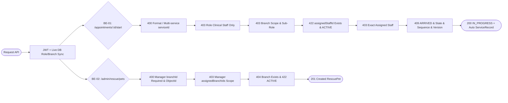

# TÀI LIỆU BÀN GIAO FRONTEND (FE HANDOFF)
## Bổ Sung Validation Tầng API Cho Lịch Hẹn (`/start`, `check-in`) & Hồ Sơ Cứu Trợ (`branchId` Manager Scope)

> **Kính gửi:** Đội ngũ Kỹ sư Frontend (`DR_PETS_HOUSE_ANGULAR` / Web Admin / Staff Portal) & QA  
> **Tài liệu nghiệp vụ căn cứ:** `docs/WEB2_Yeu_Cau_BE_Bo_Sung_Validation_Appointment_Rescue_2026-11-16 (1).docx`  
> **Trạng thái:** ✅ **HOÀN TẤT TRIỂN KHAI & PUSH GIT – 14/14 VALIDATION TEST PASS – 69/69 REGRESSION TEST PASS – OPENAPI V6/V7 ĐỒNG BỘ**  
> **Nhánh Git:** `feat/foundation-v6`  
> **Commit triển khai:** `0f8afa2` (`feat(api): enforce validation on appointment start checkin and rescue pet branch scope (BE-01, BE-02)`)  
> **Ngày bàn giao:** 18/11/2026  
> **OpenAPI Specs:** `docs/07-openapi-v6.yaml` & `docs/Task-2.8-v7-confirmed/07-openapi-v7.yaml`  
> **Đồng bộ FE liên quan:** Nhánh `feature/admin-flash-sale-content-management` (commit `3c4e0ea0`)

---

### MỤC LỤC
1. [Tổng Quan Phạm Vi & Nguyên Tắc Bảo Vệ Fail-Closed](#1-tổng-quan-phạm-vi--nguyên-tắc-bảo-vệ-fail-closed)
2. [BE-01: Hợp Đồng API Bắt Đầu Dịch Vụ (`/start`), Check-in & Service Records](#2-be-01-hợp-đồng-api-bắt-đầu-dịch-vụ-start-check-in--service-records)
3. [BE-02: Hợp Đồng API Hồ Sơ Cứu Trợ & Phạm Vi Chi Nhánh Manager](#3-be-02-hợp-đồng-api-hồ-sơ-cứu-trợ--phạm-vi-chi-nhánh-manager)
4. [Chuẩn Hóa Response Lỗi RFC 9457 & Hướng Dẫn Xử Lý Tại Frontend](#4-chuẩn-hóa-response-lỗi-rfc-9457--hướng-dẫn-xử-lý-tại-frontend)
5. [Danh Sách Tài Khoản Test E2E & Kịch Bản Nghiệm Thu Chi Tiết](#5-danh-sách-tài-khoản-test-e2e--kịch-bản-nghiệm-thu-chi-tiết)
6. [Bằng Chứng Kiểm Thử Tự Động & Thông Tin Triển Khai](#6-bằng-chứng-kiểm-thử-tự-động--thông-tin-triển-khai)

---

## 1. Tổng Quan Phạm Vi & Nguyên Tắc Bảo Vệ Fail-Closed

Backend đã bổ sung lớp kiểm tra bắt buộc ở tầng API cho cả **BE-01** và **BE-02** cùng các điểm bảo vệ liền kề nhằm đảm bảo mọi yêu cầu sai quy tắc đều bị từ chối tuyệt đối (ngay cả khi gọi API trực tiếp qua Postman/curl hoặc bỏ qua phòng vệ giao diện FE) và **không tạo bất kỳ tác dụng phụ / ghi dữ liệu dang dở nào** khi thất bại.



### Tóm tắt 2 điểm trọng tâm đã chốt với FE:
1. **BE-01 (`POST /api/v1/appointments/:id/start`):**
   - Khóa chặt việc phải có `assignedStaffId` hợp lệ (`ACTIVE`, đúng `requiredStaffRole`, thuộc đúng `branchId` của lịch hẹn) trước khi bắt đầu dịch vụ.
   - Chỉ đúng nhân viên chuyên môn được phân công mới được `/start`; chặn tuyệt đối `ADMIN`, `MANAGER`, `RECEPTIONIST`, hoặc nhân viên chuyên môn khác.
   - Bắt buộc lịch đã `checkInStatus === 'ARRIVED'`, đang ở trạng thái hợp lệ (`CONFIRMED` / `IN_PROGRESS`), segment ở trạng thái `NOT_STARTED` và tuân thủ thứ tự `sequence` đối với lịch nhiều dịch vụ.
   - Đã đồng bộ OpenAPI Validator: không còn chặn lỗi `400` sớm nếu FE không truyền `Idempotency-Key` hoặc không truyền `expectedVersion` / `serviceId` (với lịch 1 dịch vụ).
2. **BE-02 (`POST /api/v1/admin/rescue/pets`):**
   - Xác nhận route tạo hồ sơ cứu trợ thực tế là **`POST /api/v1/admin/rescue/pets`**.
   - Bắt buộc tài khoản `MANAGER` phải gửi `branchId` khác rỗng, đúng định dạng Mongo ObjectId, nằm trong `assignedBranchIds` và tồn tại trong bảng `Branch` (`ACTIVE`).
   - Giữ nguyên phạm vi của `ADMIN` (vẫn cho phép tạo hồ sơ cứu trợ đối tác `PARTNER_MAINTAINED` với `branchId: null`), đồng thời chặn `MANAGER` xóa trắng `branchId` khi `PATCH` hoặc sửa/xóa/duyệt nhận nuôi trên hồ sơ `branchId: null` hay hồ sơ chi nhánh khác.

---

## 2. BE-01: Hợp Đồng API Bắt Đầu Dịch Vụ (`/start`), Check-in & Service Records

### 2.1. Endpoint & Request Contract

- **Canonical Endpoint:** `POST /api/v1/appointments/:id/start`
- **Alias tương thích ngược:** `PATCH /api/v1/appointments/:id/start`
- **Phân quyền Route:** Chỉ chấp nhận `STAFF` có `staffSubRole` thuộc `['VETERINARIAN', 'NURSE', 'CARE_STAFF_GROOMER']`.
- **Headers:**
  - `Authorization: Bearer <ACCESS_TOKEN>` *(Bắt buộc)*
  - `Content-Type: application/json`
  - `Idempotency-Key: <string>` *(Tuỳ chọn — được hỗ trợ nhưng không còn chặn 400 nếu FE không gửi)*
- **Request Body:**
  ```json
  {
    "serviceId": "65f1a2b3c4d5e6f7a8b9c0d1",
    "expectedVersion": 1
  }
  ```
  - `serviceId`: **Bắt buộc** khi lịch hẹn có `>= 2` dịch vụ (`services.length > 1`). Nếu lịch chỉ có 1 dịch vụ và FE không gửi, BE tự chọn `services[0]`. Nếu gửi thì phải là ObjectId 24-hex hợp lệ.
  - `expectedVersion`: **Tuỳ chọn** (số nguyên dương `>= 1`). Nếu được gửi mà lệch `appointment.version` trong DB -> trả `409 CONCURRENCY_CONFLICT`.

### 2.2. Ma Trận Phản Hồi Bắt Buộc (Scenarios A1 – A6 & Edge Cases)

| ID | Kịch bản / Điều kiện kiểm thử | HTTP | Mã lỗi (`code`) | `detail` mẫu & Hành vi DB |
| :--- | :--- | :---: | :--- | :--- |
| **A1** | Lịch hẹn / segment chưa có `assignedStaffId` (`null` / `undefined` / rỗng) | **`422`** | `STAFF_UNAVAILABLE` | *"Lịch hẹn chưa được phân công nhân viên thực hiện cho dịch vụ này"*. Không đổi trạng thái, không tạo `ServiceRecord`. |
| **A2a** | `assignedStaffId` không hợp lệ / `StaffProfile` bị xóa hoặc `status: 'INACTIVE'` | **`422`** | `STAFF_UNAVAILABLE` | *"Nhân viên được phân công không tồn tại hoặc đang ngưng hoạt động"*. Không lưu DB. |
| **A2b** | `StaffProfile` của `assignedStaffId` đã đổi `staffSubRole` khác `requiredStaffRole` | **`422`** | `STAFF_ROLE_MISMATCH` | *"Staff role ... does not match required role ..."*. Không lưu DB. |
| **A2c** | `StaffProfile` của `assignedStaffId` không còn thuộc `branchId` của lịch hẹn | **`422`** | `ASSIGNMENT_SCOPE_ERROR` | *"Nhân viên được phân công không còn thuộc chi nhánh của lịch hẹn"*. Không lưu DB. |
| **A3** | Staff chuyên môn đúng vai trò & chi nhánh, nhưng **khác** người được phân công | **`403`** | `ASSIGNMENT_SCOPE_ERROR` | *"You are not assigned to start this service segment"*. Không lưu DB. |
| **A4** | `ADMIN`, `MANAGER`, `RECEPTIONIST`, `CUSTOMER`, hoặc sai `staffSubRole` (vd: `NURSE` start ca `VETERINARIAN`) | **`403`** | `AUTHORIZATION_ERROR` | *"Only assigned clinical staff (Veterinarian, Nurse, Care Staff/Groomer) can start service segments"* (hoặc *"Staff sub-role does not match segment requirement"*). |
| **A5a** | Đúng Staff được phân công nhưng lịch chưa check-in (`checkInStatus !== 'ARRIVED'`) | **`409`** | `INVALID_STATE_TRANSITION` | *"Appointment must be checked in (ARRIVED) before starting service"*. Không lưu DB. |
| **A5b** | Lịch ở trạng thái không hợp lệ (`PENDING_PAYMENT`, `PENDING_CONFIRMATION`, `CANCELLED`, `NO_SHOW`, `COMPLETED`) hoặc segment đã `IN_PROGRESS` / `COMPLETED` | **`409`** | `INVALID_STATE_TRANSITION` | *"Cannot start service when appointment status is ..."* / *"Service segment cannot be started from status ..."*. |
| **A6** | Đúng Staff được phân công, `ACTIVE`, lịch `CONFIRMED`/`IN_PROGRESS`, đã `ARRIVED`, segment `NOT_STARTED` | **`200`** | *(Success)* | Trả về đối tượng `Appointment` đã cập nhật (`status: 'IN_PROGRESS'`, `segment.executionStatus: 'IN_PROGRESS'`, `executionStartedAt`), tự động khởi tạo `ServiceRecord` nếu chưa có. |
| **Edge-1** | Lịch có `>= 2` dịch vụ nhưng thiếu `serviceId` | **`400`** | `VALIDATION_ERROR` | *"serviceId is required when appointment has multiple services"*. |
| **Edge-2** | Lịch nhiều dịch vụ, gọi `/start` segment `sequence: 2` khi `sequence: 1` chưa `COMPLETED` | **`409`** | `INVALID_STATE_TRANSITION` | *"Previous service segment must be COMPLETED before starting the next segment"*. |
| **Edge-3** | Gửi `expectedVersion` cũ hơn phiên bản hiện tại của lịch hẹn | **`409`** | `CONCURRENCY_CONFLICT` | *"Version conflict: expected ..., actual ..."*. |
| **Edge-4** | Staff có `assignedBranchIds = []` hoặc khác chi nhánh lịch hẹn | **`403`** | `BRANCH_SCOPE_ERROR` | *"You do not have access to this branch"*. |

### 2.3. Ràng Buộc Liền Kề Đã Đồng Bộ (Check-in & Service Records)

1. **`POST / PATCH /api/v1/appointments/:id/check-in`** *(Quyền: `RECEPTIONIST`, `MANAGER`, `ADMIN`)*:
   - Chỉ cho phép check-in lịch đang ở trạng thái **`CONFIRMED`** (`409 INVALID_STATE_TRANSITION` nếu là `PENDING_PAYMENT`, `PENDING_CONFIRMATION`, `CANCELLED`, `NO_SHOW`, `COMPLETED`).
   - Nếu lịch đã `checkInStatus === 'ARRIVED'` -> trả `409 INVALID_STATE_TRANSITION` (*"Appointment has already been checked in"*).
   - Khi check-in thành công, BE đồng bộ `checkInStatus = 'ARRIVED'`, `checkedInAt`, `checkedInBy` cho cả `Appointment` lẫn từng `segment` trong `services[]`.
2. **`POST /api/v1/service-records`** *(Khóa đường vòng né `/start`)*:
   - Không cho phép tạo `ServiceRecord` trực tiếp nếu lịch chưa có `assignedStaffId` (`422 STAFF_UNAVAILABLE`), người gọi không phải nhân viên được phân công (`403 ASSIGNMENT_SCOPE_ERROR`), hoặc lịch chưa check-in / chưa `CONFIRMED` (`409 INVALID_STATE_TRANSITION`).

---

## 3. BE-02: Hợp Đồng API Hồ Sơ Cứu Trợ & Phạm Vi Chi Nhánh Manager

### 3.1. Xác Nhận Các Route Thực Tế (Admin/Manager Rescue Module)

Tất cả các route quản trị cứu trợ nằm dưới prefix `/api/v1/admin` (`requireRole(['ADMIN', 'MANAGER'])`):

| Method | Route thực tế | Mục đích | Quyền `ADMIN` | Quyền `MANAGER` |
| :--- | :--- | :--- | :--- | :--- |
| `POST` | `/api/v1/admin/rescue/pets` | Tạo mới hồ sơ thú cưng cứu trợ | Toàn quyền (`branchId` tuỳ chọn; nếu gửi vẫn validate format & tồn tại) | **Bắt buộc `branchId`** hợp lệ thuộc `assignedBranchIds` |
| `GET` | `/api/v1/admin/rescue/pets` | Lấy danh sách hồ sơ cứu trợ | Tất cả chi nhánh | Theo `assignedBranchIds` (nếu lọc `branchId` ngoài quyền -> `403`) |
| `GET` | `/api/v1/admin/rescue/pets/:id` | Xem chi tiết hồ sơ | Tất cả | Chặn `403` nếu `pet.branchId` thuộc chi nhánh ngoài quyền |
| `PATCH` | `/api/v1/admin/rescue/pets/:id` | Cập nhật hồ sơ cứu trợ | Tất cả | Chỉ sửa hồ sơ có `branchId` thuộc `assignedBranchIds`; **cấm xóa trắng `branchId`** |
| `DELETE` | `/api/v1/admin/rescue/pets/:id` | Xóa hồ sơ cứu trợ | Tất cả | Chỉ xóa hồ sơ có `branchId` thuộc `assignedBranchIds` (cấm xóa hồ sơ `branchId: null`) |
| `GET` | `/api/v1/admin/rescue/requests` | Danh sách đơn đăng ký nhận nuôi | Tất cả | Chỉ lấy đơn của thú cưng thuộc `assignedBranchIds` |
| `PATCH` | `/api/v1/admin/rescue/requests/:id/review` | Duyệt / từ chối đơn nhận nuôi | Tất cả | Chỉ duyệt đơn của thú cưng thuộc `assignedBranchIds` (cấm duyệt hồ sơ `branchId: null`) |

### 3.2. Request & Response Tạo Hồ Sơ (`POST /api/v1/admin/rescue/pets`)

**Request Payload:**
```json
{
  "petName": "Bé Cún Bông",
  "species": "DOG",
  "breed": "Poodle lai",
  "gender": "FEMALE",
  "ageDescription": "6 tháng tuổi",
  "healthStatus": "Khỏe mạnh, đã tiêm ngừa 1 mũi",
  "rescueStory": "Được cứu hộ tại khu vực Quận 1...",
  "images": ["https://cdn.drpets.vn/rescue/cun-bong.jpg"],
  "branchId": "65f1a2b3c4d5e6f7a8b9c0d1",
  "ownershipType": "PARTNER_MAINTAINED",
  "supportNeeds": "Cần thức ăn hạt và nhà mới",
  "supportPartnerId": "saigon-time"
}
```

**Response Thành công (`201 Created`):**
```json
{
  "success": true,
  "data": {
    "_id": "673...",
    "petCode": "RES-0011",
    "petName": "Bé Cún Bông",
    "species": "DOG",
    "status": "LOOKING_FOR_HOME",
    "branchId": "65f1a2b3c4d5e6f7a8b9c0d1",
    "images": ["https://cdn.drpets.vn/rescue/cun-bong.jpg"]
  }
}
```

### 3.3. Ma Trận Phản Hồi Bắt Buộc (Scenarios R1 – R5 & Edge Cases)

BE áp dụng thứ tự kiểm tra bảo mật **Fail-Closed: `400 (Format/Required)` → `403 (Manager Branch Scope)` → `404 (Branch DB Existence)` → `422 (Branch ACTIVE)`** nhằm chống dò tìm ID chi nhánh trái phép.

| ID | Kịch bản / Người gọi | HTTP | Mã lỗi (`code`) | `detail` mẫu & Kết quả |
| :--- | :--- | :---: | :--- | :--- |
| **R1** | `MANAGER` không gửi `branchId`, gửi `null`, `""`, hoặc `"   "` | **`400`** | `VALIDATION_ERROR` | *"Thiếu thông tin chi nhánh bắt buộc (branchId is required for Manager)"*. Không tạo hồ sơ. |
| **R1b** | `MANAGER` (hoặc `ADMIN`) gửi `branchId` sai định dạng ObjectId (vd: `"abc-123"`) | **`400`** | `VALIDATION_ERROR` | *"Mã chi nhánh (branchId) không hợp lệ"*. Không tạo hồ sơ. |
| **R2** | `MANAGER` gửi `branchId` đúng định dạng ObjectId nhưng **không tồn tại trong DB** | **`403`** hoặc **`404`** | `BRANCH_SCOPE_ERROR` (nếu ID ngoài `assignedBranchIds`) / `NOT_FOUND` (nếu ID nằm trong quyền nhưng chi nhánh đã bị xóa khỏi DB) | **Từ chối.** Không tạo hồ sơ hay ghi dữ liệu dang dở. *(Với `ADMIN` gửi ID không tồn tại -> luôn trả `404 NOT_FOUND`)* |
| **R3** | `MANAGER` gửi `branchId` của chi nhánh khác ngoài phạm vi được phân công (hoặc `assignedBranchIds = []`) | **`403`** | `BRANCH_SCOPE_ERROR` | *"Rescue pet belongs to a branch outside your assigned branches"*. Không tạo hồ sơ. |
| **R4** | `MANAGER` 1 chi nhánh (Q1) gửi đúng `branchId` Q1 | **`201`** | *(Success)* | Tạo thành công, lưu chính xác `branchId` của Q1. |
| **R5** | `MANAGER` đa chi nhánh (Q1 & Q7) chọn bất kỳ `branchId` nào trong `{Q1, Q7}` | **`201`** | *(Success)* | Tạo thành công, lưu đúng `branchId` đã chọn từng lần. |
| **Edge-A** | `ADMIN` tạo hồ sơ cứu trợ đối tác không truyền `branchId` | **`201`** | *(Success)* | Giữ nguyên quyền `ADMIN`, lưu `branchId: null`. |
| **Edge-B** | Gán `branchId` của chi nhánh đang có `status: 'INACTIVE'` | **`422`** | `VALIDATION_ERROR` | *"Chi nhánh đang ngưng hoạt động, không thể gán hồ sơ cứu trợ"*. |
| **Edge-C** | `MANAGER` gọi `PATCH /admin/rescue/pets/:id` với `{ branchId: null }` hoặc `{ branchId: "" }` | **`400`** | `VALIDATION_ERROR` | Chặn xóa trắng `branchId` của hồ sơ thuộc chi nhánh. |
| **Edge-D** | `MANAGER` gọi `PATCH`/`DELETE` hồ sơ toàn hệ thống (`branchId: null`) hoặc duyệt đơn nhận nuôi của hồ sơ `branchId: null` | **`403`** | `BRANCH_SCOPE_ERROR` | Chặn `MANAGER` can thiệp hồ sơ thuộc cấp Global/Admin. |

---

## 4. Chuẩn Hóa Response Lỗi RFC 9457 & Hướng Dẫn Xử Lý Tại Frontend

Tất cả các lỗi từ BE (kể cả 5 chỗ trước đây bị lệch tham số `AppError` trong `content.service.js`) đã được chuẩn hóa về định dạng `application/problem+json`:

```json
{
  "type": "https://httpstatuses.com/422",
  "title": "UnprocessableEntity",
  "status": 422,
  "code": "STAFF_UNAVAILABLE",
  "detail": "Lịch hẹn chưa được phân công nhân viên thực hiện cho dịch vụ này"
}
```

### Bảng gợi ý xử lý tại Frontend (Toast / Dialog / UI Guard):

| `status` | `error.code` | Khuyến nghị hiển thị & Hành động trên FE |
| :---: | :--- | :--- |
| `400` | `VALIDATION_ERROR` | Highlight trường thiếu/lỗi (vd: dropdown chọn chi nhánh `branchId`, hoặc chọn `serviceId`), hiển thị `error.detail`. |
| `403` | `AUTHORIZATION_ERROR` | Thông báo tài khoản không có quyền thực hiện thao tác này (ẩn/disable nút **Bắt đầu dịch vụ** với `ADMIN`, `MANAGER`, `RECEPTIONIST`). |
| `403` | `ASSIGNMENT_SCOPE_ERROR` | Thông báo: *"Chỉ nhân viên chuyên môn được phân công cho dịch vụ này mới được phép bắt đầu."* |
| `403` | `BRANCH_SCOPE_ERROR` | Thông báo vượt phạm vi chi nhánh được phân công; reload lại danh sách chi nhánh hợp lệ của Manager. |
| `404` | `NOT_FOUND` / `APPOINTMENT_NOT_FOUND` | Thông báo chi nhánh hoặc lịch hẹn không còn tồn tại; điều hướng quay lại danh sách. |
| `409` | `INVALID_STATE_TRANSITION` | Thông báo trạng thái không hợp lệ (vd: *"Vui lòng yêu cầu lễ tân check-in trước khi bắt đầu dịch vụ"* hoặc *"Dịch vụ trước đó chưa hoàn tất"*); gọi lại API GET detail để đồng bộ trạng thái mới nhất. |
| `409` | `CONCURRENCY_CONFLICT` | Thông báo dữ liệu lịch hẹn vừa được người khác cập nhật; tự động refresh detail để lấy `version` mới. |
| `422` | `STAFF_UNAVAILABLE` / `STAFF_ROLE_MISMATCH` | Thông báo lịch hẹn chưa có nhân viên hợp lệ / nhân viên đã ngưng hoạt động hoặc đổi vai trò -> hướng dẫn Lễ tân/Manager phân công lại nhân viên (`PUT /api/v1/appointments/:id/segments/:serviceId/staff`). |

---

## 5. Danh Sách Tài Khoản Test E2E & Kịch Bản Nghiệm Thu Chi Tiết

### 5.1. Tài Khoản Seed Dùng Để Kiểm Thử (Theo `src/seeds/demoUsersSeed.js`)

Mật khẩu chung cho toàn bộ tài khoản nội bộ & demo: **`K9#mQ$8xL!2vW*7z`**

| Vai trò | Username | Mật khẩu | Phạm vi chi nhánh | Phục vụ kịch bản test |
| :--- | :--- | :--- | :--- | :--- |
| **Admin** | `admin` | `K9#mQ$8xL!2vW*7z` | Toàn hệ thống | Test **A4** (bị chặn `/start`), test **Admin** tạo RescuePet không cần `branchId` |
| **Manager (1 chi nhánh)** | `manager` | `K9#mQ$8xL!2vW*7z` | Quận 1 | Test **R1, R2, R3, R4**, test **A4** (bị chặn `/start`) |
| **Manager (Đa chi nhánh)** | `manager_dual` | `K9#mQ$8xL!2vW*7z` | Quận 1 & Quận 7 | Test **R5** (chọn luân phiên Q1 và Q7 thành công; chi nhánh thứ 3 bị chặn `403`) |
| **Lễ tân (Receptionist)** | `receptionist` | `K9#mQ$8xL!2vW*7z` | Quận 1 | Thực hiện `check-in`, phân công nhân viên, test **A4** (bị chặn `/start`) |
| **Bác sĩ Thú y A** | `doctor` | `K9#mQ$8xL!2vW*7z` | Quận 1 | Test **A5** (chưa check-in -> `409`), test **A6** (đã check-in -> `200`) |
| **Bác sĩ Thú y B** | `vet_dual` | `K9#mQ$8xL!2vW*7z` | Quận 1 & Quận 7 | Test **A3** (gọi `/start` vào lịch phân công cho `doctor` -> `403 ASSIGNMENT_SCOPE_ERROR`) |
| **Y tá (Nurse)** | `nurse` | `K9#mQ$8xL!2vW*7z` | Quận 1 | Test **A4** (gọi `/start` vào dịch vụ yêu cầu `VETERINARIAN` -> `403`) |
| **Groomer** | `groomer` | `K9#mQ$8xL!2vW*7z` | Quận 1 | Test luồng **A6** cho nhóm dịch vụ Grooming & Spa |

### 5.2. Checklist Kịch Bản Nghiệm Thu E2E Cho FE/QA

#### Luồng A: Check-in → Bắt đầu dịch vụ (`BE-01`)
1. **Test A5 (Chưa check-in):** Dùng lịch hẹn ở trạng thái `CONFIRMED`, `checkInStatus: 'PENDING'`, đã gán cho `doctor`. Đăng nhập `doctor`, gọi `POST /api/v1/appointments/:id/start` → Kỳ vọng **`409 INVALID_STATE_TRANSITION`**, dữ liệu lịch hẹn không đổi.
2. **Test Check-in:** Đăng nhập `receptionist`, bấm Check-in (`POST /api/v1/appointments/:id/check-in`) → Kỳ vọng **`200 OK`**, `checkInStatus` đổi sang `'ARRIVED'`.
3. **Test A4 (Sai vai trò):** Đăng nhập lần lượt `admin`, `manager`, `receptionist`, `nurse` và thử gọi `/start` vào lịch trên → Kỳ vọng đều trả **`403 AUTHORIZATION_ERROR`**.
4. **Test A3 (Sai người được phân công):** Đăng nhập `vet_dual` (cùng là `VETERINARIAN`, cùng chi nhánh Q1) gọi `/start` vào lịch của `doctor` → Kỳ vọng **`403 ASSIGNMENT_SCOPE_ERROR`**.
5. **Test A1 / A2 (Thiếu / hỏng `assignedStaffId`):** Với lịch chưa phân công hoặc nhân viên bị chuyển sang `INACTIVE`, gọi `/start` → Kỳ vọng **`422 STAFF_UNAVAILABLE`**, không tạo `ServiceRecord`.
6. **Test A6 (Happy Path):** Đăng nhập `doctor`, bấm **Bắt đầu dịch vụ** → Kỳ vọng **`200 OK`**, lịch chuyển sang `IN_PROGRESS`, segment chuyển `IN_PROGRESS`, xuất hiện `ServiceRecord` tương ứng.

#### Luồng B: Tạo & Quản Lý Hồ Sơ Cứu Trợ Bằng Manager (`BE-02`)
1. **Test R1 (Thiếu/rỗng `branchId`):** Đăng nhập `manager` (Q1), gửi `POST /api/v1/admin/rescue/pets` không kèm `branchId` (hoặc `branchId: ""`) → Kỳ vọng **`400 VALIDATION_ERROR`**, không sinh bản ghi mới.
2. **Test R2 (Chi nhánh không tồn tại):** Đăng nhập `manager`, gửi `branchId` giả `65f1a2b3c4d5e6f7a8b9c099` → Kỳ vọng bị từ chối **`403 BRANCH_SCOPE_ERROR`** (hoặc **`404 NOT_FOUND`**), không sinh bản ghi mới.
3. **Test R3 (Vượt quyền chi nhánh):** Đăng nhập `manager` (Q1), gửi `branchId` của chi nhánh Quận 7 → Kỳ vọng **`403 BRANCH_SCOPE_ERROR`**, không sinh bản ghi mới.
4. **Test R4 (Manager 1 chi nhánh hợp lệ):** Đăng nhập `manager` (Q1), chọn chi nhánh Quận 1 → Kỳ vọng **`201 Created`**, bản ghi trả về có đúng `branchId` Quận 1.
5. **Test R5 (Manager đa chi nhánh):** Đăng nhập `manager_dual` (Q1 & Q7), lần lượt tạo 1 bé ở Quận 1 và 1 bé ở Quận 7 → Cả 2 đều **`201 Created`** và lưu chính xác `branchId` tương ứng; thử truyền chi nhánh Bình Thạnh → bị chặn **`403 BRANCH_SCOPE_ERROR`**.

---

## 6. Bằng Chứng Kiểm Thử Tự Động & Thông Tin Triển Khai

### 6.1. Bộ Kiểm Thử Tự Động (Automated Tests)
- File test mới bổ sung: `tests/integration/validation-appointment-rescue.test.js` (bao phủ 100% `A1–A6`, `R1–R5`, multi-service, concurrency `expectedVersion`, `check-in` state, `service-records` bypass, và phạm vi `PATCH`/`DELETE`/review của Manager).
- Lệnh tái kiểm chứng:
  ```bash
  npx jest tests/integration/validation-appointment-rescue.test.js \
    tests/integration/rbac-fixed-roles-matrix.test.js \
    tests/integration/be-fix-gap-uat.test.js \
    tests/integration/content-community-rescue.test.js \
    tests/content-dashboard.test.js --runInBand
  ```
- **Kết quả thực thi trước khi push:**
  - `PASS tests/integration/validation-appointment-rescue.test.js` (**14/14 passed**)
  - `PASS tests/integration/rbac-fixed-roles-matrix.test.js`
  - `PASS tests/integration/be-fix-gap-uat.test.js`
  - `PASS tests/integration/content-community-rescue.test.js`
  - `PASS tests/content-dashboard.test.js`
  - **Tổng cộng:** `Test Suites: 5 passed, 5 total` | `Tests: 69 passed, 69 total` (`0 failed`, thời gian `12.165 s`).

### 6.2. Thông Tin Triển Khai Git & Môi Trường
- **Repository:** `https://github.com/minhllk24/PET_CLINIC_BACKEND`
- **Branch:** `feat/foundation-v6`
- **Commit Code & Tests:** `0f8afa2` — `feat(api): enforce validation on appointment start checkin and rescue pet branch scope (BE-01, BE-02)`
- **Các file source đã thay đổi:**
  - `src/modules/booking/booking.controller.js`
  - `src/modules/booking/booking.service.js`
  - `src/modules/execution/execution.service.js`
  - `src/modules/content/content.service.js`
  - `docs/07-openapi-v6.yaml`
  - `docs/Task-2.8-v7-confirmed/07-openapi-v7.yaml`
  - `tests/integration/validation-appointment-rescue.test.js`
- **Triển khai môi trường test:** Đã push lên nhánh `feat/foundation-v6` lúc `11:31` ngày `18/11/2026` để Render tự động build & deploy lên môi trường API dùng chung cho FE kiểm thử E2E.

