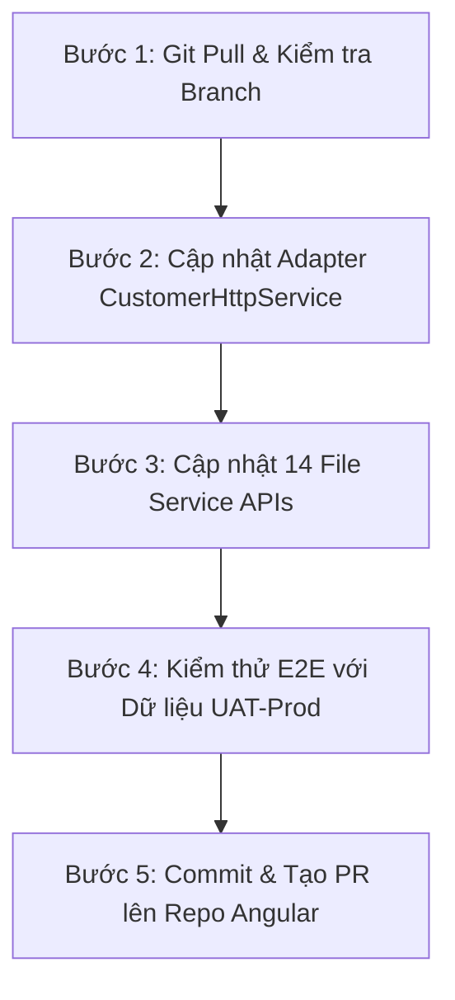

# 🐾 KẾ HOẠCH & BẢN PROMPT KỸ THUẬT NÂNG CAO: KẾT NỐI API CUSTOMER (ANGULAR 22) VỚI BACKEND MONGODB ATLAS
**Dự án:** Hệ thống Chuỗi Phòng khám Thú y Dr. Pet's House  
**Frontend Official Repo:** `https://github.com/chungvinhhung/DR_PETS_HOUSE_ANGULAR` (branch: `main`)  
**Backend Official Repo:** `https://github.com/minhllk24/PET_CLINIC_BACKEND` (branch: `feat/foundation-v6`)  
**Đối tượng bàn giao:** Linh (Customer Frontend Lead) & Hưng (Admin Frontend Lead)  
**Tác giả:** Senior Prompt Engineer & System Integration Architect  
**Ngày cập nhật:** 28/10/2026 (Phiên bản V7 Production Ready)  

---

## MỤC LỤC
1. [Bối cảnh & Phân tích Gốc rễ Vấn đề (Root Cause Analysis)](#1-bối-cảnh--phân-tích-gốc-rễ-vấn-đề)
2. [Bộ Quy tắc Cốt lõi Bất khả xâm phạm (System Guardrails & Rules)](#2-bộ-quy-tắc-cốt-lõi-bất-khả-xâm-phạm)
3. [Kiến trúc Kỹ thuật & Chuẩn hóa Tầng Adapter](#3-kiến-trúc-kỹ-thuật--chuẩn-hóa-tầng-adapter)
4. [Bản đồ Định tuyến Router & Payload Mapping Chuẩn OpenAPI V7](#4-bản-đồ-định-tuyến-router--payload-mapping-chuẩn-openapi-v7)
5. [Mã Nguồn Mẫu Nâng Cấp Tầng Adapter (Ready to Copy-Paste)](#5-mã-nguồn-mẫu-nâng-cấp-tầng-adapter)
6. [Quy trình Triển khai 5 Bước An toàn & Bảo mật](#6-quy-trình-triển-khai-5-bước-an-toàn--bảo-mật)
7. [Kịch bản Kiểm thử Nghiệm thu E2E (Acceptance Testing)](#7-kịch-bản-kiểm-thử-nghiệm-thu-e2e)
8. [MASTER PROMPT: Dành Cho Linh Sử Dụng Trực Tiếp Với AI Agent](#8-master-prompt-dành-cho-linh-sử-dụng-trực-tiếp-với-ai-agent)

---

## 1. BỐI CẢNH & PHÂN TÍCH GỐC RỄ VẤN ĐỀ

### 1.1. Hiện trạng Dự án
- **Hệ thống Frontend:** Linh và Hưng đã hợp nhất toàn bộ mã nguồn lên repository Angular 22 (`DR_PETS_HOUSE_ANGULAR`). Phân hệ Quản trị (Admin) chạy tại `/admin/...` và 27 màn hình Khách hàng (Customer Storefront) chạy tại root `/...`.
- **Backend:** Toàn bộ hệ thống Backend đã hoàn tất di trú từ MySQL sang MongoDB Atlas (`pet_clinic_v2`), hỗ trợ đầy đủ 100% test suites (282/282 tests passed), áp dụng kiểm duyệt schema nghiêm ngặt qua `OpenApiValidator` và tuân thủ OpenAPI V7.
- **Ranh giới công việc (Scope Boundary):** Team Backend hoàn toàn không can thiệp hay sửa mã nguồn Frontend (`DR_PETS_HOUSE_ANGULAR`). Toàn bộ việc tích hợp được chuyển giao dưới dạng tài liệu kỹ thuật, adapter pattern và master prompt tiêu chuẩn.

### 1.2. Tại sao Linh nhận định "API đang làm của Linh hình như là cái cũ"?
Linh đã nhận định **hoàn toàn chính xác** về triệu chứng, nhưng nguyên nhân sâu xa không phải do Backend chưa xong mà do sự bất tương thích ở tầng bọc Service khi chuyển đổi từ React cũ sang Angular:
1. **Lỗi Tử huyệt trong hàm `assertSuccess`:**
   Tại các file `user-api.service.ts`, `pet-api.service.ts`, `cart-api.service.ts`... đang viết:
   ```typescript
   function assertSuccess(response: any) {
     if (response?.EC !== 0) throw new Error(response?.EM || "Request failed");
     return response.DT;
   }
   ```
   Backend MongoDB mới trả về REST chuẩn HTTP (`{ success: true, data: {...} }` hoặc trả trực tiếp payload object/array với HTTP 200/201), không hề có trường `EC`. Dẫn đến `response?.EC !== 0` luôn trả về `true` (vì `undefined !== 0`), khiến **100% các request dù Backend trả về dữ liệu chuẩn xác vẫn bị ném lỗi "Request failed" ngay lập tức trên Frontend**!
2. **Lỗi 404 Not Found từ Endpoint Legacy:**
   Nhiều service vẫn gọi URL của bản Web 1 cũ (ví dụ: `/users/:id` thay vì `/customers/:id`, `/pets` thay vì `/customers/:customerId/pets`, `/orders/guest-checkout` thay vì `/orders/checkout`).
3. **Lỗi 400 Bad Request do sai quy tắc đặt tên (`snake_case` vs `camelCase`):**
   Backend mới sử dụng `OpenApiValidator` nghiêm ngặt theo chuẩn OpenAPI V7 (`camelCase`). Việc gửi payload cũ như `full_name`, `login_id`, `recipient_name` bị validator chặn và báo lỗi 400 Schema Validation.
4. **Lỗi 400 Idempotency-Key Required:**
   Các thao tác tạo dữ liệu quan trọng như Đặt hàng (`POST /orders/checkout`), Tạo lịch hẹn (`POST /appointments`), Hủy đơn/lịch hẹn bắt buộc phải có header `Idempotency-Key`. Hiện tại tầng Service của Linh chưa tự sinh header này.
5. **Lỗi Văng phiên đăng nhập sang Admin (`/admin/login`):**
   Khi access token (15 phút) hết hạn, interceptor mặc định đá người dùng sang trang `/admin/login`, làm gián đoạn trải nghiệm của khách hàng Customer Storefront.

---

## 2. BỘ QUY TẮC CỐT LÕI BẤT KHẢ XÂM PHẠM

### 🛡️ Rule 1: Nguyên Tắc Zero-Disruption UI (Bảo Toàn 100% Giao Diện)
- **Quy tắc:** Tuyệt đối **KHÔNG SỬA ĐỔI** bất kỳ template HTML, file SCSS hay component logic nào bên trong thư mục `src/app/features/customer/`.
- **Giải pháp:** Toàn bộ công việc điều chỉnh, map dữ liệu, normalize payload được giải quyết **100% tại tầng Service và Adapter** trong `src/app/core/customer/services/`.

### 🛡️ Rule 2: Polymorphic Envelope Normalization (Thích Ứng Mọi Cấu Trúc Response)
- **Quy tắc:** Tầng HTTP phải thông minh tự động nhận biết cả 3 dạng Response:
  1. REST Chuẩn OpenAPI V7: `{ success: true, data: ... }`
  2. Legacy Web 1: `{ EC: 0, EM: '...', DT: ... }`
  3. Direct REST: Object hoặc Array trả về trực tiếp từ Controller (ví dụ `{ items: [...], total: ... }`).

### 🛡️ Rule 3: Auto Idempotency-Key Injection (Chống Lỗi 400 Idempotency)
- **Quy tắc:** Đối với tất cả request dạng `POST`, `PUT`, `PATCH`, `DELETE` gửi qua `CustomerHttpService`, nếu caller chưa truyền `Idempotency-Key`, service phải tự động tạo một UUID duy nhất (sử dụng `crypto.randomUUID()` hoặc timestamp entropy) và đính kèm vào HTTP Headers.

### 🛡️ Rule 4: Phân Định Rõ Ràng Danh Tính (`userId` vs `customerId` & Khách Vãng Lai)
- **Khách hàng đã đăng ký (Member):**
  - `userId`: Dùng cho hệ thống tài khoản / bảo mật / đổi mật khẩu.
  - `customerId`: Dùng cho hồ sơ thú cưng, lịch sử khám bệnh, đặt lịch hẹn và giỏ hàng.
- **Khách vãng lai (Guest):**
  - Không có tài khoản $\rightarrow$ gửi `customerId: null`.
  - Mọi thông tin khách nằm trong `contactSnapshot: { fullName, phone, email, address }`.
  - Hỗ trợ tra cứu đơn và lịch hẹn bằng OTP số điện thoại (`/api/v1/auth/guest-otp`) và kích hoạt tạo tài khoản nhanh (`/api/v1/auth/activate-guest`).

### 🛡️ Rule 5: Bảo Mật Cookie HttpOnly & Silent Refresh (Phiên Đăng Nhập Cô Lập)
- **Quy tắc:** Mọi HTTP request phải luôn bật `withCredentials: true` để trình duyệt tự động gửi cookie `pet_clinic_refresh`.
- Khi token hết hạn (401), nếu refresh token thất bại, phát sự kiện `window.dispatchEvent(new CustomEvent('petclinic:auth-expired'))` để mở Modal đăng nhập tại chỗ của Customer. **TUYỆT ĐỐI KHÔNG redirect về `/admin/login`**.

---

## 3. KIẾN TRÚC KỸ THUẬT & CHUẨN HÓA TẦNG ADAPTER

### Sơ đồ Luồng Dữ liệu Chuẩn (Data Flow)
```
[Customer UI Component] 
       │ (Calls standard method: getProfile, bookAppointment, checkout...)
       ▼
[Customer API Service (e.g. OrderApiService)] 
       │ (Sanitizes snake_case -> camelCase, attaches contactSnapshot)
       ▼
[CustomerHttpService (Adapter Layer)] 
       │ (Injects Idempotency-Key, withCredentials: true, handles Auth Expired)
       ▼
[ApiClientService (Angular Core HttpClient)] 
       │ (Prepends environment.apiBaseUrl, dispatches HTTP)
       ▼
[Backend MongoDB Atlas (OpenAPI V7)]
```

---

## 4. BẢN ĐỒ ĐỊNH TUYẾN ROUTER & PAYLOAD MAPPING CHUẨN OPENAPI V7

Dưới đây là bảng tra cứu chi tiết toàn bộ 14 API Services mà Linh cần cập nhật:

| Phân hệ / Nghiệp vụ | Service Angular | Đường dẫn Cũ (Lỗi 404/400) | Đường dẫn Chuẩn Mới (Backend đang chạy) | Method | Yêu cầu Payload & Xử lý Dữ liệu |
|---|---|---|---|---|---|
| **Đăng nhập** | `auth-api.service.ts` | `/login` | `/auth/login` | `POST` | Body: `{ identifier, password }` |
| **Đăng ký tài khoản** | `auth-api.service.ts` | `/register` | `/auth/register` | `POST` | Body: `{ fullName, phone, password, confirmPassword }` |
| **Làm mới Token** | `auth-api.service.ts` | `/refresh` | `/auth/refresh-token` | `POST` | Sử dụng Cookie HttpOnly `pet_clinic_refresh` |
| **Đăng xuất** | `auth-api.service.ts` | `/logout` | `/auth/logout` | `POST` | Xóa cookie và token local |
| **Gửi OTP Khách vãng lai** | `auth-api.service.ts` | `/verify-otp` | `/auth/guest-otp` | `POST` | Body: `{ phone }` |
| **Kích hoạt TK Guest** | `auth-api.service.ts` | — | `/auth/activate-guest` | `POST` | Body: `{ token, password }` |
| **Hồ sơ Cá nhân** | `user-api.service.ts` | `/users/:id` | `/customers/:id` | `GET` | Đọc thông tin cá nhân từ Customer Profile |
| **Cập nhật Hồ sơ** | `user-api.service.ts` | `/users/:id` | `/customers/:id` | `PUT` | Body: `{ fullName, email, phone, address }` |
| **Danh sách Thú cưng** | `pet-api.service.ts` | `/pets` | `/customers/:customerId/pets` | `GET` | Trả về danh sách thú cưng của khách |
| **Tạo mới Thú cưng** | `pet-api.service.ts` | `/pets` | `/customers/:customerId/pets` | `POST` | Body: `{ name, species, breed, ageYears, weightKg }` |
| **Chi tiết Thú cưng** | `pet-api.service.ts` | `/pets/:id` | `/customers/:customerId/pets/:petId` | `GET` | Trả về thông tin chi tiết thú cưng |
| **Lịch sử Tiêm/Bệnh án**| `pet-api.service.ts` | `/pets/:id/records` | `/customers/:customerId/pets/:petId/medical-records` | `GET` | Sổ y bạ điện tử |
| **Danh sách Chi nhánh**| `booking-api.service.ts`| `/branches` | `/branches?status=ACTIVE` | `GET` | Nạp 3 chi nhánh (Q1, Q7, Bình Thạnh) |
| **Bảng giá Dịch vụ** | `booking-api.service.ts`| `/services` | `/catalog/services` | `GET` | Nạp danh mục dịch vụ khám & grooming |
| **Khung giờ Trống (Slots)**| `booking-api.service.ts`| `/appointments/slots`| `/appointments/slots` | `GET` | Params: `date`, `branchId`, `serviceType` |
| **Tính giá Đặt lịch (Quote)**| `booking-api.service.ts`| `/appointments/preview-pricing` | `/appointments/quote` | `POST` | Tính toán chi phí dự kiến & tiền cọc 30% |
| **Đặt lịch Hẹn Khám** | `booking-api.service.ts`| `/appointments/book` | `/appointments` | `POST` | Member: `customerId`; Guest: `customerId: null`, `contactSnapshot` |
| **Lịch sử Lịch hẹn** | `booking-api.service.ts`| `/appointments` | `/appointments/my-history` | `GET` | Lọc theo tài khoản đăng nhập |
| **Hủy Lịch hẹn** | `booking-api.service.ts`| `PATCH /appointments/:id/cancel` | `POST /appointments/:id/cancel` | `POST` | Hỗ trợ cả POST lẫn PATCH backwards compat |
| **Đặt hàng Checkout** | `order-api.service.ts` | `/orders/guest-checkout` | `/orders/checkout` | `POST` | Member: `addressId`; Guest: `customerId: null`, `contactSnapshot` |
| **Danh sách Đơn hàng** | `order-api.service.ts` | `/orders` | `/orders` | `GET` | Trả về danh sách đơn hàng của khách |
| **Chi tiết Đơn hàng** | `order-api.service.ts` | `/orders/:id` | `/orders/:id` | `GET` | Thông tin chi tiết đơn, trạng thái, tracking |
| **Hủy Đơn hàng** | `order-api.service.ts` | `PATCH /orders/:id/cancel` | `POST /orders/:id/cancel` | `POST` | Body: `{ reason }` |
| **Đánh giá Sản phẩm** | `order-api.service.ts` | `/reviews` | `/reviews` | `POST` | Body: `{ targetType: 'PRODUCT', targetId, rating, comment }` |
| **Kiểm tra Voucher** | `loyalty-api.service.ts`| `/vouchers/apply` | `/vouchers/validate` | `POST` | Body: `{ code, orderTotal, branchId }` |
| **Danh mục Sản phẩm** | `product-api.service.ts`| `/products` | `/catalog/products` | `GET` | Params: `page`, `limit`, `category`, `sort` |
| **Chi tiết Sản phẩm** | `product-api.service.ts`| `/products/:id` | `/catalog/products/:id` | `GET` | Đầy đủ thuộc tính, variants, hình ảnh CDN |

---

## 5. MÃ NGUỒN MẪU NÂNG CẤP TẦNG ADAPTER

### 5.1. Nâng cấp Hoàn chỉnh `src/app/core/customer/services/customer-http.service.ts`
Linh thay thế toàn bộ nội dung file này để giải quyết triệt để lỗi `assertSuccess`, tự động inject `Idempotency-Key` và bảo vệ phiên:

```typescript
import { HttpHeaders, HttpParams } from '@angular/common/http';
import { inject, Injectable } from '@angular/core';
import { firstValueFrom, Observable } from 'rxjs';
import { AppHttpError } from '../../models/app-http-error.model';
import { ApiClientService } from '../../services/api-client.service';

/**
 * Normalizer Response Đa Hình:
 * Tự thích ứng cả Backend MongoDB mới { success, data }, Direct REST, lẫn Legacy Web 1 { EC, EM, DT }
 */
export function assertSuccess<T = any>(response: any): T {
  if (response === null || response === undefined) {
    return null as unknown as T;
  }

  // 1. Chuẩn REST OpenAPI V7 Backend MongoDB hiện tại: { success: true, data: ... }
  if (response && typeof response === 'object' && 'success' in response) {
    if (!response.success) {
      throw new Error(response.message || 'Yêu cầu không thành công');
    }
    return (response.data !== undefined ? response.data : response) as T;
  }

  // 2. Chuẩn Legacy Web 1: { EC: 0, EM: '...', DT: ... }
  if (response && typeof response === 'object' && 'EC' in response) {
    if (response.EC !== 0) {
      throw new Error(response.EM || 'Yêu cầu không thành công');
    }
    return (response.DT !== undefined ? response.DT : response) as T;
  }

  // 3. Chuẩn Direct REST: Trả về trực tiếp items, object hoặc array
  return (response.data ?? response.items ?? response) as T;
}

export interface CustomerRequestOptions {
  params?: Record<string, unknown>;
  headers?: Record<string, string>;
  skipIdempotency?: boolean;
}

@Injectable({ providedIn: 'root' })
export class CustomerHttpService {
  private readonly api = inject(ApiClientService);

  get<T = any>(path: string, options: CustomerRequestOptions = {}): Promise<T> {
    return this.run(this.api.get<T>(path, this.toOptions('GET', options)));
  }

  post<T = any>(path: string, body: unknown = {}, options: CustomerRequestOptions = {}): Promise<T> {
    return this.run(this.api.post<T>(path, body, this.toOptions('POST', options)));
  }

  put<T = any>(path: string, body: unknown = {}, options: CustomerRequestOptions = {}): Promise<T> {
    return this.run(this.api.put<T>(path, body, this.toOptions('PUT', options)));
  }

  patch<T = any>(path: string, body: unknown = {}, options: CustomerRequestOptions = {}): Promise<T> {
    return this.run(this.api.patch<T>(path, body, this.toOptions('PATCH', options)));
  }

  delete<T = any>(path: string, options: CustomerRequestOptions = {}): Promise<T> {
    return this.run(this.api.delete<T>(path, this.toOptions('DELETE', options)));
  }

  private generateIdempotencyKey(): string {
    if (typeof crypto !== 'undefined' && crypto.randomUUID) {
      return crypto.randomUUID();
    }
    return `idemp-${Date.now()}-${Math.random().toString(36).substring(2, 9)}`;
  }

  private toOptions(method: string, options: CustomerRequestOptions) {
    let params = new HttpParams();
    for (const [key, value] of Object.entries(options.params ?? {})) {
      if (value === undefined || value === null || value === '') continue;
      params = params.set(key, String(value));
    }

    let headers = new HttpHeaders({
      'ngrok-skip-browser-warning': '69420',
      ...(options.headers ?? {}),
    });

    // Tự động sinh Idempotency-Key cho các request làm thay đổi dữ liệu
    if (['POST', 'PUT', 'PATCH', 'DELETE'].includes(method.toUpperCase()) && !options.skipIdempotency) {
      if (!headers.has('Idempotency-Key') && !headers.has('idempotency-key')) {
        headers = headers.set('Idempotency-Key', this.generateIdempotencyKey());
      }
    }

    return {
      params,
      headers,
      withCredentials: true, // Bắt buộc để truyền cookie HttpOnly
    };
  }

  private async run<T>(request: Observable<T>): Promise<T> {
    try {
      return await firstValueFrom(request);
    } catch (error) {
      throw this.toCustomerError(error);
    }
  }

  private toCustomerError(error: unknown) {
    if (error instanceof AppHttpError) {
      const data = error.details as any;
      const authExpired = error.status === 401 || data?.EC === -999;
      if (authExpired) {
        // Kích hoạt Modal đăng nhập của Customer, tuyệt đối không chuyển hướng sang /admin/login
        window.dispatchEvent(new CustomEvent('petclinic:auth-expired'));
      }
      return {
        status: error.status || null,
        message:
          data?.message ||
          data?.detail ||
          data?.EM ||
          data?.error ||
          (authExpired ? 'Phiên đăng nhập đã hết hạn. Vui lòng đăng nhập lại.' : 'Thao tác không thành công'),
        data,
        authExpired,
      };
    }
    return {
      status: null,
      message: error instanceof Error ? error.message : 'Lỗi kết nối máy chủ',
      data: null,
      authExpired: false,
    };
  }
}
```

---

### 5.2. Nâng cấp `order-api.service.ts` (Hỗ trợ cả Thành viên lẫn Khách vãng lai)
Cập nhật file `src/app/core/customer/services/api/order-api.service.ts`:

```typescript
import { Injectable, inject } from '@angular/core';
import { CustomerHttpService, assertSuccess } from '../customer-http.service';

export function toCheckoutItems(items: any[]) {
  return (items || []).map((item: any) => ({
    productId: String(item.productId ?? item.product_id ?? item.id).split(':')[0],
    variantId: item.variantId ?? item.variant_id ?? null,
    quantity: Number(item.qty ?? item.quantity ?? 1),
  }));
}

@Injectable({ providedIn: 'root' })
export class OrderApiService {
  private readonly http = inject(CustomerHttpService);

  // Đặt hàng cho Thành viên (Member Checkout)
  async checkoutOrder({ addressId, paymentMethod, voucherCode, note, items }: any) {
    const payload = {
      addressId,
      paymentMethod: paymentMethod === 'store' ? 'STORE' : paymentMethod === 'online' ? 'ONLINE' : 'COD',
      voucherCode: voucherCode || undefined,
      note: note || undefined,
      items: toCheckoutItems(items),
    };
    const response = await this.http.post('/orders/checkout', payload);
    return assertSuccess(response);
  }

  // Đặt hàng cho Khách vãng lai (Guest Checkout - customerId: null)
  async guestCheckoutOrder({ guest, paymentMethod, voucherCode, note, items }: any) {
    const payload = {
      customerId: null,
      contactSnapshot: {
        fullName: guest.fullName || guest.name,
        phone: guest.phone,
        email: guest.email || undefined,
        address: [guest.address, guest.ward, guest.district, guest.city].filter(Boolean).join(', '),
      },
      paymentMethod: paymentMethod === 'store' ? 'STORE' : paymentMethod === 'online' ? 'ONLINE' : 'COD',
      voucherCode: voucherCode || undefined,
      note: note || undefined,
      items: toCheckoutItems(items),
    };
    const response = await this.http.post('/orders/checkout', payload);
    return assertSuccess(response);
  }

  // Lấy danh sách đơn hàng
  async getMyOrders(params: any = {}) {
    const response = await this.http.get('/orders', {
      params: { page: 1, limit: 100, ...params },
    });
    const payload = assertSuccess(response);
    const orders = Array.isArray(payload?.items) ? payload.items : Array.isArray(payload?.orders) ? payload.orders : Array.isArray(payload) ? payload : [];
    return orders;
  }

  // Chi tiết đơn hàng
  async getOrderDetails(orderId: string) {
    const response = await this.http.get(`/orders/${orderId}`);
    return assertSuccess(response);
  }

  // Hủy đơn hàng
  async cancelOrder(orderId: string, reason: string = 'Khách hàng yêu cầu hủy đơn') {
    const response = await this.http.post(`/orders/${orderId}/cancel`, { reason });
    return assertSuccess(response);
  }
}
```

---

### 5.3. Nâng cấp `booking-api.service.ts` (Đặt Lịch Y Tế & Grooming)
Cập nhật file `src/app/core/customer/services/api/booking-api.service.ts`:

```typescript
import { Injectable, inject } from '@angular/core';
import { CustomerHttpService, assertSuccess } from '../customer-http.service';

@Injectable({ providedIn: 'root' })
export class BookingApiService {
  private readonly http = inject(CustomerHttpService);

  // Lấy danh sách chi nhánh hoạt động
  async getBranches() {
    const response = await this.http.get('/branches', { params: { status: 'ACTIVE' } });
    const data = assertSuccess(response);
    return Array.isArray(data?.items) ? data.items : Array.isArray(data) ? data : [];
  }

  // Lấy danh mục dịch vụ khám & spa
  async getServices(params: any = {}) {
    const response = await this.http.get('/catalog/services', { params: { limit: 100, ...params } });
    const data = assertSuccess(response);
    return Array.isArray(data?.items) ? data.items : Array.isArray(data) ? data : [];
  }

  // Lấy slot khung giờ còn trống
  async getAppointmentSlots({ date, branchId, serviceType }: any) {
    const response = await this.http.get('/appointments/slots', {
      params: {
        date,
        branchId: branchId || undefined,
        serviceType: serviceType === 'grooming' ? 'GROOMING' : 'MEDICAL',
      },
    });
    const data = assertSuccess(response);
    return Array.isArray(data) ? data : data?.slots || [];
  }

  // Báo giá trước đặt lịch (Tính cọc 30%)
  async previewAppointmentPricing(payload: any) {
    const response = await this.http.post('/appointments/quote', {
      serviceIds: payload.serviceIds || [payload.serviceId],
      petWeightKg: Number(payload.petWeight || 3),
      branchId: payload.branchId,
      voucherCode: payload.voucherCode || undefined,
    });
    return assertSuccess(response);
  }

  // Đặt lịch hẹn mới (Hỗ trợ cả Member lẫn Guest)
  async bookAppointment(bookingData: any) {
    const payload = {
      branchId: bookingData.branchId,
      customerId: bookingData.customerId || null,
      petId: bookingData.petId || null,
      serviceIds: bookingData.serviceIds || [bookingData.serviceId],
      appointmentDate: bookingData.date,
      startTime: bookingData.startTime,
      contactSnapshot: bookingData.contactSnapshot || {
        fullName: bookingData.customerName || bookingData.fullName,
        phone: bookingData.customerPhone || bookingData.phone,
        email: bookingData.customerEmail || bookingData.email || undefined,
      },
      note: bookingData.note || undefined,
    };
    const response = await this.http.post('/appointments', payload);
    return assertSuccess(response);
  }

  // Lịch sử hẹn khám
  async getAppointmentHistory() {
    const response = await this.http.get('/appointments/my-history');
    const data = assertSuccess(response);
    return Array.isArray(data?.items) ? data.items : Array.isArray(data) ? data : [];
  }

  // Hủy lịch hẹn
  async cancelAppointment(appointmentId: string, reason: string = 'Khách bận việc đột xuất') {
    const response = await this.http.post(`/appointments/${appointmentId}/cancel`, { reason });
    return assertSuccess(response);
  }
}
```

---

## 6. QUY TRÌNH TRIỂN KHAI 5 BƯỚC AN TOÀN & BẢO MẬT



1. **Bước 1: Đồng bộ mã nguồn:**
   - Mở terminal trong thư mục `DR_PETS_HOUSE_ANGULAR`.
   - Chạy: `git pull origin main` để đảm bảo code mới nhất.
2. **Bước 2: Cập nhật tầng Adapter:**
   - Thay thế toàn bộ mã trong file `src/app/core/customer/services/customer-http.service.ts` theo mục 5.1.
3. **Bước 3: Chuẩn hóa 14 File Service:**
   - Cập nhật lần lượt các file API service theo danh mục tại mục 4 và code mẫu tại mục 5.
4. **Bước 4: Chạy thử nghiệm trên máy:**
   - Khởi động Frontend: `npm start` (truy cập `http://localhost:4200`).
   - Đăng nhập với tài khoản kiểm thử UAT.
5. **Bước 5: Nghiệm thu & Đóng gói:**
   - Mở DevTools Console (F12) và Network tab, đảm bảo không có bất kỳ log đỏ nào.

---

## 7. KỊCH BẢN KIỂM THỬ NGHIỆM THU E2E (ACCEPTANCE TESTING)

Team Frontend sử dụng tài khoản UAT chuẩn đã được seed sẵn trên MongoDB Atlas để nghiệm thu:

| Kịch bản | Tài khoản / Dữ liệu Test | Hành động Kiểm thử | Kết quả Kỳ vọng Đạt Chuẩn |
|---|---|---|---|
| **TC-01: Đăng nhập Khách hàng** | `identifier`: `customer`<br>`password`: `K9#mQ$8xL!2vW*7z` | Vào trang Login, nhập thông tin và nhấn Đăng nhập | Đăng nhập thành công, lưu token, load avatar, không ném lỗi `assertSuccess`. |
| **TC-02: Xem Thú cưng** | Tài khoản `customer` đã login | Vào mục "Thú cưng của tôi" (`/profile/pets`) | Hiển thị 2 bé: **Buddy** (Golden Retriever) và **Luna** (Mèo Anh lông ngắn). |
| **TC-03: Thêm mới Thú cưng** | Tên: `Miu Miu`, Giống: `Mèo Ta`, Tuổi: `1`, Cân nặng: `3.5` kg | Nhấn "Thêm thú cưng", điền form và lưu | Gọi `POST /customers/:id/pets`, danh sách cập nhật ngay lập tức. |
| **TC-04: Đặt lịch Hẹn Khám** | Chi nhánh: `Chi nhánh Quận 1`, Dịch vụ: `Khám tổng quát` | Chọn ngày, slot giờ còn trống, xác nhận | Gọi `POST /appointments`, nhận mã lịch hẹn, trạng thái `PENDING`. |
| **TC-05: Đặt hàng Khách vãng lai** | Không đăng nhập (Guest), Chọn sản phẩm bất kỳ | Vào Checkout, điền họ tên + SĐT + địa chỉ, chọn COD | Gọi `POST /orders/checkout` với `customerId: null`, tạo đơn thành công. |
| **TC-06: Áp dụng Voucher** | Mã Voucher: `PETCLINIC10` | Nhập mã tại ô Voucher trong giỏ hàng | Gọi `POST /vouchers/validate`, giảm 10% tổng đơn hàng hợp lệ. |

---

## 8. MASTER PROMPT: DÀNH CHO LINH SỬ DỤNG TRỰC TIẾP VỚI AI AGENT

Linh có thể sao chép nguyên văn khối Master Prompt dưới đây và gửi trực tiếp cho trợ lý AI (Cursor, Claude, Copilot hoặc ChatGPT) trong workspace `DR_PETS_HOUSE_ANGULAR` để AI tự động thực thi từng bước một cách an toàn tuyệt đối:

```markdown
<MASTER_PROMPT>
<ROLE>
Bạn là Chuyên gia Frontend Angular 22 Senior kiêm Kỹ sư Tích hợp Hệ thống (Senior System Integration Engineer).
</ROLE>

<CONTEXT>
Tôi đang hoàn thiện tích hợp API phân hệ Khách hàng (Customer Storefront) trong repository DR_PETS_HOUSE_ANGULAR với Backend Node.js / MongoDB Atlas (chuẩn OpenAPI V7).
Hiện tại tôi đang gặp các lỗi:
1. Lỗi "Request failed" do hàm `assertSuccess` trong các file `api/*.service.ts` đang kiểm tra `response?.EC !== 0`, trong khi Backend MongoDB mới trả về `{ success: true, data: {...} }` hoặc object trực tiếp.
2. Lỗi 404 Not Found do một số endpoint cũ (như `/users/:id`, `/pets`, `/orders/guest-checkout`).
3. Lỗi 400 Bad Request do gửi payload `snake_case` lên Backend hoặc thiếu header `Idempotency-Key` khi checkout/đặt lịch.
4. Lỗi khi access token hết hạn bị interceptor chuyển hướng sang `/admin/login`.
</CONTEXT>

<CORE_GUARDRAILS>
1. ZERO-DISRUPTION UI: Tuyệt đối KHÔNG thay đổi cấu trúc HTML, CSS, SCSS hoặc các Component trong `src/app/features/customer/`. Tất cả mọi việc chuyển đổi dữ liệu phải xử lý hoàn toàn ở tầng Service (`src/app/core/customer/services/`).
2. ENVELOPE NORMALIZER: Nâng cấp `assertSuccess` trong `customer-http.service.ts` thành normalizer thông minh, hỗ trợ cả `{ success, data }`, `{ EC, DT }` và Direct REST.
3. AUTO IDEMPOTENCY KEY: Tự động đính kèm header `Idempotency-Key: <uuid>` cho mọi request POST/PUT/PATCH/DELETE trong `CustomerHttpService`.
4. SANITIZE PAYLOAD: Tự động ánh xạ `snake_case` sang `camelCase` trước khi gửi lên API Backend.
5. GUEST SUPPORT: Hỗ trợ luồng khách vãng lai bằng cách gửi `customerId: null` và `contactSnapshot: { fullName, phone, email, address }`.
6. ISOLATED SESSION: Khi nhận lỗi 401 hết hạn phiên, kích hoạt `window.dispatchEvent(new CustomEvent('petclinic:auth-expired'))`. Tuyệt đối không chuyển hướng sang `/admin/login`.
</CORE_GUARDRAILS>

<EXECUTION_PLAN>
- Bước 1: Cập nhật file `src/app/core/customer/services/customer-http.service.ts` theo chuẩn adapter mới.
- Bước 2: Cập nhật 14 file Service trong `src/app/core/customer/services/api/`:
  + `auth-api.service.ts`: sửa route sang `/auth/login`, `/auth/register`, `/auth/refresh-token`.
  + `user-api.service.ts`: sửa route sang `/customers/:id`.
  + `pet-api.service.ts`: sửa route sang `/customers/:customerId/pets`.
  + `booking-api.service.ts`: sửa route sang `/branches?status=ACTIVE`, `/catalog/services`, `/appointments/slots`, `/appointments/quote`, `/appointments`.
  + `order-api.service.ts`: hợp nhất checkout thành `POST /orders/checkout`.
  + `loyalty-api.service.ts`: sửa route kiểm tra voucher sang `/vouchers/validate`.
  + `product-api.service.ts`: sửa route danh mục sang `/catalog/products`.
- Bước 3: Kiểm tra biên dịch `npm run build` hoặc `ng test` để đảm bảo không có bất kỳ lỗi cú pháp Typescript nào.
</EXECUTION_PLAN>
</MASTER_PROMPT>
```
