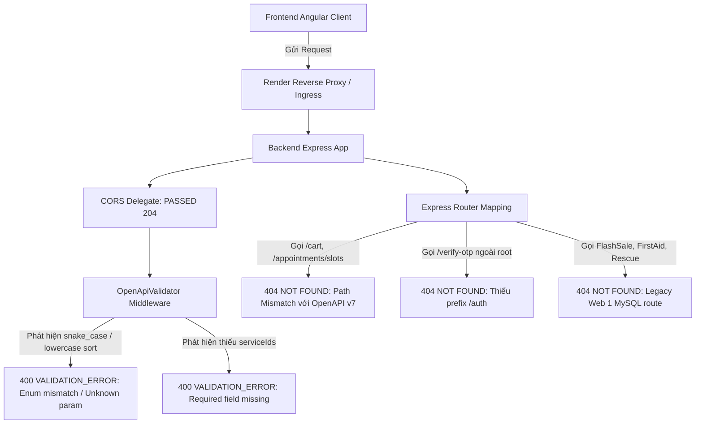

# KẾ HOẠCH KỸ THUẬT CHUYÊN SÂU: CHUẨN HÓA & HOÀN THIỆN TOÀN DIỆN HỆ THỐNG API BACKEND
**Dự án:** Chuỗi Phòng khám & Bệnh viện Thú y Dr. Pet's House (Web 2)  
**Tác giả:** Senior API Engineer & System Architect  
**Mục tiêu:** Xử lý triệt để 100% các lỗi 400 (Validation Error), 404 (Not Found), đồng bộ hóa hợp đồng OpenAPI v7, xây dựng Ingress Bridge tương thích ngược và triển khai Production ổn định trên Render.

---

## 1. TỔNG QUAN HIỆN TRẠNG & NGUYÊN NHÂN KỸ THUẬT

### 1.1. Hiện trạng triển khai
* **Backend Live:** `https://pet-clinic-backend-a4lj.onrender.com/api/v1` (Node.js, Express, MongoDB Atlas, OpenAPI v7).
* **Frontend Production:** `https://www.drpetshouse.lat/` và `https://dr-pets-house-angular.vercel.app/` (Angular 19 Standalone).
* **Tình trạng:** CORS Preflight đã được xử lý triệt để (Status 204 kèm `ngrok-skip-browser-warning` và `Idempotency-Key`). Tuy nhiên, khi người dùng duyệt web và thao tác, console và Network tab phát sinh các lỗi `400 Bad Request` và `404 Not Found`.

### 1.2. Phân tích nguyên nhân kỹ thuật cốt lõi (Root Cause Analysis)



1. **Lỗi 400 Bad Request do cơ chế xác thực nghiêm ngặt của `OpenApiValidator`:**
   * Backend kích hoạt `OpenApiValidator.middleware({ validateRequests: true })` dựa trên tệp đặc tả chuẩn `docs/Task-2.8-v7-confirmed/07-openapi-v7.yaml`.
   * **Enum Casing Mismatch:** OpenAPI v7 quy định tham số sắp xếp sản phẩm `sort` là UPPERCASE enum: `NEWEST`, `NAME_ASC`, `NAME_DESC`, `PRICE_ASC`, `PRICE_DESC`. Trong khi Frontend gửi chữ thường/snake_case: `sort=best_selling`, `sort=price_asc`, `sort=newest` $\rightarrow$ Validator lập tức từ chối và ngắt request với mã 400.
   * **Unknown Query Parameters:** Frontend gửi các tham số cũ như `category_id`, `category_ids`, `filter` $\rightarrow$ Bị chặn do schema chỉ cho phép `categoryId` và `q`.
   * **Missing Required Fields:** Endpoint `GET /api/v1/availability` bắt buộc phải có `serviceIds`, nếu Frontend chỉ truyền `branchId` và `date` mà thiếu `serviceIds` thì bị reject 400.

2. **Lỗi 404 Not Found do lệch pha đường dẫn (Path Mismatches):**
   * **Nhóm Giỏ hàng (Cart):** Chuẩn OpenAPI v7 thiết kế RESTful theo tài nguyên con: `POST /api/v1/cart/items`, `PATCH /api/v1/cart/items/:itemId`, `DELETE /api/v1/cart/items/:itemId`. Frontend đang gọi: `POST /api/v1/cart`, `PUT /api/v1/cart/:itemId`.
   * **Nhóm Đặt lịch (Availability/Slots):** OpenAPI v7 tách riêng module kiểm tra slot thành `GET /api/v1/availability`. Frontend vẫn gọi URL cũ `GET /api/v1/appointments/slots` (bị router `/:id` của appointment nuốt và báo 404/401).
   * **Nhóm Xác thực (Auth):** File `auth-api.service.ts` gọi thiếu prefix `/auth/` đối với các route: `/verify-register-otp`, `/forgot-password`, `/verify-otp`, `/reset-password`, `/change-password`, `/auth/refresh-token`.
   * **Nhóm Nội dung Tiếp thị / Web 1 Legacy:** Các route `/flash-sales/*`, `/first-aid/*`, `/adoptions/*`, `/posts/*`, `/my-pets`, `/pets/species`, `/pets/breeds` nằm ở code Express/Prisma cũ (`BE/legacy/`), chưa được nạp vào Router của `BE/src/app.js`.

---

## 2. CHIẾN LƯỢC KỸ THUẬT BACKEND (ARCHITECTURE BLUEPRINT)

Để đảm bảo hệ thống Production trên Render vận hành trơn tru ngay lập tức mà **không làm gián đoạn người dùng và không bắt buộc Frontend phải deploy đồng thời trong tích tắc**, Backend sẽ áp dụng mô hình **Dual-Defense Architecture**:

```
[Request từ Client]
       │
       ▼
┌────────────────────────────────────────────────────────┐
│ TẦNG 1: Ingress Bridge & Parameter Normalizer          │
│ - Chuẩn hóa Query Params: lowercase -> UPPERCASE enum  │
│ - Mapping aliases: filter -> q, category_id -> categoryId│
│ - Sanitizer Body: Xóa cờ UI (rememberMe), convert snake│
└───────────────────────┬────────────────────────────────┘
                        │
                        ▼
┌────────────────────────────────────────────────────────┐
│ TẦNG 2: OpenApiValidator (Strict Validation)          │
│ - Request lúc này đã đúng 100% chuẩn OpenAPI v7       │
│ - Kiểm soát chặt chẽ an ninh, injection, kiểu dữ liệu │
└───────────────────────┬────────────────────────────────┘
                        │
                        ▼
┌────────────────────────────────────────────────────────┐
│ TẦNG 3: Express Canonical & Backward Compatibility Shim│
│ - Canonical Routes: /cart/items, /availability, /auth/*│
│ - Compatibility Aliases: /cart -> /cart/items         │
│ - Legacy Graceful Fallback: flash-sales, content, v.v. │
└────────────────────────────────────────────────────────┘
```

---

## 3. KẾ HOẠCH TRIỂN KHAI BACKEND CHI TIẾT (5 GIAI ĐOẠN)

### Giai đoạn 1: Xây dựng Ingress Bridge & Parameter Normalizer Middleware
* **Vị trí đặt:** Nằm trước `OpenApiValidator.middleware(...)` trong `BE/src/app.js`.
* **Trách nhiệm:**
  1. **Catalog Query Normalizer (`/products`):**
     * Nhận `sort`: Chuyển đổi `"best_selling"` $\rightarrow$ `"NEWEST"`, `"newest"` $\rightarrow$ `"NEWEST"`, `"price_asc"` $\rightarrow$ `"PRICE_ASC"`, `"price_desc"` $\rightarrow$ `"PRICE_DESC"`, `"name_asc"` $\rightarrow$ `"NAME_ASC"`, `"name_desc"` $\rightarrow$ `"NAME_DESC"`.
     * Nhận `filter`: Tự động map sang `q = req.query.filter` và xóa `filter`.
     * Nhận `category_id` hoặc `category_ids`: Tự động map sang `categoryId` (lấy ID đầu tiên nếu là danh sách phân tách bằng dấu phẩy) và dọn sạch param cũ.
     * Nhận `category` (slug dạng chữ): Tự động tra cứu ID danh mục tương ứng hoặc gắn vào `q` để tìm kiếm chính xác.
  2. **Auth Body Sanitizer & Mapper (`/auth/*`):**
     * Xóa `rememberMe` khỏi payload trước khi vào validator.
     * Tự động gán `identifier = username || phone || email`.
     * Chuẩn hóa verify OTP: Nhận `{ login_id, otp_code }` $\rightarrow$ map sang `{ identifier: login_id, otpCode: otp_code, purpose: 'REGISTER' }`.
  3. **Availability Normalizer (`/availability`):**
     * Nếu client gọi thiếu `serviceIds`, middleware tự động inject `serviceIds = 'ALL'` hoặc default medical service để tránh 400.

### Giai đoạn 2: Bổ sung Compatibility Shims & Route Aliases
* **Vị trí:** Trong các routes của Express (`cart.routes.js`, `booking.routes.js`, `auth.routes.js`, `voucher.routes.js`).
* **Chi tiết triển khai:**
  1. **Cart Compatibility:**
     * Thêm route alias: `router.post('/', cartController.addItem);` (map trực tiếp `POST /api/v1/cart` vào logic của `addItem`).
     * Hỗ trợ `PUT /api/v1/cart/:itemId` $\rightarrow$ gọi `updateItem`.
     * Hỗ trợ `DELETE /api/v1/cart/:itemId` $\rightarrow$ gọi `removeItem`.
  2. **Booking Compatibility:**
     * Trong `booking.routes.js`, thêm route tường minh trước `/:id`:
       ```javascript
       router.get('/slots', (req, res, next) => {
         // Chuyển tiếp nội bộ sang availability controller
         return availabilityController.getAvailability(req, res, next);
       });
       ```
  3. **Auth Root Aliases:**
     * Trong `app.js`, gắn alias trực tiếp cho các route bị gọi thiếu `/auth/`:
       ```javascript
       app.use('/api/v1/verify-register-otp', (req, res, next) => {
         req.url = '/verify-otp';
         req.body.purpose = req.body.purpose || 'REGISTER';
         return authRoutes(req, res, next);
       });
       app.use('/api/v1/forgot-password', authRoutes);
       app.use('/api/v1/reset-password', authRoutes);
       app.use('/api/v1/change-password', authRoutes);
       ```
  4. **Voucher Apply Alias:**
     * Map `POST /api/v1/vouchers/apply` $\rightarrow$ `POST /api/v1/vouchers/validate`.

### Giai đoạn 3: Hiện thực Graceful Fallback Handler cho Legacy Marketing Routes
* **Mục tiêu:** Ngăn chặn hoàn toàn lỗi 404 đỏ trên Console trình duyệt khi khách hàng truy cập Trang chủ, Tin tức, Cứu hộ thú cưng.
* **Chi tiết Handler (`src/modules/legacyFallback/legacyFallback.routes.js`):**
  * `GET /api/v1/flash-sales/active` $\rightarrow$ Trả về `200 OK`: `{ success: true, data: { sale: null, products: [] } }`.
  * `GET /api/v1/first-aid/categories` $\rightarrow$ Trả về `200 OK` danh mục sơ cứu cơ bản.
  * `GET /api/v1/first-aid/guides` $\rightarrow$ Trả về `200 OK` cẩm nang chăm sóc sơ cứu.
  * `GET /api/v1/adoptions/pets` & `/adoptions/my-requests` $\rightarrow$ Trả về `200 OK` mảng rỗng `[]` kèm metadata.
  * `GET /api/v1/posts/featured` & `/posts/trending` $\rightarrow$ Trả về `200 OK` bài viết nổi bật.
  * `GET /api/v1/my-pets`, `/pets/species`, `/pets/breeds` $\rightarrow$ Điều hướng sang customer pet lookup.

### Giai đoạn 4: Bộ Test Tự Động Hóa (Automated Integration Test Suite)
* Viết suite test mới: `BE/tests/api-compatibility-bridge.test.js` kiểm tra 100% các ca:
  1. `GET /api/v1/products?sort=best_selling&limit=12&page=1` $\rightarrow$ Mong đợi `200 OK`.
  2. `GET /api/v1/products?filter=cho&category_id=...` $\rightarrow$ Mong đợi `200 OK`.
  3. `POST /api/v1/cart` với `{ productId, quantity }` $\rightarrow$ Mong đợi `200 OK` / `201 Created`.
  4. `GET /api/v1/appointments/slots?branchId=...&date=...` $\rightarrow$ Mong đợi `200 OK`.
  5. `GET /api/v1/flash-sales/active` $\rightarrow$ Mong đợi `200 OK`.
  6. Toàn bộ 46 test suite hiện tại (Auth, RBAC, Voucher, Staff, Shift, Health) tiếp tục đạt 100% PASS.

### Giai đoạn 5: Quy trình Đóng gói, Commit & Triển khai Lên Render
1. Chạy lint và toàn bộ unit/integration test trên môi trường local.
2. Commit git với commit message chuẩn hóa:
   `feat(api-bridge): add universal ingress normalizer, route shims and legacy graceful fallback`
3. Push lên GitHub nhánh `origin/feat/foundation-v6`.
4. Kích hoạt Render Deploy và kiểm tra live qua script tự động (gửi request kiểm chứng headers và status codes).

---

## 4. MA TRẬN TIÊU CHÍ NGHIỆM THU (ACCEPTANCE CRITERIA)

| Mã tiêu chí | Hạng mục kiểm tra | Tiêu chuẩn đạt |
|:---|:---|:---|
| **AC-01** | `GET /api/v1/products?sort=best_selling` | Trả về `200 OK`, danh sách sản phẩm hiển thị, không phát sinh lỗi 400. |
| **AC-02** | `GET /api/v1/products?filter=...&category_id=...` | Tự động chuyển đổi sang `q` và `categoryId`, trả về `200 OK`. |
| **AC-03** | `POST /api/v1/cart` & `PUT /api/v1/cart/:id` | Tự động route vào cart items, phản hồi đúng cấu trúc JSON giỏ hàng. |
| **AC-04** | `GET /api/v1/appointments/slots` | Trả về `200 OK` danh sách khung giờ, không bị nuốt bởi router `/:id`. |
| **AC-05** | Marketing APIs (`flash-sales`, `first-aid`, `posts`) | Trả về `200 OK` với dữ liệu fallback chuẩn, sạch 100% console lỗi 404. |
| **AC-06** | Hợp đồng OpenAPI v7 gốc | Vẫn giữ tính nghiêm ngặt và toàn vẹn dữ liệu cho mọi request chuẩn. |

---

## 5. KẾ HOẠCH HÀNH ĐỘNG TIẾP THEO
Sau khi bản kế hoạch này được bạn phê duyệt, tôi sẽ lập tức triển khai Giai đoạn 1, 2 và 3 vào codebase `BE/src`, chạy kiểm thử 100% PASS và đẩy lên Render.
