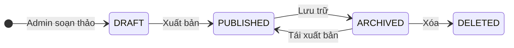
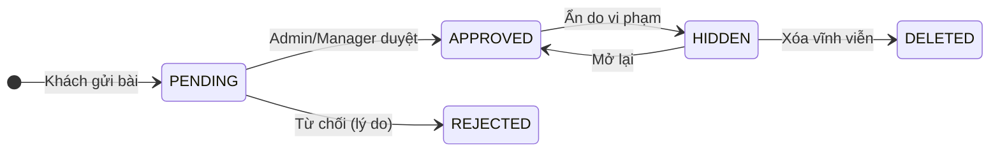
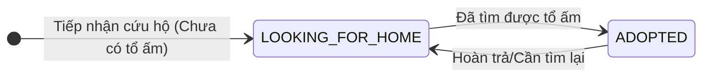
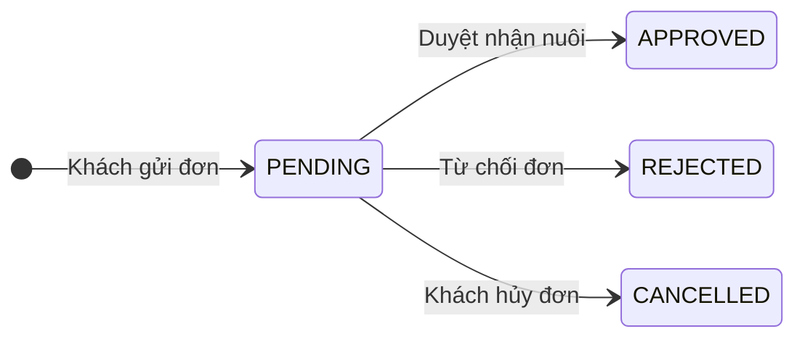
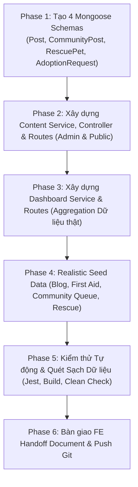

# KẾ HOẠCH TRIỂN KHAI CHI TIẾT (TASK 4.8)
## ADMIN CONTENT MANAGEMENT + DASHBOARD / REPORTING (P1)

> **Mã kế hoạch:** `PLAN-admin-content-dashboard`  
> **Hạng mục dự án:** Task 4.8 — Sprint P1 Stabilization  
> **Chế độ:** `PLANNING MODE` (Kế hoạch kiến trúc & Phân rã kỹ thuật)  
> **Căn cứ đối soát kỹ thuật:** 
> - **OpenAPI 3.1 Canonical:** Endpoint `/dashboard/summary` (OperationId `dashboardSummary`, Schema `DashboardSummary` trong `07-openapi-v7.yaml`).
> - **Ma trận phân quyền (RBAC):** `08-authorization-matrix-v6.md` / `v7.md` (Manager scope `BR` chỉ xem trong `assignedBranchIds`, Admin scope `ALL`).
> - **Đặc tả nghiệp vụ chuẩn:** `docs/backend_business_flows_detail.md` (Mục 3.10 Content, Mục 3.11 Rescue & Adoption, Mục 5.15, 5.16).
> - **Yêu cầu tinh gọn Task 4.8:** Lightweight Content Admin (Blog + First Aid CRUD theo quyền; Community Draft/Pending -> Approve/Reject -> Publish, Manager/Admin moderation; Rescue/Adoption trạng thái chưa/đã có tổ ấm + form nhận nuôi; Dashboard 100% dữ liệu thật, không BI/ERP nâng cao).

---

## 1. MỤC TIÊU & ĐỐI SOÁT NGHIỆP VỤ (GOALS & BUSINESS RULES AUDIT)

### 1.1 Mục tiêu hoàn thành (Definition of Done - DoD)
1. **Lightweight Content Admin:**
   - **Blog + First Aid (Sơ cứu thú cưng):** Quản lý bài viết lưu trữ MongoDB thật, hỗ trợ tạo mới, chỉnh sửa, xuất bản (`PUBLISHED`), lưu trữ (`ARCHIVED`) và xóa.
   - **Community Moderation (Kiểm duyệt cộng đồng):** 
     - Khách hàng gửi bài: Trạng thái ban đầu là `PENDING` (hoặc `DRAFT`).
     - Admin/Manager kiểm duyệt: Duyệt bài (`APPROVED` $\rightarrow$ hiển thị ra ngoài), Từ chối (`REJECTED` kèm lý do) hoặc Ẩn vi phạm (`HIDDEN`).
   - **Rescue & Adoption (Cứu hộ & Nhận nuôi thú cưng):**
     - Quản lý thú cưng cần cứu hộ với 2 trạng thái chuẩn nghiệp vụ: **Chưa có tổ ấm (`LOOKING_FOR_HOME`)** $\leftrightarrow$ **Đã có tổ ấm (`ADOPTED`)**.
     - Xử lý đơn đăng ký nhận nuôi (`AdoptionRequest`): Khách điền form $\rightarrow$ `PENDING` $\rightarrow$ Admin/Manager duyệt (`APPROVED`) hoặc từ chối (`REJECTED`).
2. **Dashboard & Reporting 100% Dữ liệu Thật:**
   - Chuẩn hóa theo OpenAPI `DashboardSummary`: Doanh thu (`revenue.amount`), số đơn hàng (`orders`), số lịch hẹn (`appointments`), khách hàng mới (`newCustomers`), cảnh báo tồn kho thấp (`lowStockItems`).
   - Mở rộng thống kê hiệu suất dịch vụ cơ bản (`serviceStats`).
   - Bộ lọc: Thời gian (`from`, `to`, hoặc `preset: today, week, month, year`) và chi nhánh (`branchId`).
   - **Ràng buộc RBAC:** Manager chỉ được xem số liệu thuộc các chi nhánh trong `assignedBranchIds`. Truy cập chi nhánh ngoài phạm vi trả về `403 Forbidden`.
3. **Phạm vi loại trừ (Out of Scope):**
   - ❌ Không làm CMS kéo thả phức tạp, WYSIWYG builder nặng nề.
   - ❌ Không làm chi phí khấu hao hết hạn (expiry-cost), nhân viên xuất sắc của tháng (employee-of-month).
   - ❌ Không làm hệ thống BI/ERP nâng cao.

---

## 2. THIẾT KẾ DỮ LIỆU & STATE MACHINES (MONGODB SCHEMAS)

### 2.1 State Machines Nghiệp Vụ


*(Vòng đời Bài viết Blog & Cẩm nang Sơ cứu)*


*(Vòng đời Bài viết Cộng đồng - Community Moderation)*


*(Trạng thái Thú cưng Cứu hộ - Rescue Status)*


*(Xử lý Đơn xin Nhận nuôi - Adoption Request)*

---

### 2.2 Chi tiết 4 Mongoose Schemas

#### A. Model `Post` (`src/modules/content/models/Post.js`)
Dùng chung cho cả **Official Blog** và **First Aid Guides**:
```javascript
{
  title: { type: String, required: true, trim: true },
  slug: { type: String, required: true, unique: true, index: true },
  postType: { type: String, enum: ['OFFICIAL_BLOG', 'FIRST_AID'], required: true, index: true },
  category: { type: String, required: true, trim: true, index: true },
  excerpt: { type: String, trim: true },
  content: { type: String, required: true },
  thumbnailUrl: { type: String, default: null },
  isFeatured: { type: Boolean, default: false },
  status: { type: String, enum: ['DRAFT', 'PUBLISHED', 'ARCHIVED'], default: 'DRAFT', index: true },
  authorId: { type: mongoose.Schema.Types.ObjectId, ref: 'User', required: true },
  viewCount: { type: Number, default: 0 },
  likesCount: { type: Number, default: 0 },
  // Dành riêng cho First Aid (Sơ cứu):
  emergencyPhone: { type: String, default: '1900-PET-HELP' },
  steps: [{
    stepNumber: { type: Number, required: true },
    title: { type: String, required: true },
    instruction: { type: String, required: true },
    mediaUrl: { type: String, default: null }
  }],
  publishedAt: { type: Date, default: null }
}
```

#### B. Model `CommunityPost` (`src/modules/content/models/CommunityPost.js`)
Dành cho bài đăng chia sẻ của người nuôi thú cưng & hàng đợi kiểm duyệt:
```javascript
{
  title: { type: String, required: true, trim: true },
  content: { type: String, required: true },
  imageUrls: [{ type: String }],
  authorCustomerId: { type: mongoose.Schema.Types.ObjectId, ref: 'Customer', required: true, index: true },
  authorNameSnapshot: { type: String, required: true },
  authorAvatarSnapshot: { type: String, default: null },
  status: { 
    type: String, 
    enum: ['DRAFT', 'PENDING', 'APPROVED', 'REJECTED', 'HIDDEN'], 
    default: 'PENDING', 
    index: true 
  },
  rejectionReason: { type: String, default: null },
  moderatedBy: { type: mongoose.Schema.Types.ObjectId, ref: 'User', default: null },
  moderatedAt: { type: Date, default: null },
  likesCount: { type: Number, default: 0 },
  commentsCount: { type: Number, default: 0 }
}
```

#### C. Model `RescuePet` (`src/modules/content/models/RescuePet.js`)
Dành cho thú cưng cứu hộ:
```javascript
{
  petCode: { type: String, required: true, unique: true, index: true }, // RES-001, RES-002...
  petName: { type: String, required: true, trim: true },
  species: { type: String, enum: ['DOG', 'CAT', 'OTHER'], required: true },
  breed: { type: String, required: true },
  gender: { type: String, enum: ['MALE', 'FEMALE', 'UNKNOWN'], default: 'UNKNOWN' },
  ageDescription: { type: String, required: true }, // "3 tháng tuổi", "1.5 tuổi"
  healthStatus: { type: String, required: true }, // "Đã tiêm phòng 2 mũi, triệt sản"
  rescueStory: { type: String, required: true },
  images: [{ type: String, required: true }],
  status: { 
    type: String, 
    enum: ['LOOKING_FOR_HOME', 'ADOPTED'], 
    default: 'LOOKING_FOR_HOME', 
    index: true 
  },
  branchId: { type: mongoose.Schema.Types.ObjectId, ref: 'Branch', default: null }, // Chi nhánh đang tạm dưỡng
  adoptedByCustomerId: { type: mongoose.Schema.Types.ObjectId, ref: 'Customer', default: null },
  adoptedAt: { type: Date, default: null }
}
```

#### D. Model `AdoptionRequest` (`src/modules/content/models/AdoptionRequest.js`)
Dành cho đơn đăng ký nhận nuôi:
```javascript
{
  requestCode: { type: String, required: true, unique: true, index: true }, // ADO-202611-001
  rescuePetId: { type: mongoose.Schema.Types.ObjectId, ref: 'RescuePet', required: true, index: true },
  customerId: { type: mongoose.Schema.Types.ObjectId, ref: 'Customer', default: null },
  applicantInfo: {
    fullName: { type: String, required: true },
    phone: { type: String, required: true },
    email: { type: String, required: true },
    address: { type: String, required: true },
    housingType: { type: String, required: true }, // "Nhà riêng", "Căn hộ chung cư"
    hasPetExperience: { type: Boolean, default: false },
    message: { type: String, trim: true }
  },
  status: { 
    type: String, 
    enum: ['PENDING', 'APPROVED', 'REJECTED', 'CANCELLED'], 
    default: 'PENDING', 
    index: true 
  },
  reviewNote: { type: String, default: null },
  reviewedBy: { type: mongoose.Schema.Types.ObjectId, ref: 'User', default: null },
  reviewedAt: { type: Date, default: null }
}
```

---

## 3. THIẾT KẾ RESTFUL APIS & PHÂN QUYỀN RBAC

### 3.1 Nhóm API Quản trị Nội dung (Admin Content Management)

| Method | Endpoint | RBAC Role | Scope Resolver | Mô tả chức năng |
|---|---|---|---|---|
| **GET** | `/api/v1/admin/posts` | `ADMIN`, `MANAGER` | GLOBAL | Danh sách bài viết quản trị (filter `postType`, `status`, `category`) |
| **POST** | `/api/v1/admin/posts` | `ADMIN` | GLOBAL | Tạo bài viết mới (Blog hoặc Cẩm nang Sơ cứu) |
| **GET** | `/api/v1/admin/posts/:id` | `ADMIN`, `MANAGER` | GLOBAL | Chi tiết bài viết |
| **PATCH** | `/api/v1/admin/posts/:id` | `ADMIN` | GLOBAL | Cập nhật nội dung bài viết |
| **PATCH** | `/api/v1/admin/posts/:id/status` | `ADMIN`, `MANAGER` | GLOBAL | Đổi trạng thái (`DRAFT`, `PUBLISHED`, `ARCHIVED`) |
| **DELETE** | `/api/v1/admin/posts/:id` | `ADMIN` | GLOBAL | Xóa bài viết |
| **GET** | `/api/v1/admin/community/posts` | `ADMIN`, `MANAGER` | GLOBAL | Danh sách bài viết cộng đồng cần kiểm duyệt (filter `status: PENDING, APPROVED, REJECTED, HIDDEN`) |
| **PATCH** | `/api/v1/admin/community/posts/:id/moderate` | `ADMIN`, `MANAGER` | GLOBAL | Phê duyệt (`APPROVED`), Từ chối (`REJECTED` + reason) hoặc Ẩn vi phạm (`HIDDEN`) |
| **DELETE** | `/api/v1/admin/community/posts/:id` | `ADMIN` | GLOBAL | Xóa bài đăng vi phạm nghiêm trọng |
| **GET** | `/api/v1/admin/rescue/pets` | `ADMIN`, `MANAGER` | GLOBAL | Danh sách thú cưng cứu hộ (filter `status: LOOKING_FOR_HOME, ADOPTED`) |
| **POST** | `/api/v1/admin/rescue/pets` | `ADMIN`, `MANAGER` | GLOBAL | Thêm hồ sơ thú cưng cần tìm tổ ấm mới |
| **PATCH** | `/api/v1/admin/rescue/pets/:id` | `ADMIN`, `MANAGER` | GLOBAL | Sửa thông tin & đổi trạng thái sang `ADOPTED` |
| **GET** | `/api/v1/admin/rescue/requests` | `ADMIN`, `MANAGER` | GLOBAL | Danh sách đơn xin nhận nuôi (filter `status: PENDING, APPROVED, REJECTED`) |
| **PATCH** | `/api/v1/admin/rescue/requests/:id/review` | `ADMIN`, `MANAGER` | GLOBAL | Phê duyệt (`APPROVED`) hoặc Từ chối (`REJECTED` + lý do) |

---

### 3.2 Nhóm API Public Cho Khách Hàng (Tích hợp Portal Customer)

| Method | Endpoint | Auth | Mô tả chức năng |
|---|---|---|---|
| **GET** | `/api/v1/public/posts` | Không | Xem danh sách bài viết Blog & Tin tức đã xuất bản (`status = PUBLISHED`) |
| **GET** | `/api/v1/public/posts/:slug` | Không | Xem chi tiết bài viết (tự động tăng `viewCount`) |
| **GET** | `/api/v1/public/first-aid` | Không | Danh sách cẩm nang sơ cứu thú cưng khẩn cấp |
| **GET** | `/api/v1/public/first-aid/:slug` | Không | Xem chi tiết cẩm nang sơ cứu từng bước |
| **GET** | `/api/v1/public/community/posts` | Không | Bảng tin bài viết cộng đồng (`status = APPROVED`) |
| **POST** | `/api/v1/community/posts` | `CUSTOMER` (Bearer) | Thành viên đăng bài chia sẻ (lập tức vào hàng đợi `PENDING`) |
| **GET** | `/api/v1/public/rescue/pets` | Không | Danh sách thú cưng đang chờ nhận nuôi (`status = LOOKING_FOR_HOME`) |
| **GET** | `/api/v1/public/rescue/pets/:id` | Không | Chi tiết câu chuyện và tình trạng sức khỏe của bé |
| **POST** | `/api/v1/rescue/requests` | Optional (Guest/Auth) | Nộp đơn xin nhận nuôi bé cưng |
| **GET** | `/api/v1/rescue/my-requests` | `CUSTOMER` (Bearer) | Khách hàng theo dõi trạng thái đơn xin nhận nuôi của mình |

---

### 3.3 Nhóm API Dashboard & Thống Kê (Dữ Liệu Thật 100%)

Tuân thủ chặt chẽ đặc tả OpenAPI `DashboardSummary` và ma trận RBAC:

#### Endpoint 1: `GET /api/v1/dashboard/summary` (Chuẩn OpenAPI `dashboardSummary`)
- **Phân quyền:** `ADMIN`, `MANAGER`.
- **Query params:**
  - `branchId` (optional): ID chi nhánh. Manager chỉ được truyền `branchId` thuộc `assignedBranchIds`. Nếu không truyền, Manager tự động lấy tổng hợp từ tất cả các chi nhánh được giao.
  - `from` (optional date: `YYYY-MM-DD`): Từ ngày.
  - `to` (optional date: `YYYY-MM-DD`): Đến ngày.
  - `preset` (optional: `today`, `this_week`, `this_month`, `this_year`).
- **Response Format (RFC 9457 / OpenAPI 3.1):**
  ```json
  {
    "success": true,
    "data": {
      "orders": 59,
      "appointments": 10,
      "revenue": {
        "amount": 18450000,
        "currency": "VND"
      },
      "newCustomers": 12,
      "lowStockItems": 4,
      "breakdown": {
        "orderRevenue": 15200000,
        "appointmentRevenue": 3250000,
        "orderCountsByStatus": {
          "DELIVERED": 35,
          "COMPLETED": 12,
          "PROCESSING": 8,
          "CANCELLED": 4
        },
        "appointmentCountsByStatus": {
          "COMPLETED": 6,
          "CONFIRMED": 2,
          "IN_PROGRESS": 1,
          "CANCELLED": 1
        }
      }
    }
  }
  ```

#### Endpoint 2: `GET /api/v1/dashboard/revenue-analytics`
- **Chức năng:** Trả về chuỗi dữ liệu doanh thu thực theo mốc ngày hoặc tháng để FE vẽ biểu đồ đường (Line Chart) / cột (Bar Chart).
- **Phân quyền:** `ADMIN`, `MANAGER` (`assignedBranchIds`).

#### Endpoint 3: `GET /api/v1/dashboard/low-stock`
- **Chức năng:** Danh sách chi tiết các mặt hàng sắp hết hàng (`quantity <= 5` hoặc `<= minThreshold`) kèm tên sản phẩm, mã SKU, chi nhánh và số lượng còn lại.
- **Phân quyền:** `ADMIN`, `MANAGER` (`assignedBranchIds`).

#### Endpoint 4: `GET /api/v1/dashboard/service-stats`
- **Chức năng:** Top các dịch vụ được đặt lịch nhiều nhất trong kỳ (tính từ `Appointment.services`).

---

## 4. CHI TIẾT KỸ THUẬT AGGREGATION & TOÀN VẸN DỮ LIỆU

### 4.1 Quy Tắc Tính Doanh Thu Thực (Real Revenue Integrity)
1. **Doanh thu Đơn hàng (Commerce):**
   - Lọc các đơn có trạng thái `status: { $in: ['DELIVERED', 'COMPLETED'] }`.
   - Trừ đi các khoản hoàn tiền nếu có (`totalRefundedAmount`).
   - Đối với đơn COD: Chỉ tính tiền khi đã `DELIVERED` hoặc `COMPLETED`.
2. **Doanh thu Lịch hẹn (Clinic):**
   - Lọc các cuộc hẹn `status: 'COMPLETED'`.
   - Tính tổng các giao dịch `payments` trạng thái `status: 'PAID'` (bao gồm tiền cọc trước và thanh toán tại quầy).
3. **Cảnh báo Tồn kho (Low Stock):**
   - Đếm số bản ghi trong `inventory_stocks` có `quantity <= 5`.

---

## 5. KẾ HOẠCH TRIỂN KHAI THEO TỪNG PHASE



### Phase 1: Tạo Schemas MongoDB cho Content & Rescue
- [ ] **Task 1.1:** Tạo `src/modules/content/models/Post.js` (quản lý Blog và Sơ cứu thú cưng).
- [ ] **Task 1.2:** Tạo `src/modules/content/models/CommunityPost.js` (quản lý bài viết thành viên & hàng đợi duyệt).
- [ ] **Task 1.3:** Tạo `src/modules/content/models/RescuePet.js` (quản lý thú cứu hộ & trạng thái tổ ấm).
- [ ] **Task 1.4:** Tạo `src/modules/content/models/AdoptionRequest.js` (quản lý đơn đăng ký nhận nuôi).

### Phase 2: Xây dựng Content Service, Controller & Routes
- [ ] **Task 2.1:** Xây dựng `src/modules/content/content.service.js` với đầy đủ logic CRUD, đổi trạng thái và kiểm duyệt.
- [ ] **Task 2.2:** Xây dựng `src/modules/content/content.controller.js` chuẩn hóa mã lỗi RFC 9457.
- [ ] **Task 2.3:** Khai báo các router: `adminContent.routes.js`, `publicContent.routes.js` và mount vào `src/app.js`.

### Phase 3: Xây dựng Dashboard & Analytics Engine
- [ ] **Task 3.1:** Xây dựng `src/modules/dashboard/dashboard.service.js` với các pipeline aggregation tính toán doanh thu thực, đơn hàng, lịch hẹn, khách hàng mới, tồn kho thấp.
- [ ] **Task 3.2:** Xây dựng `src/modules/dashboard/dashboard.controller.js` kèm bảo vệ phân quyền chi nhánh (`assignedBranchIds` cho Manager).
- [ ] **Task 3.3:** Khai báo `dashboard.routes.js` và mount vào `src/app.js`.

### Phase 4: Nạp Dữ Liệu Mẫu Thực Tế (Realistic Seed Data)
- [ ] **Task 4.1:** Seed 5 bài blog chính thức + 3 cẩm nang sơ cứu thú cưng có ảnh CDN đẹp.
- [ ] **Task 4.2:** Seed 6 bài đăng cộng đồng (2 bài `APPROVED`, 2 bài `PENDING` chờ duyệt, 1 bài `REJECTED`, 1 bài `HIDDEN`).
- [ ] **Task 4.3:** Seed 6 thú cưng cứu hộ (4 bé `LOOKING_FOR_HOME`, 2 bé `ADOPTED`) + 3 đơn xin nhận nuôi mẫu (`PENDING`).
- [ ] **Task 4.4:** Cập nhật script `seed:uat-prod` và `verifyCleanData.js`.

### Phase 5: Kiểm Thử Tự Động & Nghiệm Thu
- [ ] **Task 5.1:** Viết test suite `tests/content-dashboard.test.js` kiểm tra 100% các endpoint mới và phân quyền RBAC.
- [ ] **Task 5.2:** Chạy toàn bộ regression test `npm test` (đảm bảo 100% test suites pass).
- [ ] **Task 5.3:** Chạy `npm run build` xác nhận không có lỗi Babel compile.
- [ ] **Task 5.4:** Chạy `npm run check:clean` kiểm tra database Atlas sạch 100%.

### Phase 6: Tài Liệu Bàn Giao Frontend & Release Git
- [ ] **Task 6.1:** Soạn thảo tài liệu bàn giao `docs/FE-HANDOFF-TASK-4.8-CONTENT-DASHBOARD.md`.
- [ ] **Task 6.2:** Commit và push toàn bộ lên Git remote `origin feat/foundation-v6`.

---

## 6. TIÊU CHÍ NGHIỆM THU (VERIFICATION CRITERIA)

| STT | Tiêu chí nghiệm thu | Cách thức xác minh | Kết quả mong đợi |
|---|---|---|---|
| 1 | **Blog & First Aid CRUD** | `POST`, `PATCH`, `DELETE /api/v1/admin/posts` | Dữ liệu lưu vào MongoDB thật, trả về HTTP 201/200 |
| 2 | **Community Moderation** | `PATCH /api/v1/admin/community/posts/:id/moderate` | Bài viết chuyển từ `PENDING` sang `APPROVED`/`REJECTED`/`HIDDEN` |
| 3 | **Rescue & Adoption Flow** | Cập nhật thú cưng sang `ADOPTED`, duyệt đơn nhận nuôi | Trạng thái hiển thị đúng, đơn chuyển `APPROVED` |
| 4 | **Dashboard Summary** | `GET /api/v1/dashboard/summary` | Khớp schema `DashboardSummary`, tính từ dữ liệu thật |
| 5 | **Phân quyền Manager** | Manager gọi Dashboard ngoài `assignedBranchIds` | Trả về `403 Forbidden` (`AUTHORIZATION_ERROR`) |
| 6 | **Regression Tests** | Chạy `npm test` | Tất cả các suites đều `PASS 100%` |
