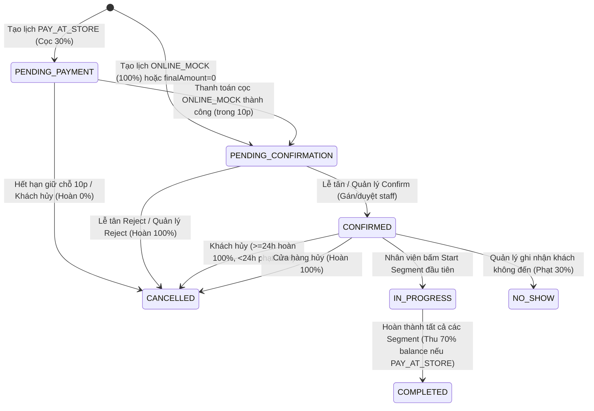

# Kế Hoạch Triển Khai: Appointment Management & Time Slot Engine (P0/P1)

> **Mã công việc:** `PLAN-appointment-management`  
> **Trạng thái:** DRAFTING / PENDING SOCRATIC CLEARANCE  
> **Tài liệu đặc tả chuẩn:** `docs/Task-2.8-v7-confirmed/07-openapi-v7.yaml` & `docs/07-openapi-v6.yaml`  
> **Mức độ ưu tiên:** Core Appointment = P0; Payment/Deposit/Refund Execution = P1 (Mock)

---

## 1. TỔNG QUAN NGHIỆP VỤ & MỤC TIÊU

Hệ thống quản lý lịch hẹn (Appointment) và bộ máy tính toán khung giờ khả dụng (Availability Slot Engine) đóng vai trò xương sống cho hoạt động khám chữa bệnh và chăm sóc thú cưng của chuỗi phòng khám Pet Clinic.

### 1.1. Các nguyên tắc bất biến (Core Invariants)
1. **Slot Engine Tự Động 100% (No Manual Slot Creation):** Tuyệt đối không có màn hình hay API tạo slot thủ công. Toàn bộ slot được tính toán động (15-phút step) dựa trên:
   - Giờ mở cửa & Ngày nghỉ lễ chi nhánh (`Branch.openingHours`, `Branch.holidays`).
   - Cấu hình dịch vụ tại chi nhánh (`BranchServiceConfig.enabled`, `BranchServiceConfig.capacity`, `BranchServiceConfig.availability`, `temporary blocked windows`).
   - Ca trực của nhân viên đủ điều kiện (`Shift` ACTIVE + `StaffProfile.staffSubRole` trùng `Service.requiredStaffRole` + `authorizedBranchIds`).
   - Các lịch hẹn đang hoạt động (`Appointment` CONFIRMED / IN_PROGRESS) hoặc đang giữ chỗ còn hiệu lực (`holdExpiresAt > now`).
2. **Khái niệm Capacity:** `capacity` trong `BranchServiceConfig` là **trần đồng thời (max concurrency)** của dịch vụ đó tại chi nhánh tại một thời điểm, KHÔNG phải số slot nhập tay theo giờ.
3. **Multi-Service trong một Appointment:**
   - Tất cả các dịch vụ trong cùng một lịch hẹn phải có cùng `serviceType` (`GROOMING` hoặc `MEDICAL`).
   - Các dịch vụ được xếp **nối tiếp nhau theo thứ tự (sequential segments)**: Segment $N$ bắt đầu chính xác khi Segment $N-1$ kết thúc.
   - Mỗi segment có `durationMinutes`, `requiredStaffRole`, và `assignedStaffId` riêng biệt.
   - Khách hàng (Customer/Guest) **không được chọn nhân viên**; hệ thống tự động gán hoặc giữ chỗ nhân viên phù hợp.
4. **Phân loại Booking Mode:**
   - `BOOKABLE`: Áp dụng Slot Engine và đặt lịch tự động trực tiếp.
   - `REQUEST_ONLY` (ví dụ: Phẫu thuật Surgery): Khách chỉ gửi yêu cầu qua `/appointment-requests`; quản lý duyệt, xếp lịch và gán bác sĩ sau.
   - `CONTACT_ONLY` (ví dụ: Cấp cứu Emergency): Chỉ hiển thị thông tin hotline, cấm đặt online qua API (báo lỗi `422 BOOKING_MODE_NOT_ALLOWED`).
5. **Quy tắc Y tế (MEDICAL):** Không bắt buộc phải có segment do Bác sĩ (`VETERINARIAN`) phụ trách nếu dịch vụ chỉ yêu cầu Y tá (`NURSE`). Tuy nhiên, việc ký duyệt hồ sơ bệnh án (Medical Review) vẫn tuân thủ thẩm quyền của Bác sĩ.
6. **Thanh toán & Cọc (P1):**
   - `ONLINE_MOCK`: Thanh toán 100% trước, chuyển thẳng sang `PENDING_CONFIRMATION` (với `paidAmount = finalAmount`).
   - `PAY_AT_STORE`: Bắt buộc cọc trước 30% `Math.round(finalAmount * 0.30)` bằng `ONLINE_MOCK` qua cổng thanh toán trong thời gian giữ chỗ 10 phút. Sau khi thanh toán cọc thành công, chuyển sang `PENDING_CONFIRMATION`. 70% còn lại (`balanceAmount`) thu tại quầy khi hoàn thành khám.
   - Nếu `finalAmount === 0` (do voucher 100%): Không cần thanh toán, tự động chuyển ngay sang `PENDING_CONFIRMATION`.
7. **Chính sách Hủy & Dời lịch (Quy tắc TA-30):**
   - **Dời lịch (Reschedule):** Khách hàng tự dời lịch phải trước giờ hẹn $\ge 24\text{h}$, tối đa 2 lần (`rescheduleCount < 2`). Toàn bộ segment và slot giữ chỗ cũ được giải phóng, đặt chỗ mới nguyên tử.
   - **Dời lịch ngoại lệ (Reschedule Override):** Manager/Admin có quyền dời lịch đặc cách (bỏ qua giới hạn 24h/2 lần), bắt buộc có lý do ghi nhận audit.
   - **Khách hủy lịch:**
     - Trước $\ge 24\text{h}$: Hoàn trả 100% số tiền đã trả. Phục hồi quota voucher đã dùng.
     - Dưới $< 24\text{h}$ hoặc Vắng mặt (No-Show): Phạt 30% `finalAmount`. Số tiền hoàn lại $= \max(0, \text{paidAmount} - \text{penalty})$. (Khách cọc 30% mất cọc; khách trả 100% được hoàn 70%). Không phục hồi quota voucher.
   - **Cửa hàng hủy lịch (Store Cancel):** Do lỗi từ phòng khám $\rightarrow$ Hoàn trả 100% tiền đã thu, phục hồi voucher.

---

## 2. KIẾN TRÚC LUỒNG DỮ LIỆU & STATE MACHINE

### 2.1. Vòng đời Trạng thái Appointment (State Transitions)



### 2.2. Kiến trúc Thuật toán Availability Slot Engine

```mermaid
flowchart TD
    A[Request: branchId, date, serviceIds] --> B[Kiểm tra Branch ACTIVE & Ngày lễ]
    B -->|Đóng cửa / Lễ| Z[Trả về slots: []]
    B -->|Hợp lệ| C[Lấy OpeningHours trong ngày]
    C --> D[Validate Services: Cùng serviceType, BOOKABLE, ACTIVE]
    D --> E[Lấy BranchServiceConfig: enabled=true, capacity]
    E --> F[Lấy Shifts của Staff có role phù hợp tại branch]
    F --> G[Lấy Occupied Segments từ Booking CONFIRMED / Active Hold]
    G --> H[Chạy vòng lặp candidateStart từ branchOpen -> branchClose - totalDuration theo bước 15p]
    H --> I{Tất cả các segment nối tiếp thỏa mãn Capacity & Staff?}
    I -->|Có| K[Ghi nhận Slot vào kết quả, tính remaining capacity]
    I -->|Không| L[Bỏ qua candidateStart này]
    K --> M[Trả về AvailabilityResponse]
```

---

## 3. DANH SÁCH ENDPOINTS CANONICAL OPENAPI CẦN HOÀN THIỆN

| Phương thức | Đường dẫn API | Thẩm quyền (RBAC) | Mô tả nghiệp vụ |
|---|---|---|---|
| `GET` | `/api/v1/availability` | Public / Customer / Guest | Trả về các slot khả dụng trong ngày cho tập dịch vụ |
| `GET` | `/api/v1/appointments` | Customer (Own), Staff/Manager/Admin | Danh sách lịch hẹn lọc theo chi nhánh, khách hàng, ngày, trạng thái |
| `POST` | `/api/v1/appointments` | Customer, Guest (X-Guest-Lookup-Token) | Đặt lịch hẹn mới (Atomic hold & voucher consume) |
| `GET` | `/api/v1/appointments/{id}` | Customer (Own), Guest, Staff/Manager | Xem chi tiết lịch hẹn kèm danh sách segments và trạng thái cọc |
| `POST` | `/api/v1/appointments/{id}/confirm` | Receptionist, Manager, Admin | Xác nhận lịch hẹn (`PENDING_CONFIRMATION` $\rightarrow$ `CONFIRMED`) |
| `POST` | `/api/v1/appointments/{id}/reject` | Receptionist, Manager, Admin | Từ chối lịch hẹn và hoàn tiền 100% tự động |
| `POST` | `/api/v1/appointments/{id}/no-show` | Receptionist, Manager, Admin | Đánh dấu khách vắng mặt, phạt 30% theo luật TA-30 |
| `POST` | `/api/v1/appointments/{id}/start` | Staff, Manager, Admin | Bắt đầu thực hiện segment dịch vụ |
| `POST` | `/api/v1/appointments/{id}/reschedule` | Customer, Guest | Khách tự dời lịch ($\ge 24\text{h}$, tối đa 2 lần) |
| `POST` | `/api/v1/appointments/{id}/reschedule-override` | Manager, Admin | Quản lý dời lịch ngoại lệ có ghi nhận audit |
| `POST` | `/api/v1/appointments/{id}/cancel` | Customer, Guest | Khách tự hủy lịch theo điều khoản phạt TA-30 |
| `POST` | `/api/v1/appointments/{id}/store-cancel` | Receptionist, Manager, Admin | Cửa hàng hủy lịch (hoàn tiền 100%) |
| `POST` | `/api/v1/appointments/{id}/cancel-override` | Manager, Admin | Quản lý hủy lịch ngoại lệ với số tiền hoàn tùy chỉnh |
| `POST` | `/api/v1/internal/appointments` | Receptionist, Manager, Admin | Nhân viên tạo lịch hẹn hộ khách hàng tại quầy |
| `PUT` | `/api/v1/appointments/{id}/segments/{serviceId}/staff` | Receptionist, Manager, Admin | Gán/Đổi nhân viên thực hiện cho từng segment |

---

## 4. CHI TIẾT CÁC GIAI ĐOẠN TRIỂN KHAI

### Phase 1: Hoàn thiện Availability Slot Engine Chuẩn Xác
- Nâng cấp `availability.service.js` để đáp ứng toàn bộ điều kiện:
  - Step 15 phút, tính toán duration chính xác theo từng service.
  - Kiểm tra `BranchServiceConfig.capacity` là số segment đồng thời tối đa.
  - Phân tích ca trực `Shift` và đối chiếu `StaffProfile.staffSubRole` khớp với `Service.requiredStaffRole`.
  - Kiểm tra các khoảng thời gian bị khóa tạm thời (`temporary blocked windows`).
  - Đảm bảo một nhân viên không bị trùng lịch khám khác trong cùng một khoảng thời gian.
  - Trả về payload chuẩn OpenAPI: `{ serviceIds, branchId, date, serviceType, scheduledDurationMinutes, slots: [{ start, end, remaining, segments }] }`. Không để lộ thông tin nhân viên cho phía public/customer.

### Phase 2: Schema & Model Appointment, SlotReservation, Payment
- Cập nhật Mongoose Schema `Appointment`:
  - Enums trạng thái: `PENDING_PAYMENT`, `PENDING_CONFIRMATION`, `CONFIRMED`, `IN_PROGRESS`, `COMPLETED`, `CANCELLED`, `NO_SHOW`.
  - Enums thanh toán: `ONLINE_MOCK`, `PAY_AT_STORE`.
  - Cấu trúc `pricing`: `subtotal`, `voucherDiscount`, `finalAmount`, `depositAmount`, `balanceAmount`, `paidAmount`.
  - Cấu trúc `deposit`: `status` (`NOT_REQUIRED`, `PENDING`, `HELD`, `APPLIED`, `REFUNDED`, `FORFEITED`), `paymentId`.
  - Cấu trúc `services` (segments): `serviceId`, `serviceName`, `serviceType`, `durationMinutes`, `requiredStaffRole`, `assignedStaffId`, `executionStatus`.
  - Cấu trúc `cancel`: `by` (`CUSTOMER`, `STORE`, `SYSTEM`), `at`, `actorId`, `reason`, `hoursBeforeStart`, `prepaidOutcome`.
  - Khóa lạc quan (Optimistic Concurrency Control) với `version`.
- Củng cố Schema `SlotReservation`:
  - Khóa duy nhất (Compound unique index) ngăn chặn tuyệt đối double-booking: `{ branchId: 1, staffId: 1, slotStartUnit: 1, unitIndex: 1 }`.
  - Hỗ trợ TTL index tự động giải phóng giữ chỗ khi quá hạn `holdExpiresAt`.

### Phase 3: Xây Dựng Booking Core Services & Idempotency
- **Tạo lịch hẹn (`createAppointment` & `createInternalAppointment`):**
  - Mở MongoDB Session transaction.
  - Kiểm tra tính hợp lệ của toàn bộ services (cùng `serviceType`, mode `BOOKABLE`).
  - Kiểm tra và tự động gán/giữ chỗ nhân viên có ca trực phù hợp.
  - Tính toán giá, áp dụng voucher tỉ lệ và trừ quota voucher trong cùng transaction.
  - Tính cọc: Nếu `PAY_AT_STORE` $\rightarrow$ tạo Payment cọc 30% `ONLINE_MOCK` ở trạng thái `PENDING`, hẹn giữ chỗ trong 10 phút. Nếu `ONLINE_MOCK` $\rightarrow$ mô phỏng thanh toán 100% `PAID`.
  - Gắn `Idempotency-Key` bảo đảm không phát sinh giao dịch kép khi người dùng bấm gửi nhiều lần.
- **Xác nhận / Từ chối lịch hẹn:**
  - `confirmAppointment`: Chuyển sang `CONFIRMED`, gỡ bỏ `holdExpiresAt`, chốt giữ chỗ nhân viên.
  - `rejectAppointment`: Chuyển sang `CANCELLED`, giải phóng giữ chỗ, kích hoạt hoàn tiền 100% tự động nếu đã có `paidAmount > 0`, hoàn lại quota voucher.

### Phase 4: Điều Phối Dời Lịch, Hủy Lịch & Xử Lý Tiền (TA-30)
- **Dời lịch (`rescheduleAppointment` & `rescheduleOverride`):**
  - Kiểm tra điều kiện $\ge 24\text{h}$ và `rescheduleCount < 2` đối với khách.
  - Tìm kiếm slot khả dụng mới, giải phóng reservation cũ và ghi nhận reservation mới trong cùng session nguyên tử.
  - Giữ nguyên liên kết thanh toán đã trả sang lịch hẹn mới.
- **Hủy lịch (`cancelAppointment`, `storeCancelAppointment`, `cancelOverride`):**
  - Tính số giờ còn lại `hoursBeforeStart = (scheduledStart - now) / 3600000`.
  - Áp dụng công thức hoàn tiền TA-30:
    - Nếu khách hủy $< 24\text{h}$ hoặc No-Show: Phạt 30% `finalAmount`, hoàn tiền dư $\max(0, \text{paidAmount} - \text{penalty})$. Quota voucher không hoàn.
    - Nếu khách hủy $\ge 24\text{h}$ hoặc Store Cancel: Hoàn tiền 100% `paidAmount`, phục hồi quota voucher.
  - Tạo bản ghi `Payment` với status `REFUND_PENDING` / `REFUNDED` tương ứng.
- **Đổi nhân viên (`reassignSegmentStaff`):**
  - Kiểm tra nhân viên mới có ca trực `Shift` tại chi nhánh, có `staffSubRole` khớp với `requiredStaffRole` của segment, và không bị trùng lịch khác.
  - Cập nhật segment và chuyển đổi reservation nguyên tử.

### Phase 5: Controller, Router, Middleware RBAC & Serializer
- Tạo `booking.controller.js` và `booking.routes.js` đáp ứng chuẩn REST API với đầy đủ 15 endpoints.
- Xây dựng serializer `formatAppointment` tuân thủ nghiêm ngặt OpenAPI schema (`additionalProperties: false`), tính toán trường `allowedActions` động dựa trên trạng thái và mốc thời gian.
- Cập nhật middleware phân quyền `authorizeRequest.js` hỗ trợ đầy đủ các role: `CUSTOMER`, `guest(lookup token)`, `RECEPTIONIST`, `STAFF`, `MANAGER`, `ADMIN`.

---

## 5. KẾ HOẠCH KIỂM THỬ (PHASE X: VERIFICATION CHECKLIST)

- [ ] **Unit Tests Availability Slot Engine:**
  - Kiểm tra mở cửa, ngày lễ, ca trực của nhân viên.
  - Kiểm tra trần concurrency `capacity` của `BranchServiceConfig`.
  - Kiểm tra ghép nối đa dịch vụ (multi-service) cùng `serviceType`.
  - Chặn triệt để dịch vụ `REQUEST_ONLY` và `CONTACT_ONLY`.
- [ ] **Integration Tests Booking & Double-Booking Prevention:**
  - Kiểm tra đặt lịch đồng thời trên cùng 1 slot/nhân viên $\rightarrow$ 1 request thành công, request thứ hai trả về 409 Conflict.
  - Kiểm tra thanh toán cọc 30% `PAY_AT_STORE` và thanh toán 100% `ONLINE_MOCK`.
  - Kiểm tra giữ chỗ hết hạn 10 phút tự động giải phóng.
- [ ] **Integration Tests Phân Quyền & Quy tắc Hủy/Dời lịch (TA-30):**
  - Khách tự dời lịch $\ge 24\text{h}$ thành công; dời lịch $< 24\text{h}$ bị từ chối 422.
  - Khách hủy lịch $\ge 24\text{h}$ nhận hoàn tiền 100% + hoàn voucher quota.
  - Khách hủy lịch $< 24\text{h}$ bị phạt 30% `finalAmount` (khách cọc 30% mất cọc, khách trả 100% nhận lại 70%).
  - Lễ tân/Quản lý thực hiện override và đổi nhân viên (`reassign`) thành công.
- [ ] **Regression & Contract Tests:**
  - Đảm bảo toàn bộ 9 test suites hiện tại (131 tests) tiếp tục PASS 100%.
  - Chạy `npm run build` xác nhận không có lỗi Babel transpilation.
