# Kế Hoạch Triển Khai Chi Tiết: Giải Quyết Toàn Bộ Yêu Cầu BE Final E2E/UAT & Supplement (Flash Sale, Content, Moderation)

> **Tài liệu nguồn:**
> 1. `docs/WEB2_YEU_CAU_BE_FINAL_E2E_UAT_2026-11-05 (1).docx` — **30 Requirement IDs** (`AUTH-01..04`, `OPS-01..05`, `ORD-01..05`, `RET-01..03`, `APT-01..07`, `SR-01..05`, `DATA-01..03`), **8 Release Gates (`RG-01..08`)**, **36 kịch bản UAT (`UAT-01..36`)**.
> 2. `docs/WEB2_BE_HANDOFF_FLASH_CONTENT_MODERATION_2026-11-06.docx` — **35 Requirement IDs** (`FS-01..08`, `CM-01..15`, `MOD-01..12`), **28 kịch bản UAT (`UAT-S01..S28`)**.
>
> **Tổng phạm vi:** 65 Requirement IDs + 64 kịch bản UAT E2E.

---

## 1. Tổng Quan Kiến Trúc & Ma Trận Gap Analysis

```mermaid
flowchart TD
    subgraph P1["Phase 1: Auth, RBAC, Ingress & Error Contract (AUTH-01..04, DATA-01..03)"]
        A1["Mount /api/v1/admin/users (AUTH-01)"]
        A2["Preserve rememberMe & 403 domain codes (AUTH-02)"]
        A3["Unified branchScope guard & fail-closed (AUTH-03)"]
        A4["StaffProfile._id <-> User._id resolver (AUTH-04)"]
    end

    subgraph P2["Phase 2: Catalog, Branch, Shift, Order, Return & Ledger (OPS-01..05, ORD-01..05, RET-01..03)"]
        B1["Branch Config RBAC, Product Safe Delete, ShiftTemplate CRUD (OPS-01..03)"]
        B2["Structured Inventory Ledger & Scoped Staff Read (OPS-04..05)"]
        B3["Single-branch Order Allocation, Voucher Contract Fix & Compensation Saga (ORD-01..05)"]
        B4["4-Stage Return Qty Contract, Per-SKU Quality & Partial Restock PNK (RET-01..03)"]
    end

    subgraph P3["Phase 3: Multi-Pet Booking & Multi-ServiceRecord Execution (APT-01..07, SR-01..05)"]
        C1["Admin Stateless Quote & Create-on-Behalf + Mixed Service Types (APT-01..02, APT-07)"]
        C2["Per-Pet Check-in, Segment Start -> Atomic ServiceRecord (APT-03..06)"]
        C3["Drop single appointmentId unique index -> Compound (appointmentId, petId, group) (SR-01)"]
        C4["Zero Default Actual Materials, Nurse/Vet/Groomer Finalize & Parent Completion (SR-02..05)"]
    end

    subgraph P4["Phase 4: Flash Sale Module & Authoritative Checkout (FS-01..08)"]
        D1["FlashSale Model, Atomic Create+Publish & Derived State (FS-01..03)"]
        D2["Variant/Price Validation, Overlap Prevention & Active Endpoint (FS-04, FS-06..07)"]
        D3["Order/Checkout Flash Sale Pricing & Atomic Sold Quota Restore (FS-05, FS-08)"]
    end

    subgraph P5["Phase 5: Content Studio, First Aid, Community & Partner Rescue (CM-01..15)"]
        E1["Official Blog: contentBlocks, layoutType, hashtags, HTML sanitizer (CM-01..03)"]
        E2["First Aid: urgencyLevel, heroTitle, video, ordered steps, remove legacy stub (CM-04..06)"]
        E3["Community: 4 canonical tags, nested replies, like/unlike, moderation lock (CM-07..10)"]
        E4["Partner Rescue: 6-partner registry, optional pet fields, decoupled status (CM-11..15)"]
    end

    subgraph P6["Phase 6: Moderation — Reviews, Feedback & Violation Reports (MOD-01..12)"]
        F1["Admin Reviews: Enriched target/source DTO, CAS hide/show + audit + reply (MOD-01..04)"]
        F2["Feedback: gender, sourceCode, statusHistory, email/outbox reply delivery (MOD-05..08)"]
        F3["CommunityReport: Customer report submit + Admin resolve -> atomic post hide (MOD-09..12)"]
    end

    P1 --> P2 --> P3 --> P4 --> P5 --> P6
```

---

## 2. Quyết Định Thiết Kế Cho Các Mục `BA DECISION` (Socratic Gate)

Trước khi bắt đầu viết code (Phase 4 Implementation), dưới đây là 8 điểm `BA DECISION` từ 2 tài liệu cùng phương án đề xuất chuẩn hóa:

| Mã YC | Vấn đề trong tài liệu | Phương án đề xuất (Recommended Default) |
| :--- | :--- | :--- |
| **`APT-07`** | Cho phép đặt chung dịch vụ `MEDICAL` + `GROOMING` trong 1 Appointment hay tách? | **(Khuyến nghị - Option A):** Cho phép tạo chung trong 1 `Appointment` nhiều segment (`MEDICAL` + `GROOMING`), tự động tách thành các `ServiceRecord` độc lập theo `(appointmentId, petId, serviceGroup)` khi `Start`. Giữ nguyên 1 mã lịch hẹn & 1 hóa đơn thanh toán cho khách. |
| **`OPS-02`** | `DELETE /api/v1/products/:id` xóa cứng khi nào? | **(Khuyến nghị):** Chỉ cho xóa cứng khi `status === 'ARCHIVED'` **VÀ** không có tham chiếu trong `Order`, `InventoryRecord` (stock > 0), `InventoryTransaction`, `ServiceRecord`, `FlashSale`. Nếu còn tham chiếu → trả `409 PRODUCT_IN_USE` với thông điệp giữ trạng thái `ARCHIVED`. |
| **`OPS-03`** | Quản lý Ca làm việc mẫu (`ShiftTemplate`) theo cấu trúc nào? | **(Khuyến nghị):** Tạo model `ShiftTemplate` gắn với `branchId` (`name`, `code`, `startTime`, `endTime`, `daysOfWeek`, `status: ACTIVE\|INACTIVE`, `version`), cung cấp đầy đủ `GET/POST /api/v1/branches/:branchId/shift-templates` và `PATCH/DELETE /api/v1/shift-templates/:id`. |
| **`RET-02`** | Xử lý trả hàng có cả SKU nguyên vẹn (`RESELLABLE`) và SKU hư hỏng (`DAMAGED`)? | **(Khuyến nghị):** Hỗ trợ mảng `items[]` với `receivedQty`, `approvedQty`, `restockedQty`, `quality` (`RESELLABLE\|DAMAGED\|EXPIRED`), `damageReason` trên từng dòng; chỉ sinh phiếu nhập kho `RECEIPT` cho phần `restockedQty > 0` (`RESELLABLE`). |
| **`CM-10`** | Quy tắc chuyển trạng thái bài viết Cộng đồng (`CommunityPost`) và xóa bài `PENDING`? | **(Khuyến nghị):** Áp dụng chặt chẽ state machine: `PENDING -> APPROVED \| REJECTED`, `APPROVED <-> HIDDEN`, `REJECTED -> APPROVED`. Chặn `DELETE` vật lý khi bài đang `PENDING` (`409 MODERATION_ACTION_REQUIRED`), buộc duyệt hoặc từ chối để lưu audit log. |
| **`CM-14`** | Duyệt yêu cầu nhận nuôi (`AdoptionRequest`) có tự động đổi trạng thái `RescuePet` sang `ADOPTED` không? | **(Khuyến nghị):** Tách biệt theo `ownershipType`: với `PARTNER_MAINTAINED` (mặc định mới), duyệt `AdoptionRequest` chỉ cập nhật hồ sơ lead nhận nuôi, trạng thái `RescuePet` (`LOOKING_FOR_HOME` / `ADOPTED`) do Admin/Manager cập nhật độc lập theo xác nhận của trạm đối tác. |
| **`MOD-04`** | Phản hồi của Staff/Admin trên `Review` hiển thị công khai hay ghi chú nội bộ? | **(Khuyến nghị):** Hỗ trợ cả 2 trường: `staffReply` (`{ text, repliedBy, repliedAt }` — hiển thị công khai dưới đánh giá trên Web 1) và `moderationNote` (ghi chú nội bộ khi ẩn/hiện). |
| **`MOD-12`** | Xử lý các báo cáo vi phạm (`CommunityReport`) trùng lặp khi 1 báo cáo đã được xử lý? | **(Khuyến nghị):** Khi Moderator chốt 1 report của bài viết (`HIDE_POST` hoặc `NO_VIOLATION`), hệ thống tự động đồng bộ kết quả đóng tất cả các report đang `PENDING`/`UNDER_REVIEW` của cùng `postId` trong cùng transaction (kèm `resolvedByReportId`) để tránh tồn đọng hàng đợi ảo. |

---

## 3. Phân Rã Chi Tiết Theo 7 Phase Triển Khai

### Phase 1: Auth, RBAC, Ingress & Error Contract (`AUTH-01..04`, `DATA-01..03`)
- **Agent phụ trách:** `backend-specialist`, `security-auditor`
- **Các thay đổi cụ thể:**
  1. **`AUTH-01` (Admin Users CRUD):**
     - Mount `adminUsersRoutes` tại `/api/v1/admin` trong [`src/app.js`](file:///d:/A1.%20Lap%20Trinh%20Web/Group_Project_Pet_Clinic/PET_CLINIC_BACKEND/src/app.js).
     - Chuẩn hóa các route: `GET /api/v1/admin/users`, `POST /api/v1/admin/users`, `GET /api/v1/admin/users/:id`, `PUT /api/v1/admin/users/:id`, `PATCH /api/v1/admin/users/:id/status` (lock/unlock thu hồi refresh token), `PATCH /api/v1/admin/users/:id/role`.
     - Khi gán role thuộc nhóm vận hành (`MANAGER`, `RECEPTIONIST`, `VET`, `GROOMER`, `NURSE`, `STAFF`), tự động khởi tạo/đồng bộ `StaffProfile` và kiểm tra bắt buộc `branchIds` / `primaryBranchId`.
  2. **`AUTH-02` (Login `rememberMe`, Error Codes, Profile Email Clear):**
     - Xóa dòng `delete req.body.rememberMe` tại [`src/app.js`](file:///d:/A1.%20Lap%20Trinh%20Web/Group_Project_Pet_Clinic/PET_CLINIC_BACKEND/src/app.js#L395-L397) để `auth.service.js` nhận đúng cờ `rememberMe` (`true` → 30 ngày, `false` → 7 ngày / session cookie).
     - Sửa [`src/shared/errorHandler.js`](file:///d:/A1.%20Lap%20Trinh%20Web/Group_Project_Pet_Clinic/PET_CLINIC_BACKEND/src/shared/errorHandler.js#L44-L46): giữ nguyên `err.code` chuyên biệt (`ACCOUNT_BLOCKED`, `ACCOUNT_NOT_ACTIVATED`, `BRANCH_ACCESS_DENIED`, `INSUFFICIENT_ROLE_PERMISSION`) thay vì ghi đè toàn bộ HTTP 403 thành `AUTHORIZATION_ERROR`.
     - Cập nhật validation & service `PATCH /api/v1/auth/me` (và `/users/profile`) cho phép xóa email tùy chọn khi gửi `email: null` hoặc `""`.
  3. **`AUTH-03` (Unified `branchScope` Guard):**
     - Tạo helper/middleware dùng chung `resolveActorBranchScope(req)` trong `src/shared/middleware/branchScope.middleware.js`.
     - Với `ADMIN`: full access (trừ khi filter theo `branchId`). Với `MANAGER`/Staff: nếu `branchIds` rỗng `[]` → trả `403 BRANCH_SCOPE_EMPTY` (fail-closed, tuyệt đối không trả toàn bộ dữ liệu).
  4. **`AUTH-04` (`StaffProfile._id` vs `User._id` Identity Sync):**
     - Tạo utility `resolveStaffIdentity(idOrUser)` chấp nhận cả `User._id` và `StaffProfile._id`, chuẩn hóa lưu cả 2 hoặc so khớp lưỡng cực trong `Appointment.segments.assignedStaffId`, `ServiceRecord.assignedStaffIds`, `ServiceRecord.reviewerStaffId`, `ServiceRecord.createdBy`.
  5. **`DATA-01..03` (Canonical Pagination & RFC 9457 Error Format):**
     - Chuẩn hóa envelope danh sách `{ items, totalCount, nextCursor, page, limit }` và RFC 9457 error response kèm `correlationId`.
- **VERIFY:** Chạy `npx jest tests/integration/auth-rbac-admin-users.test.js`.

---

### Phase 2: Catalog, Branch, Shift Templates, Order, Voucher, Return & Inventory Ledger (`OPS-01..05`, `ORD-01..05`, `RET-01..03`)
- **Agent phụ trách:** `backend-specialist`, `database-architect`
- **Các thay đổi cụ thể:**
  1. **`OPS-01` (Branch & Service Branch Config RBAC):**
     - Cho phép `MANAGER` đọc/cập nhật thông tin vận hành chi nhánh thuộc `branchScope` và cấu hình dịch vụ theo chi nhánh (`GET/PUT /api/v1/services/:id/branches/:branchId`), nhưng chặn đổi trạng thái kích hoạt chi nhánh toàn cục (`status`, `isActive`) chỉ dành cho `ADMIN`.
  2. **`OPS-02` (Product Safe Permanent Delete):**
     - Cập nhật `DELETE /api/v1/products/:id` trong `src/modules/catalog/product.service.js`: kiểm tra `status === 'ARCHIVED'` và kiểm tra tham chiếu trên `Order`, `InventoryRecord`, `InventoryTransaction`, `ServiceRecord`, `FlashSale`. Trả `409 PRODUCT_HAS_HISTORY` nếu đã phát sinh dữ liệu.
  3. **`OPS-03` (Branch Shift Templates CRUD):**
     - Tạo model `src/modules/branch/models/ShiftTemplate.js` (`branchId`, `code`, `name`, `startTime`, `endTime`, `daysOfWeek`, `status`, `version`) và routes `GET/POST /api/v1/branches/:branchId/shift-templates`, `PATCH/DELETE /api/v1/shift-templates/:id`.
  4. **`OPS-04` & `OPS-05` (Structured Inventory Ledger & Scoped Staff Read):**
     - Bổ sung `transactionCode` / `groupCode`, `sourceCode`, `stockBefore`, `stockAfter` rõ ràng cho mọi phiếu `ISSUE`, `RECEIPT`, `ADJUSTMENT`.
     - Mở quyền đọc lịch sử giao dịch kho (`GET /api/v1/inventory/transactions`) cho `VET`, `NURSE`, `GROOMER` đối với các giao dịch gắn với `ServiceRecord` mà nhân sự đó phụ trách.
  5. **`ORD-01..05` (Order Allocation, Voucher Signature Fix, Receptionist Lookup, Compensation Saga):**
     - Sửa lỗi gọi `validateVoucherEligibility(voucher, { userId, orderType: 'ORDER', orderTotal, context })` và `calculateDiscount(voucher, subtotal)` trong [`src/modules/order/order.service.js`](file:///d:/A1.%20Lap%20Trinh%20Web/Group_Project_Pet_Clinic/PET_CLINIC_BACKEND/src/modules/order/order.service.js).
     - Đảm bảo `quote` và `create` đơn hàng chỉ chọn 1 chi nhánh `ACTIVE` trong `branchScope` đủ tồn kho cho toàn bộ giỏ hàng (không chia nhỏ đơn ngầm).
     - Bổ sung API tra cứu khách hàng theo SĐT chính xác cho Receptionist (`GET /api/v1/customers/lookup?phone=...`) và tạo `GuestContact` nguyên tử không lộ `guestAccessToken` công khai.
     - Lưu đầy đủ `carrier`, `trackingNumber`, `statusNote`, `paymentProvider`; chặn COD chuyển `PAID` trước khi `DELIVERED`; hoàn tồn kho + hoàn lượt voucher idempotent khi hủy/thất bại thanh toán.
  6. **`RET-01..03` (Return/Refund 4-Quantity Contract & Per-SKU Inspection):**
     - Sửa [`src/modules/order/return.service.js`](file:///d:/A1.%20Lap%20Trinh%20Web/Group_Project_Pet_Clinic/PET_CLINIC_BACKEND/src/modules/order/return.service.js#L75-L85): trước khi `receive`, trả `receivedQty: null`, `approvedQty: null`, `restockedQty: null`, `quality: null` (không lấy `requestedQty` làm mặc định).
     - Lưu độc lập `requestedQty`, `receivedQty`, `approvedQty`, `restockedQty` ($0 \le \text{restockedQty} \le \text{approvedQty} \le \text{receivedQty} \le \text{requestedQty}$); chỉ tạo phiếu nhập kho `RECEIPT` cho phần `restockedQty > 0`.
     - Trả `allowedActions` chính xác theo trạng thái và role (`MANAGER`/`ADMIN` mới có `approve`, `reject`, `refund`; `finalRefundAmount` chỉ có giá trị khi `COMPLETED`).
- **VERIFY:** Chạy `npx jest tests/integration/ops-order-return-ledger.test.js`.

---

### Phase 3: Multi-Pet Appointment & Multi-ServiceRecord Execution (`APT-01..07`, `SR-01..05`)
- **Agent phụ trách:** `backend-specialist`
- **Các thay đổi cụ thể:**
  1. **`APT-01`, `APT-02`, `APT-07` (Admin Quote, Multi-Pet Lookup & Mixed Service Types):**
     - Bổ sung `POST /api/v1/admin/appointments/quote` (stateless, không giữ chỗ, không trừ voucher) và `POST /api/v1/admin/appointments` (hỗ trợ cả `customerId` và `guestContact`, hỗ trợ nhiều pet `petId` theo từng segment, cho phép kết hợp `MEDICAL` + `GROOMING` trong cùng lịch hẹn).
     - Bổ sung `GET /api/v1/customers/:customerId/pets` cho Staff/Receptionist/Manager/Admin tra cứu danh sách thú cưng của khách khi đặt lịch hộ.
  2. **`APT-03..06` (Per-Pet Check-in, Atomic Start -> ServiceRecord, BOOKABLE Lifecycle):**
     - Thêm trạng thái check-in theo từng pet/segment (`checkInStatus: 'PENDING' | 'ARRIVED'`, `checkedInAt`, `checkedInBy`); bắt buộc `ARRIVED` trước khi cho phép `Start` segment.
     - Khi gọi `POST /api/v1/appointments/:id/segments/:segmentId/start` (kèm `Idempotency-Key`), tạo hoặc trả về `ServiceRecord` tương ứng với `(appointmentId, petId, serviceGroup)` mà không sinh bản ghi trùng.
     - Chuẩn hóa vòng đời `BOOKABLE`: `PENDING_PAYMENT -> CONFIRMED -> IN_PROGRESS -> COMPLETED` (bỏ `PENDING_CONFIRMATION`), kiểm tra sức chứa ca/nhân sự theo khung giờ.
  3. **`SR-01..05` (Multi-Record Index, Zero Default Actual Materials, Role Finalize & Parent Completion):**
     - Trong [`src/modules/execution/models/ServiceRecord.js`](file:///d:/A1.%20Lap%20Trinh%20Web/Group_Project_Pet_Clinic/PET_CLINIC_BACKEND/src/modules/execution/models/ServiceRecord.js#L14): gỡ `unique: true` đơn lẻ trên `appointmentId`, thay bằng compound unique index `{ appointmentId: 1, petId: 1, recordType: 1, segmentGroupKey: 1 }` (kèm migration drop index cũ `appointmentId_1`).
     - Khi khởi tạo `ServiceRecord`: chỉ nạp `plannedMaterials` từ BOM định mức, giữ `actualMaterials: []` (tuyệt đối không tự chép sang `actualMaterials`).
     - Phân quyền chuẩn: `NURSE` nhập nháp `MEDICAL` nhưng không được `finalize` (`403`); `VET` review & `finalize` `MEDICAL`; `GROOMER` `finalize` `GROOMING`; `MANAGER`/`ADMIN` `reopen` kèm lý do và tạo giao dịch kho chênh lệch (`ADJUSTMENT`/`ISSUE`/`RECEIPT`) thay vì xóa giao dịch gốc.
     - Chỉ chuyển `Appointment.status = 'COMPLETED'` khi **tất cả** segments đã hoàn tất và **tất cả** `ServiceRecord` bắt buộc đã `FINALIZED`.
- **VERIFY:** Chạy `npx jest tests/integration/appointment-servicerecord-e2e.test.js`.

---

### Phase 4: Flash Sale Module & Authoritative Checkout (`FS-01..08`)
- **Agent phụ trách:** `backend-specialist`
- **Các thay đổi cụ thể:**
  1. **Tạo module mới `src/modules/flash-sale/`:**
     - `models/FlashSale.js`: `code`, `name`, `description`, `startAt`, `endAt`, `activationMode` (`AUTO | MANUAL`), `isPaused`, `status` (`DRAFT | PUBLISHED`), `items[]` (`{ productId, variantId, sku, originalPrice, salePrice, quantityLimit, soldQuantity }`), `version`, `createdBy`, `updatedBy`.
     - Server-side derived state (`FS-03`):
       - `status === 'DRAFT'` → `DRAFT`
       - `now >= endAt` → `ENDED`
       - `isPaused === true` → `PAUSED`
       - `now < startAt` → `UPCOMING`
       - `startAt <= now < endAt && !isPaused` → `RUNNING`
  2. **Endpoints & RBAC (`FS-01`, `FS-02`, `FS-04`, `FS-06`, `FS-07`):**
     - Admin/Manager read (`GET /api/v1/flash-sales`, `GET /api/v1/flash-sales/:id` với filter `status`, `search`, cursor pagination).
     - Admin-only write (`POST /api/v1/flash-sales` hỗ trợ tạo kèm `publishNow: true` nguyên tử, `PATCH /api/v1/flash-sales/:id`, `PATCH /api/v1/flash-sales/:id/pause`, `POST /api/v1/flash-sales/:id/publish`).
     - Validate chặt chẽ: `startAt < endAt`, `0 < salePrice < originalPrice`, `quantityLimit >= 1`, kiểm tra trùng lặp `(productId, variantId)` trong cùng campaign hoặc giao thoa thời gian với campaign `PUBLISHED` khác (`409 FLASH_SALE_ITEM_OVERLAP`).
     - Thay thế stub `/api/v1/flash-sales/active` trong [`src/modules/legacy/legacyFallback.routes.js`](file:///d:/A1.%20Lap%20Trinh%20Web/Group_Project_Pet_Clinic/PET_CLINIC_BACKEND/src/modules/legacy/legacyFallback.routes.js#L133-L135) bằng truy vấn thực tế trả về campaign đang `RUNNING` kèm thông tin sản phẩm, biến thể, `remainingQuantity`, `soldPercent`.
  3. **Authoritative Pricing & Atomic Quota (`FS-05`, `FS-08`):**
     - Tích hợp vào `order.service.js`: khi khách đặt hàng có SKU nằm trong Flash Sale đang `RUNNING` và còn hạn mức (`soldQuantity + qty <= quantityLimit`), áp dụng `salePrice` chuẩn từ server và tăng `soldQuantity` nguyên tử; nếu hết suất hoặc vượt hạn mức → trả `409 FLASH_SALE_QUOTA_EXCEEDED`.
     - Khi đơn hủy / hết hạn thanh toán → hoàn lại `soldQuantity` đúng 1 lần.
- **VERIFY:** Chạy `npx jest tests/integration/flash-sale.test.js`.

---

### Phase 5: Content Studio, First Aid, Community & Partner Rescue (`CM-01..15`)
- **Agent phụ trách:** `backend-specialist`
- **Các thay đổi cụ thể:**
  1. **Articles (`CM-01..03`):**
     - Mở rộng [`src/modules/content/models/Post.js`](file:///d:/A1.%20Lap%20Trinh%20Web/Group_Project_Pet_Clinic/PET_CLINIC_BACKEND/src/modules/content/models/Post.js): thêm `contentBlocks` (`[{ type: 'PARAGRAPH'|'HEADING'|'IMAGE'|'QUOTE'|'LIST', text, html, imageUrl, caption, alt }]`), `layoutType` (`STANDARD | FEATURED`), `hashtags` (`[String]`).
     - Sanitize HTML phía server (loại bỏ `<script>`, `onerror`, `onload`, `javascript:`), chuẩn hóa 4 danh mục bài viết (`dinh-duong`, `cham-soc`, `huan-luyen`, `suc-khoe`), trả `409 SLUG_ALREADY_EXISTS` khi trùng slug, và cung cấp `/api/v1/uploads/content`.
  2. **First Aid (`CM-04..06`):**
     - Mở rộng `Post` (`postType: 'FIRST_AID'`): thêm `urgencyLevel` (`NORMAL | URGENT`), `heroTitle`, `stepBadges`, `videoUrl`, `videoTitle`, `videoDescriptionHtml`, chuẩn hóa `steps[]` hỗ trợ đồng bộ cả `title`/`step_title`, `content`/`description`, `imageUrl`/`image_url`.
     - Gỡ bỏ dữ liệu giả cứng và số điện thoại giả `1900-PET-HELP` trong [`src/modules/legacy/legacyFallback.routes.js`](file:///d:/A1.%20Lap%20Trinh%20Web/Group_Project_Pet_Clinic/PET_CLINIC_BACKEND/src/modules/legacy/legacyFallback.routes.js#L137-L162); kết nối trực tiếp vào `content.service.js` với 4 danh mục chuẩn (`tai-nan`, `ngo-doc`, `kho-tho`, `chan-thuong`) và hotline thật từ cấu hình chi nhánh.
  3. **Community (`CM-07..10`):**
     - Mở rộng [`src/modules/content/models/CommunityPost.js`](file:///d:/A1.%20Lap%20Trinh%20Web/Group_Project_Pet_Clinic/PET_CLINIC_BACKEND/src/modules/content/models/CommunityPost.js): thêm `type` (`KHOANH_KHAC | HOI_DAP | MEO_VAT | KINH_NGHIEM`), `typeLabel`, `reportCount`, `hasOpenReport`, `moderationHistory[]`.
     - Bổ sung endpoints chuyên biệt: `POST /api/v1/community/posts/:id/comments`, `POST /api/v1/community/comments/:commentId/replies`, `POST /api/v1/community/posts/:id/like`, `POST /api/v1/community/posts/:id/unlike`, `POST /api/v1/uploads/community`.
     - Áp dụng state machine kiểm duyệt và chặn xóa vật lý bài `PENDING` (`409`).
  4. **Rescue & Adoption Partner Network (`CM-11..15`):**
     - Cập nhật [`src/modules/content/models/RescuePet.js`](file:///d:/A1.%20Lap%20Trinh%20Web/Group_Project_Pet_Clinic/PET_CLINIC_BACKEND/src/modules/content/models/RescuePet.js): chuyển `breed`, `ageDescription`, `gender`, `branchId` thành tùy chọn (nullable); thêm `supportNeeds`, `supportPartnerId`, `supportPartnerName`, `ownershipType` (`PARTNER_MAINTAINED | DR_PET_LEGACY`), và danh mục 6 đối tác cứu trợ chuẩn (`GET /api/v1/rescue/partners`).
     - Thêm `POST /api/v1/uploads/rescue` (không fallback sang ảnh Unsplash ngầm).
     - Tách trạng thái `RescuePet` của đối tác khỏi hành động duyệt `AdoptionRequest`.
- **VERIFY:** Chạy `npx jest tests/integration/content-community-rescue.test.js`.

---

### Phase 6: Moderation — Reviews, Customer Feedback & Violation Reports (`MOD-01..12`)
- **Agent phụ trách:** `backend-specialist`
- **Các thay đổi cụ thể:**
  1. **Reviews Moderation (`MOD-01..04`):**
     - Mở rộng [`src/modules/review/models/Review.js`](file:///d:/A1.%20Lap%20Trinh%20Web/Group_Project_Pet_Clinic/PET_CLINIC_BACKEND/src/modules/review/models/Review.js): thêm `moderationHistory[]` (`{ action, reason, actorId, at }`), `staffReply` (`{ text, repliedBy, repliedAt }`), `version`.
     - Làm giàu DTO `GET /api/v1/reviews/admin` và `GET /api/v1/reviews/:id`: trả đầy đủ `targetName` (tên SP/DV), `sourceType` (`ORDER | APPOINTMENT`), `sourceId`, `sourceCode` (mã đơn hàng / lịch hẹn), hỗ trợ filter (`targetType`, `rating`, `status`, `fromDate`, `toDate`, `search`) và cursor/page pagination >100 bản ghi.
     - Cập nhật `PATCH /api/v1/reviews/:id/visibility`: bắt buộc `reason` khi ẩn, kiểm tra `version`/trạng thái hiện tại (trả `409 REVIEW_STATE_CONFLICT` nếu ẩn lại review đã ẩn), và cập nhật lại `ratingAvg`/`ratingCount` của Product/Service ngay lập tức.
     - Thêm `POST /api/v1/reviews/:id/reply` cho phép Admin/Manager/Staff phản hồi đánh giá.
  2. **Customer Feedback (`MOD-05..08`):**
     - Mở rộng [`src/modules/review/models/Feedback.js`](file:///d:/A1.%20Lap%20Trinh%20Web/Group_Project_Pet_Clinic/PET_CLINIC_BACKEND/src/modules/review/models/Feedback.js): thêm `gender` (`male | female | other | null`), `sourceCode` (`CONTACT_FORM`), `statusHistory[]` (`{ status, notes, reason, actorId, at }`), `replyDelivery` (`{ subject, message, deliveryStatus: 'SENT'|'FAILED', sentAt, sentBy, providerMessageId, errorMessage }`).
     - Thêm `POST /api/v1/feedback/:id/reply` gửi phản hồi qua email/outbox và trả về trạng thái gửi thực tế, tách biệt với `processingNotes` nội bộ; trả `allowedActions` theo trạng thái.
  3. **Community Violation Reports (`MOD-09..12`):**
     - Tạo model mới `src/modules/content/models/CommunityReport.js`: `reportCode`, `postId`, `reporterCustomerId`, `reason` (`SPAM | INAPPROPRIATE | HARASSMENT | MISINFORMATION | OTHER`), `description`, `postSnapshot` (`{ title, content, images, authorName, createdAt }`), `status` (`PENDING | UNDER_REVIEW | RESOLVED | NO_VIOLATION`), `decision` (`HIDE_POST | NO_VIOLATION | null`), `moderationNote`, `moderatorId`, `reviewedAt`, `version`.
     - Compound unique index `{ postId: 1, reporterCustomerId: 1 }` chống khách hàng spam report trùng trên cùng 1 bài viết (`409 REPORT_ALREADY_SUBMITTED`).
     - Endpoints:
       - Customer: `POST /api/v1/community/posts/:id/reports`
       - Admin/Manager: `GET /api/v1/admin/reports`, `GET /api/v1/admin/reports/:id`, `PATCH /api/v1/admin/reports/:id/resolve`. Khi `decision === 'HIDE_POST'`, ẩn nguyên tử `CommunityPost` (`status = 'HIDDEN'`) và đồng bộ các report đang mở của cùng bài viết trong 1 transaction.
- **VERIFY:** Chạy `npx jest tests/integration/moderation-reviews-feedback-reports.test.js`.

---

### Phase 7: UAT Seed (>100 Records/Module) & E2E Release Gate Verification (`RG-01..08`, `UAT-01..36`, `UAT-S01..S28`)
- **Agent phụ trách:** `backend-specialist`, `test-engineer`
- **Các thay đổi cụ thể:**
  1. Cập nhật script seed UAT (`scripts/seed-uat-complete.cjs`) để đảm bảo có đầy đủ:
     - Các tài khoản mẫu theo đúng từng role (`ADMIN`, `MANAGER`, `RECEPTIONIST`, `VET`, `NURSE`, `GROOMER`, `CUSTOMER`, tài khoản bị khóa, tài khoản `branchIds: []`).
     - Chiến dịch `FlashSale` ở đủ 5 trạng thái (`DRAFT`, `UPCOMING`, `RUNNING`, `PAUSED`, `ENDED`).
     - Bài viết Blog, First Aid (4 danh mục, có cấp cứu khẩn cấp + video), Community Posts (>100 bài đủ 4 tag & trạng thái), Partner Rescue Pets (6 đối tác), Reviews (>100 bản ghi), Feedbacks, Community Reports.
  2. Chạy toàn bộ bộ test tích hợp kiểm chứng 8 Release Gates (`RG-01..08`), 36 kịch bản UAT Core (`UAT-01..36`) và 28 kịch bản UAT Supplement (`UAT-S01..S28`), xuất báo cáo đối chiếu bàn giao FE.

