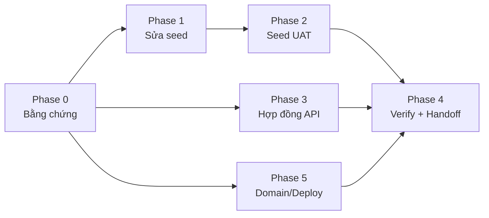

# Kế hoạch: Giải quyết "FE không thấy dữ liệu" (Nhân sự / Đơn hàng / Voucher) và lỗi domain

Nguồn: phản hồi FE + `docs/WEB2_BE_HANDOFF_Data_Order_Return_Voucher_26-10-2026.docx` + khảo sát code sau `git pull` (HEAD `2301140`).

---

## 0. Đính chính các điều tôi đã nói trước đó

> [!WARNING]
> Có hai điểm trong các lượt trước tôi đã nói chưa đủ chặt, cần sửa trước khi lập kế hoạch:
> 1. **Dữ liệu "vừa tạo" chỉ nằm trong test.** `tests/fixtures/orderE2EData.js` và `tests/order-e2e.test.js` dùng mock trong bộ nhớ. **Chưa có bản ghi nào được ghi vào MongoDB nào cả**, nên FE không thể thấy chúng. Cách nói "data thật" của tôi dễ gây hiểu nhầm.
> 2. **Domain `api.drpetshouse.lat` chưa được xác minh.** Tôi chép nó từ tài liệu handoff cũ vào `FE-GUIDE-ORDER-E2E-RETURN-REFUND.md`. Trong code BE, `drpetshouse.lat` chỉ xuất hiện như **origin được CORS cho phép của FE** (`config.js`, `app.js`), không có gì chứng minh nó là host của API. Nhận định "DNS chưa trỏ" ở lượt trước là suy đoán, chưa phải kết luận.

---

## 1. Chẩn đoán (phân biệt rõ: đã xác minh trong code vs. chưa xác minh)

### 1.1 Đã xác minh trong code

| # | Phát hiện | Bằng chứng | Hệ quả với FE |
|---|---|---|---|
| F1 | **Không có seed nào tạo Order, sản phẩm/tồn kho cho đơn, hay `SystemSetting` key `commerce`** | `fulfillmentBranchPriority` chỉ xuất hiện ở `order.service.js`; `src/seeds/` chỉ có `demoUsersSeed`, `serviceCatalogSeed`, `voucherSeed` | `GET /orders` luôn `[]` trên DB mới; checkout sẽ lỗi `FULFILLMENT_NOT_CONFIGURED` |
| F2 | `voucherSeed.js` (mới) cần chạy bằng `npm run seed:vouchers` trên đúng DB | script mới thêm ở commit `2301140`; server không tự seed (`server.js` chỉ connect + listen) | Có file seed ≠ DB đã có voucher |
| F3 | **Seed voucher không idempotent về quota**: dùng `updateOne({$set: vData})` với `usedCount: 0` | `voucherSeed.js` dòng ~149 | Chạy lại seed sẽ **xoá bộ đếm đã dùng** của voucher thật |
| F4 | Voucher `THUNHO20` (scope `PRODUCT`) **không có `scopeRefs`** | `voucherSeed.js` + logic `order.service.js` (lọc theo `scopeRefs`, rỗng ⇒ `SCOPE_MISMATCH`) | Mã này không bao giờ áp dụng được |
| F5 | `FREESHIP` thực chất là giảm tiền cố định 30.000đ trên đơn, **không phải miễn phí vận chuyển** | `voucherSeed.js` (FIXED, scope ORDER) | Tên gây hiểu nhầm cho FE/khách |
| F6 | `demoUsersSeed` gán Manager/Staff vào **ObjectId cứng** `60c72b2f9b1d8b2bad000001` | `demoUsersSeed.js` | Nếu `_id` thật của `BR-000001` trên Atlas khác, Manager/Staff bị scope vào chi nhánh không tồn tại ⇒ thấy 0 đơn/0 nhân sự |
| F7 | `demoUsersSeed` gọi `seedDemoUsers()` ngay khi import và `process.exit` | cuối file | Không gộp được vào một lệnh seed tổng |
| F8 | `GET /staff` chỉ liệt kê **StaffProfile**; ADMIN/MANAGER không có profile; DTO thiếu `staffCode`, `phone`, `email`, `accountStatus`; không có `totalCount` | `staff.service.js` `formatStaff`/`listStaff` | Màn Nhân sự thiếu cột FE cần, có thể trống dù đã có user |
| F9 | `GET /orders`: `nextCursor` luôn `null`, không `totalCount`, không lọc theo mã/ngày/tìm kiếm; **khi không có `actor` thì filter rỗng ⇒ trả toàn bộ đơn** | `order.service.js` `listOrders` | Hợp đồng không đạt ORDER-10; cần kiểm tra có lỗ hổng lộ dữ liệu cho request ẩn danh hay không (phụ thuộc OpenAPI security) |
| F10 | `formatOrder` thiếu `statusHistory`, `payment.method`, thông tin khách | `order.service.js` `formatOrder` | FE khó dựng màn chi tiết/quản trị |

### 1.2 Chưa xác minh (cần Phase 0)

- Service Render nào đang chạy commit nào; `MONGODB_URI` trỏ DB nào; hai URL (Render cũ vs. domain mới) có cùng DB không.
- Số lượng thực tế trong `users / staffprofiles / orders / vouchers / branches` trên DB đó.
- `api.drpetshouse.lat` có được cấu hình trong Render + DNS hay không.
- "Spam đăng nhập 15 phút": có thể là lỗi DNS/SSL, hoặc cold start của Render; **chưa có bằng chứng để chọn**.
- FE test nhánh `main` (chưa có màn Order/Voucher) hay nhánh `feature/admin-order-management-phase1`.

---

## 2. Phạm vi

**Trong kế hoạch này:** làm cho dữ liệu hiện ra đúng và có thể kiểm chứng (seed, sửa lỗi seed, hợp đồng list API, domain/deploy, báo cáo đối soát).

**Ngoài phạm vi (là tính năng mới, cần kế hoạch riêng) — sẽ báo FE trạng thái `NOT_SUPPORTED` trung thực:**
- `POST /admin/orders/quote`, `POST /admin/orders`, tra cứu khách theo SĐT, địa chỉ khách (ORDER-01…06).
- Trả hàng theo từng SKU với `acceptedQty / actualReceivedQty / restockQty / approvedQty` và nhập kho khi nhận hàng (RETURN-02…04, 06). Trong code tôi đã đọc, luồng hiện tại chỉ có `requestedQty` và **không** nhập kho khi trả.
- Hình thức "Nhận tại cửa hàng" (ORDER-09, cần chốt nghiệp vụ).

---

## 3. Kế hoạch triển khai

### Phase 0 — Thu thập bằng chứng (chỉ đọc, không sửa gì)
- [ ] **0.1** Bạn xác nhận từ Render dashboard: tên service, commit đang deploy, custom domain nào được gắn, biến `MONGODB_URI` trỏ cluster/DB nào (chỉ cần tên DB, không gửi secret). → Verify: ghi vào bảng đối soát.
- [ ] **0.2** Viết script **chỉ đọc** `scripts/inspectData.js` in số lượng `branches/users/staffprofiles/shifts/products/inventorystocks/vouchers/orders/orderreturns` + giá trị `commerce` setting + `_id` thật của 3 chi nhánh. → Verify: chạy trên DB đích, dán kết quả (không gồm secret).
- [ ] **0.3** `curl` đo `/health`, đăng nhập, `GET /staff|/orders|/vouchers` trên **cả hai URL**, ghi status + `correlationId`. → Verify: phân biệt `200 []` / `401` / `403` / DNS error / timeout.

### Phase 1 — Sửa lỗi seed hiện có (F3–F7)
- [ ] **1.1** `voucherSeed.js`: dùng `$set` cho trường mô tả và `$setOnInsert` cho `usedCount`; không bao giờ ghi đè `usedCount`. → Verify: test chạy seed 2 lần, `usedCount` giữ nguyên sau khi tăng thủ công.
- [ ] **1.2** `THUNHO20`: gán `scopeRefs` theo `_id` sản phẩm thú nhỏ (resolve theo SKU sau khi seed sản phẩm). → Verify: quote với cart thú nhỏ ra giảm giá, cart khác ra `SCOPE_MISMATCH`.
- [ ] **1.3** Đổi `FREESHIP` thành tên đúng nghĩa (hoặc thực sự giảm phí ship nếu BA muốn) — **cần bạn chốt** (xem câu hỏi Q4).
- [ ] **1.4** `demoUsersSeed.js`: resolve chi nhánh theo `code: 'BR-000001'` thay vì ObjectId cứng; tách hàm `seedDemoUsers()` khỏi side-effect khi import. → Verify: Manager/Staff có `assignedBranchIds` đúng `_id` thật.

### Phase 2 — Seed UAT idempotent (F1, F2)
- [ ] **2.1** `src/seeds/uatSeed.js` + script `npm run seed:uat`, có cờ `--dry-run` (in kế hoạch, không ghi). Thứ tự: branches → `commerce` setting (`fulfillmentBranchPriority` bằng `_id` thật) → 4 category → 4 sản phẩm đa loài + InventoryItem → InventoryStock theo chi nhánh → vouchers → staff profile.
- [ ] **2.2** Tạo **≥ 12 đơn qua chính service** (`checkoutCreateOrder` → `confirm/process/ship/mark-delivered/cancel`), **không insert thô**, để sổ kho/voucher/payment nhất quán; phủ các trạng thái `PENDING/CONFIRMED/PROCESSING/SHIPPED/COMPLETED/CANCELLED`, cả COD và ONLINE_MOCK, có đơn dùng voucher; kèm vài `OrderReturn` ở `REQUESTED/PROCESSING/RECEIVED/APPROVED/COMPLETED/REJECTED`.
- [ ] **2.3** Mọi bản ghi gắn marker `seedBatch: 'UAT-2026-10'` (hoặc tiền tố mã) để tìm/dọn được; chạy lại không nhân đôi. → Verify: chạy 2 lần, đếm không đổi; tồn kho khớp tổng ISSUE/RECEIPT.
- [ ] **2.4** `npm run seed:verify` in bảng đếm theo role và chi nhánh (dùng cho báo cáo DATA-02).

### Phase 3 — Sửa hợp đồng API (F8–F10)
- [ ] **3.1** `listOrders`: thêm `totalCount`, `nextCursor` thật, lọc `code`, `status`, `from/to`, `branchId`, tìm khách; **chặn truy cập khi không có actor** (kèm test ẩn danh ⇒ 401/403, không phải mảng đơn).
- [ ] **3.2** `formatOrder`: thêm `statusHistory`, `payment.method`, `createdAt/updatedAt`.
- [ ] **3.3** `formatStaff`: thêm `phone/email/accountStatus` (theo quyền) và `totalCount`; xem xét liệt kê cả MANAGER.
- [ ] **3.4** Đối chiếu **OpenAPI v7**: app đang `validateResponses` ngoài production, nên mọi trường mới phải khai báo trong `07-openapi-v7.yaml` (xem rủi ro R2).
- [ ] **3.5** `GET /vouchers`: kiểm tra shape/`totalCount` so với yêu cầu VOUCHER-02, bổ sung nếu thiếu.

### Phase 4 — Verify và bàn giao FE
- [ ] **4.1** Test Jest cho: idempotency seed, `usedCount` bất biến, `scopeRefs`, `listOrders` scope theo role (Admin/Manager/Staff/Customer/ẩn danh), shape staff/order/voucher. → Verify: `npm test` toàn bộ xanh + `npm run build`.
- [ ] **4.2** Smoke test sống bằng `curl`/script theo 5 vai (Admin, Manager, Receptionist, Customer, Guest) trên URL đã chốt, đối chiếu **TC01–TC12** trong docx; lưu kết quả từng TC.
- [ ] **4.3** Trả lời FE theo mẫu docx mục 10: base URL chính thức, git SHA, DB, số lượng seed, JSON mẫu đã ẩn danh, bảng trạng thái `DATA/STAFF/ORDER/RETURN/VOUCHER/INV` = `DONE / IN_PROGRESS / NOT_SUPPORTED / BLOCKED`.
- [ ] **4.4** Sửa `FE-GUIDE-ORDER-E2E-RETURN-REFUND.md`: gỡ domain chưa xác minh, ghi rõ URL đã kiểm chứng, nêu cold start (nếu đúng), thêm hướng dẫn phân biệt `200 []` với lỗi.

### Phase 5 — Domain / Deploy (phần lớn cần thao tác của bạn)
- [ ] **5.1** Bạn kiểm tra bản ghi DNS của `api.drpetshouse.lat` (CNAME tới `*.onrender.com`) và trạng thái chứng chỉ trong Render → Custom Domains. Tôi **không truy cập được** DNS/Render từ đây.
- [ ] **5.2** Chốt **một** base URL canonical; nếu domain mới chưa sẵn sàng thì FE dùng URL Render cho đến khi `curl https://api.drpetshouse.lat/health` trả 200.
- [ ] **5.3** (Tuỳ chọn, thay đổi nhỏ) `/health` trả thêm `gitSha` (từ `RENDER_GIT_COMMIT`) và tên DB (không lộ secret) để đối soát DATA-01 không cần đoán.

---

## 4. Câu hỏi mở (ảnh hưởng trực tiếp kế hoạch)

> [!IMPORTANT]
> **Q1 — DB đích để seed.** Seed ghi vào DB Atlas mà Render đang dùng. Bạn muốn: (a) seed thẳng vào DB đó có marker + dry-run trước *(đề xuất, vì đây là môi trường demo)*, hay (b) tạo DB staging riêng cho FE?
>
> **Q2 — Phạm vi.** Đồng ý tách *tạo đơn Admin / trả hàng theo SKU / nhận tại cửa hàng* sang kế hoạch riêng và báo FE `NOT_SUPPORTED` lúc này không?
>
> **Q3 — Truy cập.** Bạn có thể cung cấp kết quả từ Render dashboard (Phase 0.1) và chạy `inspectData.js` với `MONGODB_URI` của bạn (tôi không cần xem secret) không?
>
> **Q4 — `FREESHIP`.** Giữ là giảm 30.000đ tên lại cho đúng, hay làm thật "miễn phí vận chuyển"?

---

## 5. Rủi ro

| Mã | Rủi ro | Giảm thiểu |
|---|---|---|
| R1 | Seed ghi vào DB dùng chung | `--dry-run` trước, marker `seedBatch`, không `deleteMany`, bạn duyệt trước khi chạy thật |
| R2 | Thêm trường DTO bị `validateResponses` chặn (OpenAPI `additionalProperties: false`) | Sửa spec v7 cùng lúc; test response-validation; nếu bạn không muốn sửa spec thì dừng ở 3.1–3.2 |
| R3 | Tạo đơn qua service cần MongoDB transaction (replica set) | Atlas hỗ trợ; Phase 0 xác nhận topology |
| R4 | Sửa `listOrders` làm vỡ FE đang dùng | Giữ nguyên field cũ, chỉ thêm; không đổi `items/nextCursor` |
| R5 | Nguyên nhân thật nằm ngoài code (DB sai, FE sai nhánh) | Phase 0 chạy trước; chưa sửa code nếu bằng chứng chỉ ra vấn đề cấu hình |

---

## 6. Tiêu chí hoàn thành

- [ ] Có bảng đối soát: URL chính thức ↔ commit ↔ DB ↔ số lượng bản ghi, dựa trên kết quả thực tế.
- [ ] Admin gọi `GET /staff`, `/orders`, `/vouchers` trên URL chính thức trả `200` với dữ liệu UAT; Manager/Staff chỉ thấy phạm vi của mình; ẩn danh không đọc được đơn.
- [ ] Chạy `seed:uat` hai lần: số lượng không đổi, `usedCount` và tồn kho không bị ghi đè.
- [ ] `npm test` xanh toàn bộ, `npm run build` thành công.
- [ ] Phản hồi FE nêu rõ mục nào `DONE` và mục nào `NOT_SUPPORTED`, không gộp chung.
