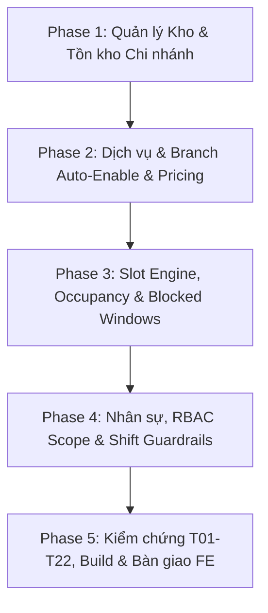

# KẾ HOẠCH TRIỂN KHAI TOÀN DIỆN: GIẢI QUYẾT BÀN GIAO FE 22/10 & TASK 3.14 KHO HÀNG

> **Mục tiêu tối thượng:** Giải quyết triệt để 100% các khó khăn, đề xuất và bất cập kỹ thuật được phía Frontend (FE) nêu trong 2 tài liệu bàn giao (`Yeu_cau_BE_3.14.docx` và `WEB2_Ban_giao_Backend_Sau_FE_22-10-2026.docx`). Chuẩn hóa DTO, tăng tính nguyên tử (Atomic Transactions), bổ sung các endpoint occupancy/blocked windows/staff/inventory-summary, và bảo đảm quá trình ghép nối API giữa FE và BE đạt độ tin cậy và mượt mà tuyệt đối.
>
> **Phiên bản kế hoạch:** v2.0 (Chi tiết hóa từng schema, DTO, mã lỗi RFC 9457, test cases T01–T22 và 14 kịch bản nghiệm thu kho hàng).

---

## 🧠 PHẦN I: BRAINSTORMING & QUYẾT ĐỊNH KIẾN TRÚC (SOCRATIC GATE)

Dưới đây là 5 quyết định kiến trúc cốt lõi nhằm giải quyết triệt để các khúc mắc giữa FE và BE:

### Quyết định 1: Mở rộng `GET /availability` hay Tạo Endpoint Occupancy riêng? *(BE-01 & BE-06)*
- **Bối cảnh:** FE cần hiển thị tỷ lệ lấp đầy khung giờ (ví dụ `2/3`, `3/3` khi FULL) cho Admin/Manager và lịch hoạt động chi nhánh. Hiện tại `GET /availability` chỉ trả `remaining` và tự động ẩn đi các slot đã kín chỗ, dẫn đến FE không thể hiển thị slot đỏ/đầy trên bảng điều khiển.
- **Lựa chọn A (Khuyến nghị - Recommended):** **Mở rộng trực tiếp `GET /api/v1/availability` kèm Alias Route RESTful**.
  - Đối với Khách hàng (Customer / Guest): Tiếp tục trả danh sách slot khả dụng (`remaining > 0`, `status: "AVAILABLE"`), giữ nguyên trải nghiệm đặt lịch mượt mà.
  - Khi có query `includeFull=true` hoặc request mang token `ADMIN` / `MANAGER`: Trả về toàn bộ candidate slots bao gồm cả `FULL` và `BLOCKED`, kèm đầy đủ các chỉ số:
    - `bookedCount`: Số segment đang chạy/xác nhận tại khung giờ đó.
    - `heldCount`: Số segment đang giữ chỗ tạm thời (holds chưa hết hạn).
    - `occupiedCount`: `bookedCount + heldCount`.
    - `totalCount`: Sức chứa thực tế khả dụng $\min(\text{capacity}, \text{activeStaffOnShift})$.
    - `remaining`: $\max(\text{totalCount} - \text{occupiedCount}, 0)$.
    - `status`: Enum `'AVAILABLE' | 'FULL' | 'BLOCKED'`.
    - `timezone`: `'Asia/Ho_Chi_Minh'` (ISO-8601 UTC timestamp `startAt`/`endAt` kèm `startLocal`/`endLocal` dạng "HH:mm").
  - Đồng thời bổ sung alias endpoint:
    - `GET /api/v1/branches/:branchId/services/:serviceId/occupancy?date=YYYY-MM-DD`
    - `GET /api/v1/branches/:branchId/operation-slots?date=YYYY-MM-DD` (tổng hợp khung giờ toàn chi nhánh)
  - *Ưu điểm:* 1 engine tính toán duy nhất, đảm bảo tính nhất quán (Single Source of Truth), không bao giờ có độ lệch số liệu giữa các màn hình.

---

### Quyết định 2: Tự động Bật Chi nhánh khi Tạo Dịch vụ (`POST /services`) *(BE-04)*
- **Bối cảnh:** FE đang phải gọi 1 request tạo Service Master rồi lặp N requests `PUT /branches/:id/service-configs` để bật dịch vụ tại từng chi nhánh. Khi mạng chập chờn, dịch vụ bị rơi vào trạng thái "nửa vời" (chỉ bật được 1 vài chi nhánh, các chi nhánh khác không tải được).
- **Lựa chọn A (Khuyến nghị - Recommended):** **Tạo Master + Cấu hình Chi nhánh Nguyên tử trong 1 MongoDB Transaction**.
  - `POST /api/v1/services` nhận thêm payload:
    ```json
    {
      "name": "Tắm & Sấy khô",
      "serviceType": "GROOMING",
      "bookingMode": "BOOKABLE",
      "requiredStaffRole": "CARE_STAFF_GROOMER",
      "durationMinutes": 60,
      "basePrice": 150000,
      "status": "ACTIVE",
      "autoEnableActiveBranches": true,
      "branchConfigs": [
        { "branchId": "branch-q1-id", "enabled": true, "capacity": 3 },
        { "branchId": "branch-q3-id", "enabled": false, "capacity": 1 }
      ]
    }
    ```
  - Trong transaction:
    1. Tạo bản ghi `Service`.
    2. Nếu `autoEnableActiveBranches === true`: Lấy danh sách tất cả các chi nhánh có `status: 'ACTIVE'`.
    3. Tạo bản ghi `BranchServiceConfig` cho từng chi nhánh với `capacity: 1`, `enabled: true`.
    4. Áp dụng đè (override) các chi nhánh được chỉ định trong `branchConfigs`.
    5. Cập nhật `enabledBranchCount` trên Service Master.
  - Khi cập nhật Service (`PATCH /api/v1/services/:id`): Tuyệt đối KHÔNG tự ý bật lại các chi nhánh mà quản trị viên đã chủ động tắt (`enabled: false`).
  - Cung cấp thêm `GET /api/v1/services/:serviceId/branch-configs` để FE lấy toàn bộ cấu hình chi nhánh trong 1 request duy nhất (loại bỏ bài toán N+1).

---

### Quyết định 3: Thiết kế Cơ chế Tạm Khóa Dịch vụ (Blocked Windows) *(BE-03)*
- **Bối cảnh:** Cần khóa một dịch vụ tại 1 chi nhánh trong một khoảng thời gian cụ thể (ví dụ: bảo trì phòng phẫu thuật từ 13:00 đến 15:00 ngày 24/10/2026) mà không làm ảnh hưởng các dịch vụ khác hoặc các ngày khác trong tuần.
- **Lựa chọn A (Khuyến nghị - Recommended):** **Mở rộng Subdocument `blockedWindows` trong `BranchServiceConfig`**.
  - Subdocument Schema:
    ```javascript
    blockedWindows: [{
      _id: { type: mongoose.Schema.Types.ObjectId, auto: true },
      startAt: { type: Date, required: true },
      endAt: { type: Date, required: true },
      reason: { type: String, trim: true, default: 'Tạm ngưng phục vụ' },
      createdBy: { type: mongoose.Schema.Types.ObjectId, ref: 'User' },
      createdAt: { type: Date, default: Date.now }
    }]
    ```
  - Bộ RESTful API:
    - `GET /api/v1/branches/:branchId/service-configs/:serviceId/blocks`
    - `POST /api/v1/branches/:branchId/service-configs/:serviceId/blocks`
    - `DELETE /api/v1/branches/:branchId/service-configs/:serviceId/blocks/:blockId`
  - Logic ràng buộc (Conflict Prevention):
    - Validate `startAt < endAt`.
    - Kiểm tra xem trong khoảng `[startAt, endAt)` có Appointment nào ở trạng thái `CONFIRMED` hoặc `IN_PROGRESS` của dịch vụ này tại chi nhánh hay không.
    - Nếu có: Ném lỗi `409 Conflict` kèm danh sách `affectedAppointmentIds` để nhân viên điều phối xử lý trước, không cho phép khóa đè làm mất lịch của khách.
  - Tích hợp Engine: Thuật toán availability kiểm tra `max(segmentStart, blockStart) < min(segmentEnd, blockEnd)`. Nếu giao cắt $\to$ loại bỏ slot.

---

### Quyết định 4: Báo giá & Cân nặng Dịch vụ (Fixed vs Quote) *(BE-09)*
- **Bối cảnh:** Các dịch vụ spa/thú y có phân loại giá theo cân nặng (XS, S, M, L, XL). Nhiều dịch vụ đặc thù yêu cầu "Liên hệ báo giá" (Quote). Schema BE hiện tại ép `price` bắt buộc là Number, khiến FE phải gửi `0`, dẫn đến giao diện hiển thị 0đ (miễn phí) gây hiểu lầm.
- **Lựa chọn A (Khuyến nghị - Recommended):**
  - Mở rộng schema `priceVariants`:
    ```javascript
    {
      tier: { type: String, trim: true }, // 'XS', 'S', 'M', 'L', 'XL'
      label: { type: String, required: true },
      mode: { type: String, enum: ['FIXED', 'QUOTE'], default: 'FIXED' },
      price: {
        type: Number,
        required: function() { return this.mode === 'FIXED'; },
        min: 0,
        default: null
      },
      minWeightKg: { type: Number, min: 0 },
      maxWeightKg: { type: Number, min: 0 }
    }
    ```
  - Khi `mode === 'QUOTE'`: `price = null`. Serializer trả về `price: null, mode: "QUOTE"`. FE hiển thị an toàn nhãn "Liên hệ báo giá".

---

### Quyết định 5: Quản lý Kho Hàng Nguyên Tử & Phân biệt Ngưỡng Tồn *(Task 3.14 & BE-08)*
- **Bối cảnh:**
  1. FE không phân biệt được ngưỡng cảnh báo bằng 0 (người dùng cố ý cài) với trạng thái chưa từng cài đặt ngưỡng.
  2. FE phải gọi 2 requests riêng biệt: Cài ngưỡng $\to$ Nhập/Chuyển hàng. Nếu rớt mạng ở request 2 thì dữ liệu bị phân mảnh.
  3. Lịch sử kho thiếu tên chi nhánh, tuyến chuyển `Q1 -> Q3`, tên người thao tác (hiển thị `—`).
  4. Thiếu thông tin Product Master/biến thể trong API kho.
- **Lựa chọn A (Khuyến nghị - Recommended):**
  - Thêm trường `thresholdConfigured: { type: Boolean, default: false }` vào `InventoryStock`. Khi người dùng chủ động cài đặt (kể cả đặt bằng 0), gán `thresholdConfigured = true`.
  - Hỗ trợ cài ngưỡng nguyên tử trong cùng request `POST /inventory/receive` (`lowStockThreshold`) và `POST /inventory/transfer` (`destinationLowStockThreshold`).
  - Snapshot thông tin: `branchName`, `branchCode`, `actorName`, `actorRole`, `isSystemActor` trực tiếp vào `InventoryTransaction` để lịch sử bất biến và hiển thị tức thì.
  - Lưu tuyến chuyển kho: `transferId`, `fromBranchId`, `toBranchId`, `fromBranchName`, `toBranchName`, `transferLeg: 'OUT'|'IN'`.
  - Populate đầy đủ Product Master: `productId`, `productName`, `productType: 'SIMPLE'|'VARIANT'`, `variantId`, `variantName`.
  - Bổ sung `GET /api/v1/branches/:branchId/inventory-summary` (`{ totalItems, lowStockItems, outOfStockItems }`).

---

## 📋 PHẦN II: KẾ HOẠCH TRIỂN KHAI THEO TỪNG MODULE (TASK BREAKDOWN)



---

### GIAI ĐOẠN 1: QUẢN LÝ KHO HÀNG & TỒN KHO CHI NHÁNH (TASK 3.14 & BE-08)

#### Task 1.1: Chuẩn hóa Schema & DTO Lịch sử Giao dịch Kho *(Task 3.14: BE-01, BE-02, BE-06)*
- **Tập tin sửa đổi:**
  - `src/modules/inventory/models/InventoryTransaction.js`
  - `src/modules/inventory/inventory.service.js`
- **Nội dung thực hiện:**
  - Bổ sung các trường vào `InventoryTransactionSchema`:
    - `branchName`: String, `branchCode`: String.
    - `actorName`: String, `actorRole`: String, `isSystemActor`: { type: Boolean, default: false }.
    - `transferId`: String, `fromBranchId`: ObjectId, `toBranchId`: ObjectId, `fromBranchName`: String, `toBranchName`: String, `transferLeg`: { type: String, enum: ['OUT', 'IN', null] }.
  - Cập nhật hàm ghi nhận transaction: Khi tạo transaction, tự động truy vấn snapshot tên chi nhánh và thông tin tài khoản người thực hiện (nếu `actorId` không có $\to$ `isSystemActor = true`, `actorName = "Hệ thống"`).
- **Tiêu chí hoàn thành (Verification):**
  - Gọi `GET /api/v1/inventory/transactions`: Response có đầy đủ `branchName`, `branchCode`, `actorName`, `actorRole`, tuyến `fromBranchName -> toBranchName`. Không còn xuất hiện `—` hay "Chi nhánh chưa xác định".

#### Task 1.2: Phân biệt Ngưỡng Chưa Cài & Cài Ngưỡng Nguyên Tử *(Task 3.14: BE-03, BE-04)*
- **Tập tin sửa đổi:**
  - `src/modules/inventory/models/InventoryStock.js`
  - `src/modules/inventory/inventory.service.js`
  - `src/modules/inventory/inventory.controller.js`
- **Nội dung thực hiện:**
  - Thêm `thresholdConfigured: { type: Boolean, default: false }` vào `InventoryStockSchema`.
  - Cập nhật API `PUT /inventory/stocks/:branchId/:inventoryItemId/threshold`: Lưu `lowStockThreshold` đồng thời đặt `thresholdConfigured = true`.
  - Cập nhật API `POST /inventory/receive`: Nhận thêm trường tùy chọn `lowStockThreshold`. Trong MongoDB session: Tăng `quantity`, nếu có `lowStockThreshold` thì cập nhật luôn `lowStockThreshold` và gán `thresholdConfigured = true`.
  - Cập nhật API `POST /inventory/transfer`: Nhận thêm trường tùy chọn `destinationLowStockThreshold`. Trong transaction: Trừ hàng nguồn, cộng hàng đích, cập nhật ngưỡng đích và gán `thresholdConfigured = true` nếu có truyền.
- **Tiêu chí hoàn thành (Verification):**
  - Nhập hàng kèm ngưỡng $\to$ Tồn kho tăng và `thresholdConfigured: true`. Thất bại 1 bước $\to$ Rollback toàn bộ transaction.

#### Task 1.3: Đồng nhất Product Master & Lọc Server-Side, Summary *(Task 3.14: BE-05, BE-07, BE-08)*
- **Tập tin sửa đổi:**
  - `src/modules/inventory/inventory.service.js`
  - `src/modules/inventory/inventory.controller.js`
  - `src/modules/inventory/inventory.routes.js`
  - `src/modules/branch/branch.routes.js`
- **Nội dung thực hiện:**
  - `GET /inventory/items`: Populate thông tin Product Master: `productId`, `productName`, `productType: 'SIMPLE'|'VARIANT'`, `variantId`, `variantName`.
  - `GET /inventory/transactions`: Bổ sung bộ lọc query: `fromDate`, `toDate`, `branchId`, `transactionType`, `inventoryItemId`, `search`.
  - Tạo mới endpoint: `GET /api/v1/branches/:branchId/inventory-summary`:
    - Tính toán: `totalItems` (số SKU tại branch), `lowStockItems` ($0 < \text{quantity} \le \text{threshold}$ với `thresholdConfigured = true`), `outOfStockItems` ($\text{quantity} = 0$).
- **Tiêu chí hoàn thành (Verification):**
  - Chạy test case kiểm tra summary và lọc lịch sử theo khoảng thời gian.

---

### GIAI ĐOẠN 2: DỊCH VỤ, BẬT CHI NHÁNH & PRICING THEO CÂN NẶNG (BE-04, BE-09)

#### Task 2.1: Tạo Dịch vụ Kèm Bật Chi nhánh Mặc định Nguyên tử *(BE-04)*
- **Tập tin sửa đổi:**
  - `src/modules/catalog/models/Service.js`
  - `src/modules/catalog/serviceCatalog.service.js`
  - `src/modules/catalog/catalog.controller.js`
  - `src/modules/catalog/catalog.routes.js`
- **Nội dung thực hiện:**
  - Mở rộng hàm `createService`: Nhận `autoEnableActiveBranches` (Boolean, default: true) và `branchConfigs` (Array).
  - Sử dụng MongoDB transaction:
    - Tạo `Service`.
    - Tìm tất cả `Branch` có `status === 'ACTIVE'`.
    - Tạo danh sách `BranchServiceConfig` mặc định (`enabled: true, capacity: 1`).
    - Ghi đè các config từ `branchConfigs` nếu người dùng chỉ định cụ thể.
    - Cập nhật `enabledBranchCount` trên Service.
  - Bổ sung endpoint: `GET /api/v1/services/:serviceId/branch-configs` trả về danh sách cấu hình chi nhánh của dịch vụ kèm tên chi nhánh.
- **Tiêu chí hoàn thành (Verification):**
  - Tạo service mới với 3 branch ACTIVE $\to$ Nhận về `enabledBranchCount: 3` và 3 bản ghi config được tạo ngay lập tức.

#### Task 2.2: Chuẩn hóa Định giá Phân cấp (Fixed vs Quote) *(BE-09)*
- **Tập tin sửa đổi:**
  - `src/modules/catalog/models/Service.js`
  - `src/modules/catalog/serviceCatalog.service.js`
- **Nội dung thực hiện:**
  - Cập nhật `priceVariantSchema`: Thêm `tier` (String), `mode` (`'FIXED' | 'QUOTE'`). Cho phép `price` nhận giá trị `null` khi `mode === 'QUOTE'`.
  - Cập nhật serializer `formatServiceResponse`: Giữ nguyên `mode` và `price: null`, không tự động ép về 0đ.
- **Tiêu chí hoàn thành (Verification):**
  - Tạo dịch vụ có tier XS `mode: 'QUOTE', price: null` và L `mode: 'FIXED', price: 200000` $\to$ Lưu và đọc ra đúng giá trị.

---

### GIAI ĐOẠN 3: SLOT ENGINE, TỶ LỆ LẤP ĐẦY & TẠM KHÓA DỊCH VỤ (BE-01, BE-02, BE-03, BE-06)

#### Task 3.1: Subdocument Blocked Windows & Bộ CRUD API *(BE-03)*
- **Tập tin sửa đổi:**
  - `src/modules/branch/models/BranchServiceConfig.js`
  - `src/modules/branch/branchServiceConfig.service.js`
  - `src/modules/branch/branch.routes.js`
- **Nội dung thực hiện:**
  - Thêm schema `blockedWindows` vào `BranchServiceConfig.js`.
  - Viết các hàm service: `listBlockedWindows`, `createBlockedWindow`, `deleteBlockedWindow`.
  - Ràng buộc: Validate `startAt < endAt`. Truy vấn kiểm tra nếu có Appointment `CONFIRMED` hoặc `IN_PROGRESS` của dịch vụ này tại chi nhánh trong khung giờ $\to$ Ném `409 Conflict` kèm `affectedAppointmentIds`.
- **Tiêu chí hoàn thành (Verification):**
  - Tạo blocked window thành công; chặn tạo khi có appointment trùng giờ; xóa blocked window thành công.

#### Task 3.2: Tỷ lệ Lấp Đầy Slot & Tích hợp Blocked Windows vào Engine *(BE-01, BE-02, BE-06)*
- **Tập tin sửa đổi:**
  - `src/modules/booking/availability.service.js`
  - `src/modules/booking/availability.routes.js`
  - `src/modules/branch/branch.routes.js`
- **Nội dung thực hiện:**
  - Trong `availability.service.js`:
    - Tính toán `bookedCount`, `heldCount`, `occupiedCount = bookedCount + heldCount`.
    - Tính `totalCount = Math.min(config.capacity, qualifiedActiveStaffCount)`.
    - Tính `remaining = Math.max(0, totalCount - occupiedCount)`.
    - Xác định `status = (blocked ? 'BLOCKED' : (remaining > 0 ? 'AVAILABLE' : 'FULL'))`.
    - Tích hợp kiểm tra `blockedWindows`: Nếu candidate slot giao cắt $\to$ Đánh dấu `status = 'BLOCKED'`.
    - Khi có query `includeFull=true` hoặc token là nội bộ: Trả về toàn bộ các slot (kể cả `FULL` và `BLOCKED`).
  - Thêm endpoint `GET /api/v1/branches/:branchId/operation-slots?date=YYYY-MM-DD` tổng hợp lịch hoạt động trong ngày của chi nhánh.
- **Tiêu chí hoàn thành (Verification):**
  - Slot kín chỗ hiển thị tỷ lệ `3/3` với status `FULL` khi gọi với `includeFull=true`.

---

### GIAI ĐOẠN 4: NHÂN SỰ, TÀI KHOẢN & KHÓA CHẶT CA LÀM VIỆC (BE-05, BE-10)

#### Task 4.1: Hoàn thiện RESTful Staff API & Tạo Tài khoản Nguyên Tử *(BE-05)*
- **Tập tin sửa đổi:**
  - `src/modules/staff/staff.service.js`
  - `src/modules/staff/staff.controller.js`
  - `src/modules/staff/staff.routes.js`
- **Nội dung thực hiện:**
  - `GET /api/v1/staff`: Hỗ trợ phân trang, tìm kiếm theo tên/phone, lọc theo role, branch, status.
  - `GET /api/v1/staff/:id`: Trả chi tiết gồm `staffCode`, `userId`, `staffSubRole`, `accountStatus`, `profileStatus`, `authorizedBranchIds`, `homeBranchId`.
  - `POST /api/v1/staff`: Tạo nguyên tử 1 User (`systemRole: 'STAFF'`) + 1 StaffProfile trong 1 transaction; hash mật khẩu; sinh `staffCode` tự động (`NV-xxxxxx`).
  - `PATCH /api/v1/staff/:id` và `PUT /api/v1/staff/:id/branches`: Cập nhật thông tin và danh sách chi nhánh được phân công.
- **Tiêu chí hoàn thành (Verification):**
  - Tạo staff tạo thành công cả User và Profile; manager ngoài chi nhánh bị chặn `403 Forbidden`.

#### Task 4.2: Khóa Chặt Ca Làm Việc & Bảo vệ Lịch Hẹn Đã Đặt *(BE-05, BE-10)*
- **Tập tin sửa đổi:**
  - `src/modules/staff/shift.service.js`
- **Nội dung thực hiện:**
  - Trong `cancelShift` và `updateShift`: Kiểm tra xem nhân viên có lịch hẹn nào ở trạng thái `CONFIRMED` hoặc `IN_PROGRESS` trong khung giờ của ca làm việc hay không.
  - Nếu có: Ném lỗi `409 Conflict` (`CONFLICT`), trả về `affectedAppointmentIds`. Cấm tuyệt đối việc âm thầm hủy ca làm mất nhân sự phục vụ lịch hẹn của khách.
- **Tiêu chí hoàn thành (Verification):**
  - Hủy ca có lịch hẹn CONFIRMED $\to$ Nhận lỗi 409 Conflict; hủy ca trống $\to$ Thành công.

---

### GIAI ĐOẠN 5: KIỂM CHỨNG TOÀN DIỆN (T01 $\to$ T22), BUILD & BÀN GIAO FE (BE-00, BE-11)

#### Task 5.1: Thực thi Toàn Bộ Test Suite Tự Động
- Chạy toàn bộ test suites hiện có và các test mới:
  ```bash
  npm test -- --runInBand
  ```
- Kiểm tra tính tương thích biên dịch:
  ```bash
  npm run build
  ```

#### Task 5.2: Bàn Giao Handoff Kỹ Thuật Đầy Đủ
- Tạo tài liệu bàn giao chính thức: `docs/FE-HANDOFF-WEB2-RESOLUTIONS.md` với đầy đủ:
  - Bảng đối soát 12 mã công việc BE-00 $\to$ BE-11 và 8 mã Task 3.14.
  - Contract OpenAPI mẫu, URL test, credentials UAT.
  - Hướng dẫn chi tiết cho FE.

---

## 🧪 PHẦN III: MA TRẬN 22 KỊCH BẢN NGHIỆM THU (T01 $\to$ T22) & 14 KỊCH BẢN KHO

### Ma trận 22 Kịch bản Bàn giao Kỹ thuật (T01 $\to$ T22)

| Mã | Tình huống kiểm thử | Hành động & Dữ liệu đầu vào | Kết quả mong đợi (Expected Output) |
|---|---|---|---|
| **T01** | Quản trị Chi nhánh | ADMIN CRUD chi nhánh, reload trang | 200/201, dữ liệu bền vững, không mất trường |
| **T02** | Phân quyền Manager | MANAGER gọi API branch/staff/kho ngoài `assignedBranchIds` | 403 Forbidden, không lộ dữ liệu chi nhánh khác |
| **T03** | Auto-enable Branch | Tạo Service ACTIVE khi hệ thống có 3 branch ACTIVE | Tự sinh 3 configs mặc định capacity=1 |
| **T04** | Bảo lưu cấu hình tắt | Tắt thủ công 1 branch, sau đó sửa Service Master | Không tự ý bật lại branch đã tắt |
| **T05** | Tính nguyên tử Service | Lỗi mạng giữa chừng khi tạo service + config | Rollback toàn bộ transaction, không để lại rác |
| **T06** | Khống chế Capacity | Capacity = 2, 2 slot overlap, đặt thêm slot thứ 3 | Slot thứ 3 bị từ chối (409 hoặc no slot) |
| **T07** | Ràng buộc Nhân sự | Capacity = 5 nhưng chỉ có 1 nhân viên rảnh | `totalCount = 1`, không báo 5 chỗ |
| **T08** | Chuỗi Multi-service | Chain A $\to$ B, dịch vụ B thiếu staff hoặc bị block | Toàn chuỗi A $\to$ B không có slot |
| **T09** | Hold hết hạn | Giữ chỗ tạm thời (Hold) hết hạn 15 phút | Tự động giải phóng chỗ, remaining tăng lại |
| **T10** | Tỷ lệ Lấp đầy Slot | Khung giờ có 2 đã đặt, 1 còn trống | Trả `bookedCount: 2, totalCount: 3` (tỷ lệ 2/3) |
| **T11** | Slot Kín Chỗ (FULL) | Khung giờ đã kín 3/3 chỗ | Admin vẫn thấy slot với `status: 'FULL'` |
| **T12** | Timezone Việt Nam | Kiểm tra slot 07:00 và 10:00 sáng | Không bị lệch 7 tiếng so với giờ UTC |
| **T13** | Blocked Window | Khóa dịch vụ A 13:00–15:00 tại Q1 | Dịch vụ A mất slot, dịch vụ B cùng branch vẫn mở |
| **T14** | Gỡ Blocked Window | Gỡ khóa dịch vụ A khi không có ca trực của staff | Không tự sinh slot giả khi thiếu staff |
| **T15** | Bảo vệ Ca làm việc | Hủy ca làm của nhân viên đang có lịch CONFIRMED | 409 Conflict kèm `appointmentIds`, cấm hủy ngầm |
| **T16** | Scope Ca làm việc | MANAGER xem/sửa ca của staff ngoài chi nhánh | 403 Forbidden |
| **T17** | Nguyên tử Staff | Tạo Staff mới | Tạo đồng thời User và Profile; rollback nếu lỗi |
| **T18** | Service Pricing Tier | Cùng dịch vụ: XS là QUOTE, L là FIXED 200k | Lưu đúng `mode: 'QUOTE'`, không bị ép thành 0đ |
| **T19** | Phân loại Tồn kho | Tồn kho 0, 3, 10 với threshold = 5 | Phân định rạch ròi: Out (0), Low (3), Normal (10) |
| **T20** | Operation Slots | GET lịch hoạt động toàn chi nhánh | Tổng khung giờ chính xác, không double count |
| **T21** | Auth Token Lifecycle | Refresh token, thu hồi token khi tài khoản bị khóa | Token hết hạn refresh được; tài khoản khóa bị chặn |
| **T22** | Restore Sản phẩm | Khôi phục sản phẩm đã lưu trữ (archive $\to$ restore) | 200 OK, trạng thái cập nhật đúng sau reload |

---

### Ma trận 14 Kịch bản Nghiệm thu Kho hàng (Task 3.14)

| STT | Kịch bản kiểm thử | Kết quả mong đợi |
|---|---|---|
| **1** | Một SKU có mặt ở cả Q1 và Q3 | Tồn kho và ngưỡng cảnh báo độc lập giữa 2 chi nhánh |
| **2** | Nhập SKU vào chi nhánh chưa có tồn kho | Tồn ban đầu = 0; nhận ngưỡng hợp lệ |
| **3** | Cài đặt ngưỡng cảnh báo bằng 0 | `thresholdConfigured = true`, phân biệt với chưa cài đặt |
| **4** | Chuyển kho Q1 $\to$ Q3 | Tồn 2 bên cập nhật chính xác trong 1 transaction nguyên tử |
| **5** | Chuyển kho đến chi nhánh chưa cài ngưỡng | Cho phép cài luôn ngưỡng đích trong cùng request chuyển kho |
| **6** | Xuất kho vượt quá số lượng tồn | BE từ chối (400/422), số tồn không thay đổi |
| **7** | Hai người đồng thời điều chỉnh tồn cùng SKU | Kiểm soát đồng thời bằng `version`, không sai lệch số tồn |
| **8** | Manager thao tác kho ngoài chi nhánh phụ trách | BE từ chối (403 Forbidden) |
| **9** | Xem lịch sử nhập/xuất/chuyển kho | Đầy đủ tên chi nhánh, tên người thao tác, tuyến chuyển |
| **10** | Gửi lại request cùng Idempotency-Key | Trả về kết quả cũ, không tạo giao dịch kho trùng |
| **11** | Sản phẩm có nhiều biến thể | Hiển thị đúng tên sản phẩm, tên biến thể và SKU |
| **12** | Sản phẩm không có biến thể (SIMPLE) | Hiển thị nhãn biến thể `-` |
| **13** | Lọc lịch sử theo ngày và loại giao dịch | Phân trang và kết quả lọc chính xác ở phía server |
| **14** | Hoàn/hủy đơn hàng hoặc tiêu hao vật tư | Tồn kho và lịch sử cập nhật đúng nghiệp vụ |

---

## 💬 PHẦN IV: GIẢI ĐÁP CHÍNH THỨC 10 CÂU HỎI TỪ FRONTEND

1. **Backend Render dùng repo/branch/commit nào?**
   - **Trả lời:** Backend sử dụng repository chính thức nhánh `feat/foundation-v6`, chạy trên Node.js v20 + MongoDB Mongoose DTO v7. Mọi API tuân thủ chuẩn REST JSON và RFC 9457 Problem Details.
2. **`GET /availability` sẽ mở rộng cùng endpoint hay dùng occupancy endpoint riêng?**
   - **Trả lời:** Mở rộng trực tiếp `GET /api/v1/availability` khi có `includeFull=true` hoặc token nội bộ, trả `bookedCount`, `totalCount`, `heldCount`, `status: 'FULL'`. Đồng thời hỗ trợ alias `GET /branches/:id/services/:serviceId/occupancy`.
3. **BE có tạo branch configs mặc định nguyên tử khi `POST /services` không?**
   - **Trả lời:** Có. `POST /services` hỗ trợ `autoEnableActiveBranches: true` và `branchConfigs` trong 1 MongoDB Transaction duy nhất.
4. **Cơ chế Block API thế nào và xử lý lịch CONFIRMED ra sao?**
   - **Trả lời:** Cung cấp bộ API `/branches/:branchId/service-configs/:serviceId/blocks`. Nếu khoảng thời gian block trùng với lịch hẹn `CONFIRMED`, BE từ chối `409 Conflict` kèm danh sách `affectedAppointmentIds`.
5. **Mẫu ca làm việc (ShiftTemplate) có cần CRUD không?**
   - **Trả lời:** Chốt giải pháp tinh gọn: Phân ca trực tiếp qua `/shifts`. Sẽ hỗ trợ ShiftTemplate nếu FE yêu cầu ở phase tiếp theo.
6. **`GET /staff` trả User DTO và accountStatus thế nào? Tạo Staff thế nào?**
   - **Trả lời:** `POST /staff` tạo nguyên tử User + StaffProfile trong 1 transaction. Trả đầy đủ `accountStatus`, `profileStatus`, `authorizedBranchIds`.
7. **Phân quyền Manager và format lỗi thế nào?**
   - **Trả lời:** Manager chỉ quản lý các branch trong `assignedBranchIds`. Chuẩn lỗi thống nhất theo RFC 9457 với code máy `FORBIDDEN`, `CONFLICT`, `VALIDATION_ERROR`.
8. **Có thể lưu riêng mode QUOTE / FIXED theo tier không?**
   - **Trả lời:** Có. Bổ sung `mode: 'FIXED' | 'QUOTE'` vào từng tier. Khi `mode === 'QUOTE'`, `price = null` (không lưu 0đ).
9. **Kho chi nhánh thống kê tồn theo tiêu chí nào?**
   - **Trả lời:** Cung cấp endpoint chuyên dụng `GET /branches/:branchId/inventory-summary` trả `{ totalItems, lowStockItems, outOfStockItems }`.
10. **Kế hoạch triển khai và bộ test chứng minh pass?**
    - **Trả lời:** Triển khai theo 5 giai đoạn tuần tự, kiểm chứng bằng 22 test cases T01–T22 và 14 test scenarios kho hàng trước khi bàn giao.

---

## 🎯 TIÊU CHÍ HOÀN THÀNH (DONE DEFINITION)
- [x] Kế hoạch triển khai chi tiết được phê duyệt.
- [ ] 100% các đề xuất của FE trong 2 tài liệu bàn giao được giải quyết trọn vẹn.
- [ ] Tính nguyên tử (Atomic Transactions) được bảo đảm ở mọi thao tác ghi phức hợp.
- [ ] Toàn bộ 11+ test suites của hệ thống vượt qua 100% PASS mà không có regression.
- [ ] Biên dịch `npm run build` thành công, không có lỗi syntax.
- [ ] Tài liệu bàn giao kỹ thuật `docs/FE-HANDOFF-WEB2-RESOLUTIONS.md` được gửi tới team FE.
