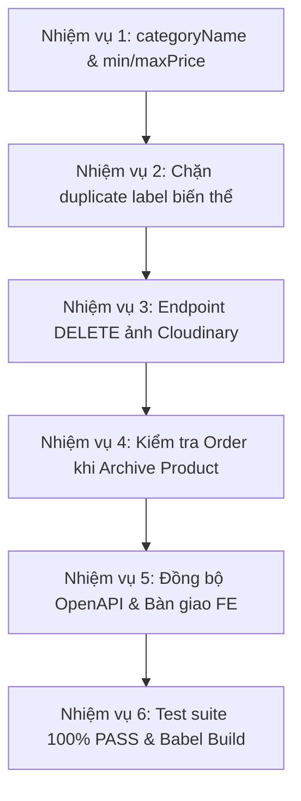

# Kế Hoạch Bổ Sung & Hoàn Thiện Nghiệp Vụ Theo Phản Hồi FE (docs/FE _ Log.md)

> **Mục tiêu:** Rà soát 100% các yêu cầu nghiệp vụ từ tài liệu `docs/FE _ Log.md` (Task 3.6 – Product / Category Management), đối soát với hiện trạng mã nguồn Backend, xác định các điểm đã hoàn thành và lập kế hoạch bổ sung các tính năng/ràng buộc còn thiếu để bàn giao trọn vẹn cho team Frontend.
>
> **Tài liệu tham chiếu:** `docs/FE _ Log.md`, `docs/BACKEND_HANDOFF_TASK_3.6_PRODUCT_MANAGEMENT.md`, `docs/QLSP.md`, `docs/Task-2.8-v7-confirmed/07-openapi-v7.yaml`.
> **Nhánh thực hiện:** `feat/foundation-v6`.

---

## I. Ma Trận Đối Soát Hiện Trạng (Audit Matrix)

| # | Hạng mục trong `FE _ Log.md` | Hiện trạng Backend | Đánh giá | Hướng xử lý |
|:---:|---|---|:---:|---|
| **1** | **Tự động sinh mã SP (`SP-000123`) & SKU (`SP-000123-001`)** | Đã có `Counter` model, `generateProductCode()`, `formatVariantSku()`. Bất biến SKU (SKU-05). | ✅ **ĐÃ CÓ** | Giữ nguyên, kiểm tra thêm tính atomic khi request đồng thời. |
| **2** | **Upload & Quản lý ảnh sản phẩm (Cloudinary)** | Đã có `POST /api/v1/uploads/products`, lưu `[{ id, url, isPrimary, sortOrder }]`. | 🟡 **CẦN BỔ SUNG** | Bổ sung endpoint `DELETE /api/v1/uploads/products/:imageId` để xóa asset trên Cloudinary khi FE xóa ảnh. |
| **3** | **Ảnh riêng cho từng biến thể (`variant.image`)** | Đã có trường `image` trong `variantSchema`, `formatProductVariant`, `addVariant`, `updateVariant`. | ✅ **ĐÃ CÓ** | Đã hoàn thiện. |
| **4** | **`usageType` & `productType`** | Đã có `SIMPLE`/`VARIANT` (chặn chuyển đổi sau tạo). Đã có `SALE`/`SHARED`/`SERVICE_SUPPLY` (ẩn trên Customer). | ✅ **ĐÃ CÓ** | Đã hoàn thiện. |
| **5** | **Khuyến mại & Giá sau khuyến mại (`finalPrice`)** | Đã có `discountPercent` (0-100), `finalPrice = Math.round(price * (100 - discount) / 100)`. Chặn giá <= 0 (422). | ✅ **ĐÃ CÓ** | Đã hoàn thiện. |
| **6** | **Dữ liệu danh sách, bộ lọc & Tồn kho** | Đã có tìm kiếm `q`, lọc categoryId, usageType, status, khoảng giá, createdWithinDays, inStockOnly, phân trang `page` + `cursor`. | 🟡 **CẦN BỔ SUNG** | • Bổ sung `categoryName` vào Product response (populate name). • Bổ sung `minPrice` & `maxPrice` (hoặc `price` cho SIMPLE) ở cấp Product để FE hiển thị cột Giá trên bảng. |
| **7** | **Quản lý biến thể & Chống trùng thuộc tính** | Đã có soft-delete variant, chặn nếu có Order đang xử lý, activate lại variant. | 🟡 **CẦN BỔ SUNG** | Bổ sung kiểm tra trùng lặp `label` (tổ hợp thuộc tính) giữa các biến thể trong cùng 1 sản phẩm (tránh tạo 2 biến thể cùng tên "500g"). |
| **8** | **Lưu trữ & Khôi phục (`archive` / `restore`)** | Đã có `POST /products/:id/archive` và `POST /products/:id/restore` (về `INACTIVE`). | ✅ **ĐÃ CÓ** | Kiểm tra thêm cảnh báo nếu sản phẩm có đơn hàng đang xử lý khi Archive. |
| **9** | **Chuẩn hóa lỗi RFC 7807 & OpenAPI sync** | Đã có Problem Details format chuẩn, đồng bộ OpenAPI v7. | 🟡 **CẦN BỔ SUNG** | Đồng bộ endpoint delete image và các trường response mới vào OpenAPI v7/v6. |

---

## II. Danh Sách Nhiệm Vụ Cụ Thể Cần Triển Khai

### 🎯 Nhiệm vụ 1: Bổ sung `categoryName` và thông tin giá cấp Product (`minPrice`, `maxPrice`)
- **Tệp chỉnh sửa:** `src/modules/catalog/catalog.service.js`
- **Mô tả:**
  - Trong `formatProduct()`: Nếu `obj.categoryId` là object đã populate, trích xuất `categoryName: obj.categoryId.name`. Đồng thời tính toán `minPrice`, `maxPrice` từ danh sách `variants`:
    - Với sản phẩm `SIMPLE`: `price = variants[0].price`, `finalPrice = variants[0].finalPrice`.
    - Với sản phẩm `VARIANT`: `minPrice = Math.min(...)`, `maxPrice = Math.max(...)`, `minFinalPrice`, `maxFinalPrice`.
  - Trong `listProducts()`: Bổ sung `.populate('categoryId', 'name slug')` để tối ưu truy vấn 1 lần mà không cần query lặp.
- **Xác minh:** Gọi `GET /api/v1/products` và `GET /api/v1/products/:id`, response có `categoryName`, `minPrice`, `maxPrice`.

### 🎯 Nhiệm vụ 2: Kiểm tra trùng lặp thuộc tính / nhãn biến thể (`label`) trong cùng một sản phẩm
- **Tệp chỉnh sửa:** `src/modules/catalog/catalog.service.js`
- **Mô tả:**
  - Trong `createProduct()`: Tạo `labelSet = new Set()`. Nếu phát hiện 2 biến thể có cùng `label` (không phân biệt hoa thường và trim khoảng trắng), trả lỗi `422 UnprocessableEntity`: *"Không được tạo hai biến thể có cùng tên/thuộc tính trong một sản phẩm"*.
  - Trong `updateProduct()` và `addVariant()`: Kiểm tra biến thể mới thêm không được trùng `label` với bất kỳ biến thể hiện có nào của sản phẩm.
- **Xác minh:** Viết test case gửi 2 variant cùng label `"500g"` -> Kỳ vọng nhận mã `422`.

### 🎯 Nhiệm vụ 3: Bổ sung endpoint xóa ảnh Cloudinary (`DELETE /api/v1/uploads/products/:imageId`)
- **Tệp chỉnh sửa:**
  - `src/modules/upload/upload.service.js`: Thêm hàm `deleteProductImage(imageId)` gọi `cloudinary.uploader.destroy(publicId)`.
  - `src/modules/upload/upload.controller.js`: Thêm controller `deleteProductImage`.
  - `src/modules/upload/upload.routes.js`: Thêm route `DELETE /products/:imageId` (Role `ADMIN`, `MANAGER`).
- **Xác minh:** Test xóa ảnh bằng imageId hợp lệ -> Trả `200 OK` `{ success: true, message: 'Image deleted successfully' }`.

### 🎯 Nhiệm vụ 4: Kiểm tra cảnh báo đơn hàng đang xử lý khi Lưu trữ (`archiveProduct`)
- **Tệp chỉnh sửa:** `src/modules/catalog/catalog.service.js`
- **Mô tả:**
  - Khi gọi `archiveProduct(productId)`: Truy vấn kiểm tra nếu có đơn hàng thuộc trạng thái `['PENDING', 'CONFIRMED', 'PROCESSING', 'SHIPPED']` chứa bất kỳ biến thể nào của sản phẩm này.
  - Nếu có đơn hàng đang xử lý: Trả lỗi `422 UnprocessableEntity` với thông điệp: *"Không thể lưu trữ sản phẩm vì đang có đơn hàng [MÃ_ĐƠN] trong quá trình xử lý"*.
- **Xác minh:** Test lưu trữ sản phẩm có order đang xử lý -> Nhận mã `422`. Lưu trữ sản phẩm không có đơn -> Thành công chuyển sang `ARCHIVED`.

### 🎯 Nhiệm vụ 5: Cập nhật OpenAPI specs & Bàn giao FE
- **Tệp chỉnh sửa:**
  - `docs/Task-2.8-v7-confirmed/07-openapi-v7.yaml`
  - `docs/07-openapi-v6.yaml`
  - `docs/BACKEND_HANDOFF_TASK_3.6_PRODUCT_MANAGEMENT.md`
- **Mô tả:**
  - Thêm endpoint `DELETE /uploads/products/{imageId}` vào spec OpenAPI.
  - Thêm `categoryName`, `minPrice`, `maxPrice` vào `ProductResponse` và `ProductListItem` schema.
  - Cập nhật tài liệu bàn giao FE với bảng tổng hợp giải quyết 100% các điểm trong `FE _ Log.md`.

### 🎯 Nhiệm vụ 6: Kiểm thử tự động & Xác minh toàn diện (Verification)
- **Tệp chỉnh sửa:** `tests/catalog.test.js`, `tests/upload.test.js`
- **Mục tiêu:**
  - Bổ sung test case cho `categoryName`, `minPrice/maxPrice`, duplicate label rejection, order active check on archive.
  - Chạy `npm test` đạt 100% PASS trên tất cả 5 test suites.
  - Chạy `npm run build` đạt 100% biên dịch sạch sẽ không có cảnh báo.

---

## III. Kế Hoạch Bàn Giao & Thứ Tự Triển Khai

