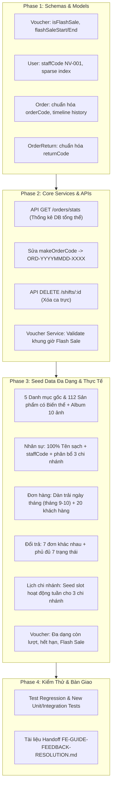

# Kế Hoạch Triển Khai Chi Tiết: Khắc Phục Toàn Diện Feedback Nhóm Trưởng & Bàn Giao FE

> **Mã kế hoạch:** `PLAN-feedback-resolution`  
> **Căn cứ tài liệu:** `docs/FEEDBACK.docx` (29 phản hồi & 25 ảnh chụp màn hình kiểm thử thực tế)  
> **Chế độ:** `PLANNING ONLY` (Tuân thủ nghiêm ngặt quy trình `project-planner` & `plan-writing`)

---

## 🎯 Mục Tiêu (Goal)
Khắc phục 100% các vấn đề gốc rễ tại tầng **Backend (BE)** và cung cấp đầy đủ API, cấu trúc dữ liệu, dữ liệu mẫu thực tế (Seed Data) chuẩn xác để **Frontend (FE)** khắc phục toàn bộ các lỗi hiển thị, bảng biểu, giao diện thống kê và luồng trải nghiệm người dùng (UX) đã được chỉ ra trong đợt kiểm thử UAT ngày 28-31/10/2026.

---

## 🏛️ Các Quyết Định Kiến Trúc Đã Thống Nhất (Architectural Decisions)
1. **Mã đơn hàng (`orderCode`):** Áp dụng định dạng tuần tự theo ngày `ORD-YYYYMMDD-XXXX` (ví dụ: `ORD-20261031-0001`, `ORD-20261031-0002`). Hoàn toàn độc lập với trạng thái đơn và loại khách hàng.
2. **Mã nhân viên (`staffCode`):** Phân loại theo vai trò nghiệp vụ chuyên môn:
   - Bác sĩ Thú y: `BS-001`, `BS-002`...
   - Y tá / Điều dưỡng: `YT-001`, `YT-002`...
   - Lễ tân: `LT-001`, `LT-002`...
   - Chăm sóc / Groomer: `CS-001`, `CS-002`...
   - Quản lý / Manager: `QL-001`, `QL-002`...
   - Họ tên nhân viên giữ sạch 100% ("Đặng Cẩm Tú", "Nguyễn Thu Cúc"), không ghép tiền tố viết tắt.
3. **Cơ chế Xóa ca làm việc (`DELETE /api/v1/shifts/:id`):** 
   - Cho phép **Hard Delete** xóa dứt điểm bản ghi nếu ca làm việc chưa diễn ra (`startTime > Date.now()`).
   - Chặn xóa và trả về HTTP 400 nếu ca làm việc đang diễn ra hoặc đã hoàn tất để bảo đảm tính toàn vẹn dữ liệu.

---

## 🏗️ Phân Tích Phạm Vi & Kiến Trúc (Architecture & Scope)

---

## 📋 Danh Sách Nhiệm Vụ Chi Tiết (Actionable Tasks)

### Giai Đoạn 1: Cập Nhật Schema & Data Models (Phase 1)

- [ ] **Task 1.1: Bổ sung trường Flash Sale vào Voucher Schema**
  - **File:** `src/modules/order/models/Voucher.js`
  - **Nội dung:** Bổ sung `isFlashSale: { type: Boolean, default: false, index: true }`, `flashSaleStartTime: { type: Date }`, `flashSaleEndTime: { type: Date }`.
  - **Xác minh (Verify):** Kiểm tra model load không lỗi, index được tạo thành công trong MongoDB.

- [ ] **Task 1.2: Bổ sung trường `staffCode` vào User Schema**
  - **File:** `src/models/User.js`
  - **Nội dung:** Bổ sung `staffCode: { type: String, unique: true, sparse: true, trim: true }` để quản lý mã nhân sự chuẩn (`NV-001`, `BS-001`, `LT-001`...) thay vì để FE hiển thị chuỗi Hex `_id`.
  - **Xác minh (Verify):** User Schema compile hợp lệ, index `staffCode` sparse duy nhất.

- [ ] **Task 1.3: Chuẩn hóa Schema Mã Yêu Cầu Đổi Trả (`OrderReturn`)**
  - **File:** `src/modules/order/models/OrderReturn.js`
  - **Nội dung:** Đảm bảo trường `code` (ví dụ `RET-202610-001`) bắt buộc, unique và được indexed, tránh việc trả về chỉ có `_id`.
  - **Xác minh (Verify):** Schema kiểm tra field `code` tồn tại.

---

### Giai Đoạn 2: Nâng Cấp Business Logic & Xây Dựng API Mới (Phase 2)

- [ ] **Task 2.1: Xây dựng API Thống kê số lượng đơn hàng tổng thể (`GET /api/v1/orders/stats`)**
  - **Files:** `src/modules/order/order.service.js`, `src/modules/order/order.controller.js`, `src/modules/order/order.routes.js`
  - **Mục đích:** Khắc phục triệt để lỗi thẻ số liệu Dashboard hiển thị phụ đề *"trong dữ liệu đã tải"* (Hình 25, 22).
  - **Nội dung:**
    - Sử dụng MongoDB Aggregation `$facet` hoặc đếm theo `status` trên toàn bộ DB:
      `{ total, pending, confirmed, processing, shipping, delivered, completed, cancelled, returned }`.
    - Hỗ trợ query params: `branchId`, `startDate`, `endDate`.
  - **Xác minh (Verify):** Gọi `curl /api/v1/orders/stats` trả về HTTP 200 kèm các con số tổng thể độc lập với pagination.

- [ ] **Task 2.2: Tái cấu trúc hàm sinh mã đơn hàng chuẩn thực tế**
  - **Files:** `src/modules/order/order.service.js`, `src/seeds/productionUatSeed.js`
  - **Mục đích:** Khắc phục phản hồi mục 10: *"cái mã đơn này là sao? sao lại có status đơn với phân loại cust/guest trong này?? rồi khi chuyển status có chuyển ko? => sửa lại"*.
  - **Nội dung:**
    - Loại bỏ tiền tố trạng thái và loại khách khỏi mã đơn: Không dùng `ORD-CUST-PENDING-01` hay `ORD-GUEST-HOT-01`.
    - Quy tắc sinh mã mới: `ORD-YYYYMMDD-XXXX` (ví dụ `ORD-20261031-0001`) hoặc chuỗi ngẫu nhiên không trùng lặp `ORD-${Date.now().toString().slice(-6)}-${counter}`.
  - **Xác minh (Verify):** Khi đơn chuyển status từ `PENDING` sang `CONFIRMED`, `orderCode` giữ nguyên bất biến.

- [ ] **Task 2.3: Chuẩn hóa Timeline Lịch Sử Trạng Thái (`statusHistory`)**
  - **File:** `src/modules/order/order.service.js`
  - **Mục đích:** Xóa bỏ hoàn toàn dòng chữ thô *"BE chưa ghi thời gian bước này"* (Hình 15).
  - **Nội dung:**
    - Khi cập nhật trạng thái đơn qua `transitionOrderStatus`, luôn push object:
      `{ status, at: new Date(), actorId: actor?.id, note: note || '' }`.
    - Serializer trả về `at` dưới dạng chuẩn `ISO 8601` string (`2026-10-31T08:30:00.000Z`).
  - **Xác minh (Verify):** `GET /api/v1/orders/:id` trả về mảng `statusHistory` đầy đủ thời gian từng bước.

- [ ] **Task 2.4: Bổ sung API Xóa Ca Làm Việc (`DELETE /api/v1/shifts/:id`)**
  - **Files:** `src/modules/staff/shift.routes.js`, `src/modules/staff/shift.controller.js`, `src/modules/staff/shift.service.js`
  - **Mục đích:** Đáp ứng phản hồi mục 27: *"chưa có nút xóa"*, gỡ bỏ thông báo mock trên FE.
  - **Nội dung:**
    - Thêm route: `router.delete('/:id', authenticate, requireRole(['MANAGER', 'ADMIN']), shiftController.deleteShift)`.
    - Service kiểm tra: Cho phép xóa mềm hoặc hard delete nếu ca làm chưa diễn ra; nếu đã hoàn thành thì trả về lỗi 400 có hướng dẫn.
  - **Xác minh (Verify):** Gửi DELETE request xóa thành công ca trực, trả về HTTP 200.

- [ ] **Task 2.5: Triển khai Nghiệp Vụ Flash Sale Cho Voucher**
  - **File:** `src/modules/order/voucher.service.js`
  - **Nội dung:**
    - Trong `listVouchers`: Thêm filter query param `isFlashSale` (boolean).
    - Trong `validateVoucher` (khi áp mã voucher): Nếu `voucher.isFlashSale === true`, kiểm tra `Date.now()` phải nằm trong khoảng `[flashSaleStartTime, flashSaleEndTime]`. Nếu ngoài giờ, trả về mã lỗi `VOUCHER_FLASH_SALE_INACTIVE` kèm message rõ ràng.
  - **Xác minh (Verify):** Test case áp mã Flash Sale trong giờ thành công, ngoài giờ bị từ chối chính xác.

- [ ] **Task 2.6: Tăng thời hạn Access Token môi trường Test/UAT**
  - **File:** `.env` / `src/config/index.js`
  - **Nội dung:** Tăng `JWT_ACCESS_EXPIRES_IN` từ 15 phút lên `8h` trong môi trường test UAT để tester và reviewer không bị gián đoạn ngắt phiên liên tục (Hình 4, 7, 22, 24).
  - **Xác minh (Verify):** Token duy trì hoạt động trong suốt phiên test.

---

### Giai Đoạn 3: Tái Cấu Trúc Toàn Bộ Dữ Liệu Mẫu (Seed Data Overhaul) (Phase 3)

- [ ] **Task 3.1: Dọn dẹp rác & Đồng bộ 5 Danh mục gốc chuẩn**
  - **File:** `src/seeds/productionUatSeed.js`
  - **Nội dung:**
    - Xóa các danh mục trùng lặp/rác (`thuc-an-hat-cho-meo`, `thuc-an-cho-cho`, `thuc-an-dinh-duong`...).
    - Giữ đúng 5 danh mục gốc: `thuc-an`, `do-dung-thiet-yeu`, `cham-soc-suc-khoe`, `do-choi`, `phu-kien`.
    - Gán toàn bộ sản phẩm về 5 danh mục này.
  - **Xác minh (Verify):** Truy vấn DB chỉ còn duy nhất 5 danh mục gốc.

- [ ] **Task 3.2: Seed 112 Sản phẩm chuẩn kèm Album tối đa 10 ảnh & Biến thể thực tế**
  - **File:** `src/seeds/productionUatSeed.js`
  - **Nội dung:**
    - Xóa sạch các sản phẩm test vô nghĩa (`dfgerrf`, `fđvdvdvv`, `Testsp26`...).
    - Toàn bộ sản phẩm đều có ảnh CDN Unsplash hợp lệ (`images: [{ url, isPrimary, sortOrder }]`).
    - Các sản phẩm tiêu biểu có từ 3 đến 8-10 ảnh để Customer UI test gallery slider.
    - Bổ sung các biến thể (variants) chân thực: Thức ăn túi 500g / 1.5kg / 5kg; Dầu tắm 250ml / 500ml; Vòng cổ size S / M / L kèm giá và tồn kho riêng.
  - **Xác minh (Verify):** Kiểm tra DB đủ 112 sản phẩm, không có sản phẩm nào thiếu ảnh hoặc rỗng biến thể.

- [ ] **Task 3.3: Seed Nhân sự 100% Tên sạch + `staffCode` + Phân bổ 3 chi nhánh**
  - **File:** `src/seeds/productionUatSeed.js`
  - **Nội dung:**
    - Tất cả tài khoản `fullName` đều là tên người thuần túy ("Đặng Cẩm Tú", "Nguyễn Thu Cúc", "Võ Thành Đạt", "Lê Mai Loan"), **xóa bỏ hoàn toàn các tiền tố `BS. BS.`, `YT. Y tá`, `CS. Master Groomer`**.
    - Sinh mã nhân viên chuẩn: `staffCode: 'NV-001'`, `'BS-001'`, `'YT-001'`, `'LT-001'`.
    - Phân bổ nhân sự đều khắp tối thiểu 3 chi nhánh (Q1, Q7, Bình Thạnh) và có nhân viên liên chi nhánh.
  - **Xác minh (Verify):** Bảng nhân sự hiển thị họ tên trang nhã, mã `staffCode` sạch sẽ.

- [ ] **Task 3.4: Seed Đơn hàng trải đều mốc thời gian & 20+ Khách hàng**
  - **File:** `src/seeds/productionUatSeed.js`
  - **Nội dung:**
    - Tạo danh sách tối thiểu 20 khách hàng (gồm khách thành viên, khách vãng lai, khách chờ kích hoạt) với họ tên thật độc lập (không nhét chuỗi `(khách vãng lai)` vào trường `fullName`).
    - Trải đều mốc `createdAt` của các đơn hàng từ cuối tháng 9 đến 31/10/2026 để bộ lọc ngày tháng hoạt động chính xác.
    - Bao phủ đầy đủ các trạng thái đơn hàng (`PENDING`, `CONFIRMED`, `PROCESSING`, `SHIPPED`, `DELIVERED`, `COMPLETED`, `CANCELLED`).
  - **Xác minh (Verify):** Bộ lọc Date-range trên giao diện lọc ra số lượng đơn khác nhau theo từng khoảng ngày.

- [ ] **Task 3.5: Seed Đổi trả (Returns) phân bổ đều 7 đơn hàng & 7 trạng thái**
  - **File:** `src/seeds/productionUatSeed.js`
  - **Nội dung:**
    - Tách biệt 7 yêu cầu đổi trả cho 7 đơn hàng khác nhau, 7 khách hàng khác nhau và các mức tiền hoàn khác nhau.
    - Gán mã chuẩn: `RET-202610-001` đến `RET-202610-007`.
    - Phủ trọn vẹn 7 trạng thái: `REQUESTED`, `PROCESSING`, `RECEIVED`, `APPROVED`, `REJECTED`, `COMPLETED`, `CANCELLED`.
  - **Xác minh (Verify):** Bảng Đổi trả không còn dữ liệu trùng lặp y hệt nhau.

- [ ] **Task 3.6: Seed Lịch hoạt động & Slot Chi nhánh (Operating Schedules)**
  - **File:** `src/seeds/productionUatSeed.js`
  - **Nội dung:** Seed slot làm việc cho 3 chi nhánh từ Thứ 2 đến Chủ nhật, khung giờ 07:00 đến 21:00 với số lượng slot `bookedCount` và `capacity` thực tế.
  - **Xác minh (Verify):** Màn hình Vận hành > Chi nhánh > Lịch hoạt động hiển thị đầy đủ số liệu, không bị ô trống "Chưa có dữ liệu".

- [ ] **Task 3.7: Seed Voucher Đa Dạng & Flash Sale**
  - **File:** `src/seeds/productionUatSeed.js`
  - **Nội dung:** Tạo voucher còn lượt, hết lượt (`usedCount === quota`), hết hạn, và đặc biệt là voucher Flash Sale (`isFlashSale: true`) đang diễn ra.
  - **Xác minh (Verify):** Bảng Voucher phản ánh đa dạng trạng thái.

---

### Giai Đoạn 4: Kiểm Thử & Biên Soạn Hướng Dẫn FE (Phase 4)

- [ ] **Task 4.1: Chạy toàn bộ Test Suite đảm bảo Không phát sinh lỗi hồi quy (No Regression)**
  - **Lệnh thực thi:** `npm test` / `npx jest --runInBand`
  - **Xác minh (Verify):** 100% test suites (Order, Catalog, Inventory, Auth, Staff) đều Pass màu xanh.

- [ ] **Task 4.2: Biên soạn Tài liệu Bàn giao Kỹ thuật FE (`docs/FE-GUIDE-FEEDBACK-RESOLUTION.md`)**
  - **Nội dung:**
    - Cung cấp tài liệu chi tiết về API mới `GET /api/v1/orders/stats`.
    - Hướng dẫn FE mapping trường `orderCode`, `staffCode`, `returnCode` mới.
    - Hướng dẫn FE cấu hình Axios Interceptor bắt `401` chuyển hướng login.
    - Hướng dẫn FE sửa lỗi tính phân trang `Math.ceil(total / pageSize)`.
    - Hướng dẫn FE render `isGuest` / `isFlashSale` bằng UI Badge độc lập.
  - **Xác minh (Verify):** File markdown hoàn chỉnh, rõ ràng, dễ hiểu cho đội ngũ FE thực hiện.

---

## 🔒 Tiêu Chuẩn Hoàn Thành (Definition of Done)
1. Toàn bộ mã nguồn BE tuân thủ kiến trúc Clean Code và vượt qua 100% bài test Jest.
2. Dữ liệu seed chạy trơn tru, phủ kín 100% các trường hợp nghiệp vụ của 6 phân hệ (Chi nhánh, Nhân sự, Đơn hàng, Đổi trả, Kho hàng, Voucher).
3. Tài liệu bàn giao FE được cập nhật đầy đủ để phía Frontend có thể áp dụng sửa giao diện ngay lập tức.
