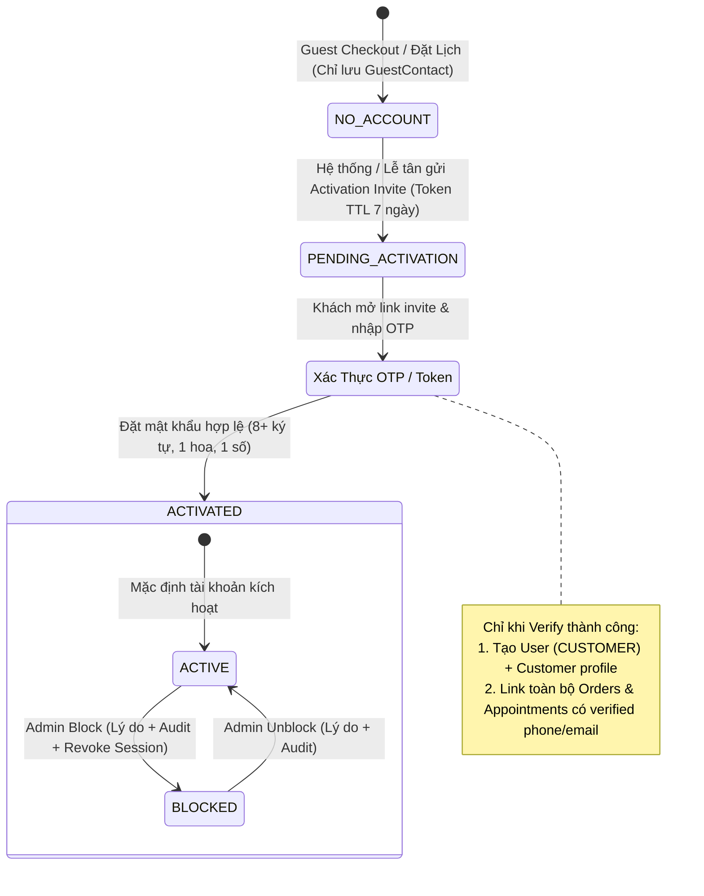

# Kế Hoạch Triển Khai: Guest Checkout/Booking + OTP Activation + Customer Account Management

> **Độ ưu tiên:** Guest/Activation = **P0**; Customer Account Management = **P1**  
> **Tài liệu tham chiếu:** `docs/Task-2.8-v7-confirmed/07-openapi-v7.yaml`, `04-domain-model-v7.md`, `08-authorization-matrix-v7.md`, `09-state-machines-v7.md`  
> **Nhánh thực hiện:** `feat/foundation-v6`

---

## 1. Mục Tiêu & Tiêu Chí Hoàn Thành (Definition of Done)

Hệ thống được coi là **DONE** khi đáp ứng đủ 3 tiêu chí cốt lõi:
1. **Guest Giao Dịch & Tra Cứu OTP:** Khách vãng lai checkout đơn hàng (`Order`) hoặc đặt lịch (`Appointment`) chỉ bằng thông tin liên hệ, tuyệt đối không tự tạo tài khoản/mật khẩu ngầm; Tra cứu lại lịch sử đơn hàng/lịch hẹn qua SĐT/Email + OTP xác thực bảo mật.
2. **Kích Hoạt Tài Khoản An Toàn (Post-Transaction Activation):** Gửi lời mời tạo mật khẩu qua Email/SMS; Chuyển đổi trạng thái `NO_ACCOUNT` $\rightarrow$ `PENDING_ACTIVATION` $\rightarrow$ `ACTIVATED`; **Chỉ liên kết (link) các giao dịch lịch sử sau khi SĐT/Email đã được xác thực 100%**.
3. **Quản Lý Khách Hàng Phân Quyền Chặt Chẽ (RBAC Scoping):**
   - **Admin:** Toàn quyền xem danh sách, chi tiết (pets, orders, appointments, lastLogin, activity), tìm kiếm, lọc và **Thực hiện Block/Unblock với lý do bắt buộc + ghi AuditLog + thu hồi refresh token**.
   - **Manager:** Chỉ xem được danh sách/chi tiết khách hàng có phát sinh giao dịch tại các chi nhánh được phân công (`assignedBranchIds`); **Không có quyền Block/Unblock (chặn 403 Forbidden)**.
   - **Staff:** Chỉ xem dữ liệu cần thiết theo phạm vi ca trực và tiếp nhận dịch vụ.

---

## 2. Kiến Trúc Luồng Nghiệp Vụ & Sơ Đồ Trạng Thái

---

## 3. Khảo Sát Hiện Trạng & Khoảng Cách Kỹ Thuật (Gap Analysis)

| Thành phần | Hiện trạng trong code | Yêu cầu chuẩn hóa (Cần bổ sung/sửa) |
|---|---|---|
| **Lưu trữ OTP** | `guest.service.js` dùng `new Map()` trong RAM (mất khi restart, lỗi cluster). | Chuyển sang dùng model **`OtpChallenge`** trong MongoDB (TTL index tự xóa, cooldown 60s, max 5 lần thử, purpose `GUEST_LOOKUP`). |
| **Gửi OTP/Invite** | Mocking đơn giản trả mã OTP trong response test. | Tích hợp **Nodemailer** với biến môi trường `EMAIL_APP` / `EMAIL_APP_PASSWORD` đã có sẵn trên Render; fallback mock có kiểm soát nếu gửi mail lỗi (không block core). |
| **Đường dẫn API (OpenAPI v7)** | Code đang dùng `/lookup/request-otp`, `/activation/invite`. | OpenAPI v7 quy định `/guest/lookup/otp`, `/guest/lookup/verify`, `/activation/invitations`. $\rightarrow$ **Cần hỗ trợ cả hai (Route Aliasing)** để tương thích 100% cả contract test và FE cũ. |
| **Liên kết giao dịch (Link History)** | `completeActivation` hiện chỉ tìm theo `guestContactId: guest._id`. | Phải mở rộng liên kết theo cả `contactSnapshot.phone` và `contactSnapshot.email` đã được xác thực, đảm bảo không bỏ sót đơn đặt lúc khách dùng nhiều thiết bị. |
| **Phân quyền Manager** | `customer.service.js` lọc theo `activityBranchIds` trên model `Customer`. | Cần tự động cập nhật `activityBranchIds` khi Order hoặc Appointment hoàn tất checkout, hoặc fallback aggregate kiểm tra giao dịch chi nhánh. |
| **Block / Unblock** | Hiện chỉ lưu vào mảng `customer.auditHistory`. | Bổ sung: Ghi vào bảng tập trung **`AuditLog`** (`ACCOUNT_BLOCKED` / `ACCOUNT_UNBLOCKED`), đồng thời **xóa toàn bộ `RefreshSession`** của User để đá văng phiên đăng nhập ngay lập tức. |

---

## 4. Kế Hoạch Triển Khai Chi Tiết Từng Phase

### Phase 1: Chuẩn Hóa Hạ Tầng OTP & Provider (P0)
1. **Mở rộng `OtpChallenge` Model:**
   - Bổ sung purpose: `'GUEST_LOOKUP'`, `'ACTIVATION'` vào `OTP_PURPOSES`.
   - Lưu trữ an toàn: hash OTP bằng bcrypt hoặc sha256 + salt; quản lý `attemptCount`, `lastSentAt`, `expiresAt`.
2. **Provider OTP Linh Hoạt (Real + Controlled Mock):**
   - Nếu có cấu hình `EMAIL_APP` & `EMAIL_APP_PASSWORD` $\rightarrow$ gửi email HTML template thương hiệu Dr.Pets House kèm mã 6 số.
   - Nếu không có mail hoặc gửi lỗi / môi trường test $\rightarrow$ ghi log an toàn vào Outbox và trả mã OTP trong môi trường non-production (`debugOtp`), không làm crash hệ thống.
   - Áp dụng Resend Cooldown: 60 giây giữa các lần yêu cầu; Max attempts: 5 lần sai tự hủy challenge.

### Phase 2: Luồng Guest Checkout & Tra Cứu Đơn Hàng/Lịch Hẹn (P0)
1. **Kiểm tra luồng Checkout & Booking của Guest:**
   - Đảm bảo `POST /api/v1/checkout` và `POST /api/v1/appointments` hoạt động bình thường khi không có token đăng nhập (`optionalAuth`).
   - Tự động tạo/cập nhật bản ghi `GuestContact` với trạng thái `activationStatus: 'NO_ACCOUNT'`.
2. **API Tra Cứu Giao Dịch Guest:**
   - `POST /api/v1/guest/lookup/otp` (alias: `/request-otp`): Nhận Phone hoặc Email $\rightarrow$ tạo `OtpChallenge` $\rightarrow$ gửi OTP.
   - `POST /api/v1/guest/lookup/verify` (alias: `/verify-otp`): Nhận Contact + OTP $\rightarrow$ trả `GuestLookupToken` (JWT 15 phút, claims: `{ guestContactId, phone, email, isGuest: true }`).
   - `GET /api/v1/guest/transactions`: Dùng token tra cứu trả về danh sách Orders, Appointments, Returns liên quan.
   - `GET /api/v1/orders/:id` & `GET /api/v1/appointments/:id`: Cho phép guest xem chi tiết đơn qua header `x-guest-lookup-token` hoặc Bearer lookup token.

### Phase 3: Luồng Kích Hoạt Tài Khoản Khách Hàng (P0)
1. **Gửi Thư Mời Kích Hoạt (Activation Invite):**
   - `POST /api/v1/activation/invitations` (alias: `/invite`): Nhận `guestContactId` hoặc Phone/Email.
   - Cấp `activationToken` (crypto random 32 bytes, TTL 7 ngày), chuyển trạng thái sang `PENDING_ACTIVATION`.
   - Gửi link kích hoạt tới email khách hàng qua Outbox / Nodemailer.
2. **Hoàn Tất Kích Hoạt (Activation Complete):**
   - `POST /api/v1/activation/complete`: Nhận token, mật khẩu mới, `acceptTerms: true`.
   - Kiểm tra chính sách mật khẩu: $\ge 8$ ký tự, $\ge 1$ chữ hoa, $\ge 1$ số.
   - Chạy Transaction MongoDB:
     - Tạo tài khoản `User` (role `CUSTOMER`, `accountStatus: 'ACTIVE'`).
     - Tạo hồ sơ `Customer` (`activationStatus: 'ACTIVATED'`, `phoneVerifiedAt`, `emailVerifiedAt`).
     - **Link Giao Dịch An Toàn:** Cập nhật `customerId` trên toàn bộ Orders và Appointments có SĐT hoặc Email khớp với thông tin đã xác thực.
     - Cập nhật `GuestContact` sang `ACTIVATED`.
   - Trả về cặp Access Token (15m) + Refresh Token (7d) để khách đăng nhập ngay.

### Phase 4: Quản Lý Khách Hàng (Customer Account Management - P1)
1. **Danh Sách Khách Hàng (`GET /api/v1/admin/customers`):**
   - Hỗ trợ phân trang bằng cursor / limit (mặc định 20, max 100).
   - Bộ lọc: `activationStatus` (`NO_ACCOUNT`, `PENDING_ACTIVATION`, `ACTIVATED`), `accountStatus` (`ACTIVE`, `BLOCKED`), `search` (theo SĐT, Email, Tên).
   - **Phân quyền Branch Scoping:**
     - `ADMIN`: Xem toàn bộ khách hàng trên hệ sinh thái.
     - `MANAGER`: Chỉ hiển thị khách hàng có `activityBranchIds` chứa ít nhất 1 chi nhánh trong `assignedBranchIds` của quản lý.
2. **Chi Tiết Khách Hàng (`GET /api/v1/admin/customers/:id`):**
   - Trả về thông tin hồ sơ: `fullName`, `phone`, `email`, `activationStatus`, `accountStatus`, `lastLogin`, `createdAt`, `blockedReason`.
   - Kèm danh sách thú cưng (`pets`), lịch sử đơn hàng (`orders`), lịch hẹn (`appointments`), đánh giá (`reviews/feedbacks`).
   - Kiểm tra quyền: Manager bị chặn `403 Forbidden` nếu khách không có giao dịch nào tại chi nhánh quản lý.
3. **Khóa / Mở Khóa Tài Khoản (`POST /admin/customers/:id/block` & `/unblock`):**
   - **Chỉ ADMIN** mới được thực hiện (Manager gọi $\rightarrow$ trả `403 Forbidden`).
   - Khi Block: Bắt buộc truyền `reason` (chuỗi không rỗng), cập nhật `accountStatus = 'BLOCKED'`.
   - **Side-effects bảo mật:**
     - Cập nhật cả `User.accountStatus = 'BLOCKED'`.
     - Xóa toàn bộ `RefreshSession` của User (buộc đăng xuất ngay lập tức).
     - Ghi nhận `AuditLog` tập trung với action `ACCOUNT_BLOCKED` / `ACCOUNT_UNBLOCKED` kèm actor Admin, IP và reason.
   - **Quy tắc chặn giao dịch:** Khách bị Block chỉ bị chặn đăng nhập và thao tác trên tài khoản cá nhân; không tự động xóa hay vô hiệu hóa lịch sử hóa đơn/đơn hàng cũ.

### Phase 5: Tự Động Hóa Kiểm Thử & Xác Minh (Verification)
1. **Unit & Integration Tests:**
   - Viết test suite `tests/guest-activation-customer.test.js`:
     - Test OTP generation, expiry, resend cooldown, max attempts.
     - Test Guest checkout $\rightarrow$ lookup bằng OTP thành công.
     - Test Activation: Tạo password, chuyển trạng thái `ACTIVATED`, liên kết chính xác lịch sử đơn hàng.
     - Test Manager branch scoping: Manager xem được khách chi nhánh mình, không xem được khách chi nhánh khác.
     - Test Block/Unblock: Manager gọi báo 403, Admin gọi thành công kèm thu hồi refresh session và ghi audit log.
2. **Kiểm tra Hợp đồng & Live Smoke Test:**
   - Chạy `npm test` toàn bộ 19 test suites.
   - Chạy `npm run build` xác nhận Babel biên dịch sạch.
   - Thực thi smoke test kịch bản E2E trên database thực tế.

---

## 5. Bảng Phân Quyền Chi Tiết (RBAC Matrix)

| Endpoint | Chức năng | Khách vãng lai (Guest) | Khách có tài khoản (Customer) | Quản lý (Manager) | Quản trị viên (Admin) | Lễ tân / Bác sĩ (Staff) |
|---|---|:---:|:---:|:---:|:---:|:---:|
| `POST /guest/lookup/otp` | Gửi OTP tra cứu | ✅ | ✅ | ✅ | ✅ | ✅ |
| `POST /guest/lookup/verify` | Xác thực OTP lấy token | ✅ | ✅ | ✅ | ✅ | ✅ |
| `GET /guest/transactions` | Xem đơn guest (token) | ✅ (qua lookup token) | ❌ | ❌ | ❌ | ❌ |
| `POST /activation/invitations`| Gửi invite kích hoạt | ❌ | ❌ | ✅ (chi nhánh) | ✅ | ✅ |
| `POST /activation/complete` | Nhập pass kích hoạt | ✅ | ❌ | ❌ | ❌ | ❌ |
| `GET /admin/customers` | Danh sách khách hàng | ❌ | ❌ | ✅ (chi nhánh mình) | ✅ (Toàn hệ thống) | ❌ |
| `GET /admin/customers/:id` | Xem chi tiết khách | ❌ | ✅ (chính mình) | ✅ (chi nhánh mình) | ✅ (Toàn hệ thống) | ✅ (khi có lịch hẹn) |
| `POST /admin/customers/:id/block` | Khóa tài khoản | ❌ | ❌ | ❌ (403 Forbidden) | ✅ (Bắt buộc reason) | ❌ |
| `POST /admin/customers/:id/unblock` | Mở khóa tài khoản | ❌ | ❌ | ❌ (403 Forbidden) | ✅ | ❌ |

---

## 6. Câu Hỏi Khảo Sát & Chốt Thiết Kế (Socratic Gate)

Trước khi tiến hành viết mã, xin xác nhận 2 điểm kỹ thuật sau:
1. **Lưu trữ OTP:** Bạn có đồng ý chuyển việc lưu OTP từ RAM `Map()` sang collection `OtpChallenge` trên MongoDB Atlas để đảm bảo dữ liệu OTP không bị mất khi Render sleep/restart không? *(Khuyến nghị: Có)*.
2. **Gửi Email OTP thực tế:** Hiện tại file `.env` đã có `EMAIL_APP` và `EMAIL_APP_PASSWORD`. Bạn muốn ưu tiên gửi email thật bằng Gmail SMTP và tự động fallback sang controlled mock nếu lỗi kết nối hay chỉ dùng mock cho môi trường phát triển? *(Khuyến nghị: Gửi email thật nếu có env, fallback mock an toàn nếu lỗi mạng)*.
