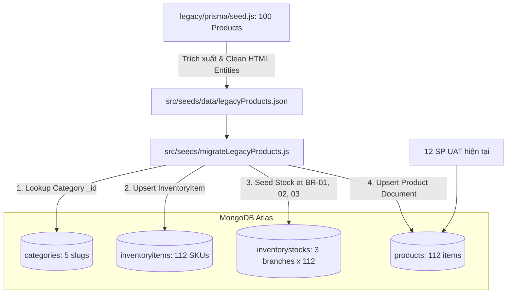

# Kế hoạch chi tiết: Di trú 100 sản phẩm từ MySQL (Legacy) sang MongoDB Atlas (Tổng 112 sản phẩm)

> **Mã kế hoạch:** `PLAN-migrate-mysql-products.md`  
> **Trạng thái:** Đã phê duyệt (Approved - Ready for Implementation)  
> **Mục tiêu:** Tái tạo và di trú 100 sản phẩm gốc từ MySQL (`legacy/prisma/seed.js`) sang MongoDB Atlas chuẩn OpenAPI v7, hợp nhất cùng 12 sản phẩm UAT hiện tại để đạt tổng cộng **112 sản phẩm** hoạt động đầy đủ trên UI.

---

## 1. Bối cảnh & Hiện trạng

### 1.1 Hiện trạng MongoDB Atlas hiện tại
- **Danh mục:** 5 danh mục chuẩn hóa khớp hoàn toàn bộ lọc UI (`thuc-an`, `do-dung-thiet-yeu`, `cham-soc-suc-khoe`, `do-choi`, `phu-kien`).
- **Sản phẩm:** 12 sản phẩm thực tế UAT (`SP-RC-MINI-001` đến `SP-CATTOY-012`), có ảnh Unsplash CDN sắc nét, đầy đủ biến thể và tồn kho tại cả 3 chi nhánh (`BR-000001`, `BR-000002`, `BR-000003`).

### 1.2 Dữ liệu nguồn từ MySQL (Legacy Prisma Seed)
Tại `legacy/prisma/seed.js` (dòng 940 - 1672) và schema `legacy/prisma/schema.prisma`:
- **Tổng số sản phẩm:** Đúng 100 sản phẩm được crawl từ PetMart với hình ảnh CDN thực tế (`https://www.petmart.vn/wp-content/uploads/...`).
- **Phân bổ theo 5 danh mục:**
  1. `Thức ăn` (`thuc-an`): 40 sản phẩm
  2. `Đồ dùng thiết yếu` (`do-dung-thiet-yeu`): 30 sản phẩm
  3. `Chăm sóc sức khỏe` (`cham-soc-suc-khoe`): 10 sản phẩm
  4. `Đồ chơi` (`do-choi`): 10 sản phẩm
  5. `Phụ kiện` (`phu-kien`): 10 sản phẩm
- **Tổng cộng:** 12 (UAT) + 100 (Legacy) = **112 sản phẩm**.

---

## 2. Phân tích So sánh Schema (MySQL vs MongoDB Atlas)

| Thực thể / Trường | MySQL (Legacy Prisma) | MongoDB Atlas (Chuẩn OpenAPI v7 Mongoose) | Giải pháp chuyển đổi (Mapping Rule) |
|---|---|---|---|
| **Danh mục (Category)** | Bảng `product_categories`: `product_category_id` (BigInt autoincrement), `category_name`, `image_url` | Collection `categories`: `_id` (ObjectId), `name`, `slug` (unique, lowercase) | Map 1:1 theo `category_name` vào 5 danh mục đã có sẵn trên MongoDB Atlas. |
| **Mã sản phẩm** | Chỉ có `product_id` (BigInt tự tăng, không có mã nghiệp vụ) | `productCode` (String unique, index): Bắt buộc | Sinh mã có quy tắc: `SP-LEG-001` đến `SP-LEG-100`. |
| **Tên sản phẩm** | `product_name` (VarChar 200) | `name` (String, required, trim) | Giữ nguyên tên gốc, giải mã HTML entities (ví dụ `&#038;` -> `&`, `&amp;` -> `&`). |
| **Mô tả** | `description` (Text) | `description` (String) | Giữ nguyên mô tả gốc, chuẩn hóa ký tự xuống dòng. |
| **Hình ảnh** | Bảng `product_images`: `product_image_id`, `product_id`, `image_url`, `is_primary` | Mảng nhúng `images`: `[{ id, url, isPrimary, sortOrder }]` | Đưa `image1` thành `{ id: 'img-1', url: item.image1, isPrimary: true, sortOrder: 0 }`, `image2` thành `{ id: 'img-2', url: item.image2, isPrimary: false, sortOrder: 1 }`. |
| **Biến thể (Variants)** | Bảng `product_variants`: `variant_id`, `product_id`, `variant_name`, `price`, `stock_quantity` | Mảng nhúng `variants`: `[{ sku, label, price, discountPercent, finalPrice, inventoryItemId, status }]` | Tạo biến thể chuẩn cho mỗi sản phẩm với `sku: '${productCode}-01'`, liên kết trực tiếp với `InventoryItem`. |
| **Quản lý Tồn kho** | Lưu cứng `stock_quantity` ngay trong bảng `products` (không phân biệt chi nhánh) | **Kiến trúc Stock Isolation:** Tách riêng `InventoryItem` và `InventoryStock` cho từng `branchId` | Tạo `InventoryItem` tương ứng cho mỗi SKU; khởi tạo `InventoryStock` cho **cả 3 chi nhánh** (Q1: 100, Q7: 50, Bình Thạnh: 30) để đảm bảo giỏ hàng/thanh toán không bị lỗi hết hàng. |
| **Trạng thái** | `status` ('active'/'inactive') | `status` ('ACTIVE'/'INACTIVE'/'ARCHIVED'), `usageType`: 'SALE' | Gán mặc định `status: 'ACTIVE'`, `usageType: 'SALE'`. |

---

## 3. Kiến trúc Luồng Dữ liệu (Data Flow Diagram)



---

## 4. Phân rã Công việc (Task Breakdown)

### Giai đoạn 1: Chuẩn bị Dữ liệu (Data Preparation)
- **Task 1.1:** Trích xuất mảng 100 sản phẩm từ `legacy/prisma/seed.js` vào file JSON chuẩn hóa: `src/seeds/data/legacyProducts.json`.
- **Task 1.2:** Làm sạch dữ liệu:
  - Giải mã HTML entities (`&#038;`, `&amp;`, `&gt;`, `&lt;`).
  - Gắn nhãn `categorySlug` tương ứng (`thuc-an`, `do-dung-thiet-yeu`, `cham-soc-suc-khoe`, `do-choi`, `phu-kien`).
  - Đảm bảo định dạng URL ảnh PetMart hợp lệ và giá trị số tiền nguyên dương (`price > 0`).

### Giai đoạn 2: Phát triển Script Di trú Độc lập & Idempotent
- **Task 2.1:** Tạo script `src/seeds/migrateLegacyProducts.js`:
  - Cơ chế **Idempotent (Upsert)**: Không bao giờ xóa hay làm ảnh hưởng đến 12 sản phẩm UAT hiện tại (`SP-RC-MINI-001` -> `SP-CATTOY-012`).
  - Đánh số mã sản phẩm: `SP-LEG-001` đến `SP-LEG-100`.
  - Sinh biến thể chuẩn: `sku: SP-LEG-xxx-01`, `label: 'Tiêu chuẩn'` hoặc biến thể theo dung tích/kích thước nếu có.
  - Đồng bộ `InventoryItem` với `kind: 'PRODUCT'`, `unit: 'Cái'`, `status: 'ACTIVE'`.
  - Khởi tạo `InventoryStock` cho cả 3 chi nhánh (`BR-000001`: 100 cái, `BR-000002`: 50 cái, `BR-000003`: 30 cái).
- **Task 2.2:** Đăng ký script trong `package.json`:
  ```json
  "seed:legacy-products": "babel-node src/seeds/migrateLegacyProducts.js"
  ```
- **Task 2.3:** Cập nhật `src/seeds/productionUatSeed.js` để tích hợp danh sách 100 mã `SP-LEG-...` vào danh sách `OFFICIAL_PRODUCT_CODES` an toàn, tránh trường hợp chạy reset UAT bị xóa nhầm.

### Giai đoạn 3: Thực thi Di trú & Kiểm chứng (Execution & Verification)
- **Task 3.1:** Chạy `npm run seed:legacy-products` kết nối trực tiếp MongoDB Atlas.
- **Task 3.2:** Kiểm tra tổng số lượng document:
  - `Product.countDocuments()` đạt **112**.
  - `Product.countDocuments({ categoryId })` tương ứng:
    - Thức ăn: 40 + 3 = 43 sản phẩm
    - Đồ dùng thiết yếu: 30 + 2 = 32 sản phẩm
    - Chăm sóc sức khỏe: 10 + 2 = 12 sản phẩm
    - Đồ chơi: 10 + 2 = 12 sản phẩm
    - Phụ kiện: 10 + 3 = 13 sản phẩm
    - Tổng: 43 + 32 + 12 + 12 + 13 = 112 sản phẩm.
- **Task 3.3:** Kiểm tra API & UI:
  - Test endpoint `GET /api/v1/catalog/products` (hỗ trợ phân trang, lọc theo category, tìm kiếm).
  - Chạy full test suite Jest `npm test` để đảm bảo 282/282 tests vẫn pass 100%.
  - Chạy `npm run build` để đảm bảo Babel compile thành công.

---

## 5. Các quyết định kiến trúc đã chốt (Confirmed Decisions)

- ✅ **Mã sản phẩm (`productCode`):** Sử dụng định dạng `SP-LEG-001` đến `SP-LEG-100` (giúp phân biệt rành mạch sản phẩm di trú từ MySQL với 12 sản phẩm UAT).
- ✅ **Cấu trúc Biến thể:** Mỗi sản phẩm có 1 biến thể `Tiêu chuẩn` (`sku: SP-LEG-xxx-01`, `label: 'Tiêu chuẩn'`, `price: item.price`, `finalPrice: item.price`).
- ✅ **Tồn kho (Stock Isolation):** Khởi tạo bản ghi `InventoryItem` và `InventoryStock` cho cả 3 chi nhánh (`BR-000001`: 100, `BR-000002`: 50, `BR-000003`: 30).
- ✅ **Quy mô danh mục:** 12 (UAT hiện tại) + 100 (Legacy) = **112 sản phẩm**, phủ đều 5 danh mục chuẩn UI.

