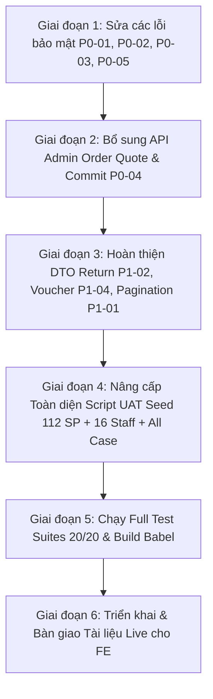

# Kế hoạch chi tiết: Khắc phục Triệt để Handoff FE Web 2 & Phủ Toàn bộ Dữ liệu UAT Đa Chi nhánh

> **Mã kế hoạch:** `PLAN-team-lead-fe-audit-resolution.md`  
> **Trạng thái:** Đã phê duyệt (Approved - Ready for Implementation)  
> **Phạm vi:** 
> 1. Phản hồi và khắc phục 100% các ticket kiểm thử từ FE Handoff (`WEB2_BE_HANDOFF_FULL_AUDIT_2026-10-27.docx`: P0-01 đến P0-06, P1-01 đến P1-06).
> 2. Mở rộng bộ dữ liệu thực tế (UAT Seed): Cung cấp tài khoản dạng văn bản thuần (only text), phủ đều tất cả các role qua tối thiểu 3 chi nhánh, hỗ trợ đầy đủ nhân sự làm việc đa chi nhánh (multi-branch).
> 3. Phủ đầy đủ tất cả các trường hợp nghiệp vụ (khách vãng lai có đơn/lịch hẹn nhưng không có tài khoản, tất cả trạng thái đơn hàng, trả hàng, lịch hẹn).

---

## I. BẢNG TỔNG HỢP TÀI KHOẢN ĐĂNG NHẬP (PLAIN TEXT - KHÔNG CHE MẬT KHẨU)

> 🔑 **Mật khẩu dùng chung cho toàn bộ tài khoản thử nghiệm:** `K9#mQ$8xL!2vW*7z`  
> (Tất cả tài khoản đều đã kích hoạt trạng thái `accountStatus: 'ACTIVE'` và `activationStatus: 'ACTIVATED'`).

### 1. Tài khoản Quản trị viên Toàn hệ thống (Admin)
| Username | Họ và tên | Role hệ thống | Phạm vi Chi nhánh | Mô tả / Mục đích kiểm thử |
|---|---|---|---|---|
| `admin` | System Administrator | `ADMIN` | Toàn quyền (All branches) | Quyền tối cao, truy cập mọi module, quản lý danh mục, cấu hình hệ thống, tạo đơn hộ. |

### 2. Tài khoản Quản lý Chi nhánh (Branch Managers)
| Username | Họ và tên | Role hệ thống | Chi nhánh phụ trách | Mô tả / Mục đích kiểm thử |
|---|---|---|---|---|
| `manager_q1` | Nguyễn Quốc Tuấn | `MANAGER` | `BR-000001` (Quận 1) | Quản lý độc quyền Chi nhánh 1, chỉ duyệt đơn/lịch hẹn/trả hàng tại Q1. |
| `manager_q7` | Lê Thúy Hằng | `MANAGER` | `BR-000002` (Quận 7) | Quản lý độc quyền Chi nhánh 2, chỉ duyệt đơn/lịch hẹn/trả hàng tại Q7. |
| `manager_bt` | Trịnh Hoàng Quân | `MANAGER` | `BR-000003` (Bình Thạnh) | Quản lý độc quyền Chi nhánh 3, chỉ duyệt đơn/lịch hẹn/trả hàng tại Bình Thạnh. |
| `manager_multi` | Đỗ Minh Thắng | `MANAGER` | `BR-000001`, `BR-000002`, `BR-000003` | **Quản lý Vùng (Đa chi nhánh)**: Có quyền quản lý và duyệt trên cả 3 chi nhánh. |
| `manager_unassigned` | Vũ Đình Trọng | `MANAGER` | Không có chi nhánh (`[]`) | **Test case biên (P0-01/AUTH-02)**: Tài khoản không có chi nhánh -> Bị chặn 403, không xem được đơn hàng nào. |

### 3. Đội ngũ Nhân viên Y tế & Dịch vụ (Staff - 4 SubRoles x 3 Chi nhánh + Đa chi nhánh)

#### A. Bác sĩ Thú y (`VETERINARIAN`)
| Username | Họ và tên | Chi nhánh chính | Chi nhánh được phân quyền | Lịch trực tuần |
|---|---|---|---|---|
| `doctor.an` | BS. Nguyễn Văn An | `BR-000001` (Q1) | `BR-000001` | Thứ 2, 3, 5, 6, CN (Nghỉ Thứ 4, 7) |
| `doctor.nam` | BS. Lê Hoàng Nam | `BR-000002` (Q7) | `BR-000002` | Thứ 3, 4, 5, 7, CN (Nghỉ Thứ 2, 6) |
| `doctor.thao` | BS. Trần Phương Thảo | `BR-000003` (Bình Thạnh) | `BR-000003` | Thứ 2, 4, 6, 7, CN (Nghỉ Thứ 3, 5) |
| `doctor.multi` | BS. CKII Vũ Cao Sơn | `BR-000001` (Q1) | `BR-000001`, `BR-000002`, `BR-000003` | **Bác sĩ Chuyên gia Luân phiên**: Trực Q1 (Thứ 2, 3), Q7 (Thứ 4, 5), Bình Thạnh (Thứ 6, 7). |

#### B. Y tá / Điều dưỡng thú y (`NURSE`)
| Username | Họ và tên | Chi nhánh chính | Chi nhánh được phân quyền | Lịch trực tuần |
|---|---|---|---|---|
| `nurse.mai` | Hoàng Thị Mai | `BR-000001` (Q1) | `BR-000001` | Thứ 2, 3, 4, 6, 7 |
| `nurse.trang` | Vũ Thu Trang | `BR-000002` (Q7) | `BR-000002` | Thứ 2, 3, 5, 6, CN |
| `nurse.phuc` | Đặng Hồng Phúc | `BR-000003` (Bình Thạnh) | `BR-000003` | Thứ 2, 4, 5, 6, 7 |
| `nurse.multi` | Phan Kim Ngân | `BR-000001` (Q1) | `BR-000001`, `BR-000002` | **Y tá Lưu động**: Trực chi viện luân phiên giữa Quận 1 và Quận 7. |

#### C. Lễ tân phòng khám (`RECEPTIONIST`)
| Username | Họ và tên | Chi nhánh chính | Chi nhánh được phân quyền | Lịch trực tuần |
|---|---|---|---|---|
| `reception.bich` | Trần Thị Bích | `BR-000001` (Q1) | `BR-000001` | Thứ 2, 4, 5, 6, 7 |
| `reception.khang` | Ngô Minh Khang | `BR-000002` (Q7) | `BR-000002` | Thứ 2, 3, 4, 6, CN |
| `reception.yen` | Nguyễn Hải Yến | `BR-000003` (Bình Thạnh) | `BR-000003` | Thứ 3, 4, 5, 6, CN |
| `reception.multi` | Lâm Mỹ Duyên | `BR-000002` (Q7) | `BR-000002`, `BR-000003` | **Lễ tân Luân phiên**: Hỗ trợ check-in và nhận khách giữa Q7 và Bình Thạnh. |

#### D. Chuyên viên Chăm sóc & Cắt tỉa (`CARE_STAFF_GROOMER`)
| Username | Họ và tên | Chi nhánh chính | Chi nhánh được phân quyền | Lịch trực tuần |
|---|---|---|---|---|
| `groomer.dat` | Phạm Quốc Đạt | `BR-000001` (Q1) | `BR-000001` | Thứ 3, 4, 5, 7, CN |
| `groomer.huy` | Đỗ Gia Huy | `BR-000002` (Q7) | `BR-000002` | Thứ 2, 4, 5, 6, 7 |
| `groomer.tuan` | Lê Anh Tuấn | `BR-000003` (Bình Thạnh) | `BR-000003` | Thứ 2, 3, 5, 7, CN |
| `groomer.multi` | Hoàng Trọng Nghĩa | `BR-000001` (Q1) | `BR-000001`, `BR-000003` | **Groomer Đa chi nhánh**: Thực hiện dịch vụ Spa cao cấp luân phiên tại Q1 & Bình Thạnh. |

#### E. Nhân viên chưa phân chi nhánh (Test Case Biên)
| Username | Họ và tên | Chi nhánh chính | Chi nhánh được phân quyền | Mục đích kiểm thử |
|---|---|---|---|---|
| `staff.unassigned` | Bùi Tiến Dũng | `null` | `[]` (Rỗng) | **Test case biên**: Kiểm tra quyền truy cập bị từ chối 403 khi nhân viên chưa gán chi nhánh. |

---

### 4. Tài khoản Khách hàng Thành viên & Khách Vãng lai (Customers & Guests)

| Loại khách | Thông tin / Số điện thoại | Trạng thái Tài khoản | Đơn hàng gắn liền | Lịch hẹn gắn liền | Đặc điểm nghiệp vụ |
|---|---|---|---|---|---|
| **Thành viên** | `customer` (Lê Văn Cường) ĐT: `0905555555` | `ACTIVE` (Có User & Customer) | 4 đơn hàng đủ các trạng thái (`COMPLETED`, `SHIPPED`, `PROCESSING`, `CANCELLED`) | Lịch khám bệnh hoàn tất (`APT-CUST-COMPLETED-01`) có Bệnh án đã ký duyệt. | Khách quen có 2 thú cưng (Buddy - Chó Golden, Luna - Mèo Anh), có số dư tích điểm và lịch sử đầy đủ. |
| **Khách Vãng lai 1** | Nguyễn Thị Hồng ĐT: `0981112233` | `NO_ACCOUNT` (Chưa có User) | `ORD-GUEST-HOT-01` (Giao thành công, thanh toán COD) | Không | **Khách vãng lai mua hàng**: Có `GuestContact`, `customerId = null`, không có tài khoản đăng nhập. |
| **Khách Vãng lai 2** | Phạm Hoàng Long ĐT: `0978889900` | `NO_ACCOUNT` (Chưa có User) | Không | `APT-GUEST-CLINIC-01` (Khám tổng quát, đã cọc 30%) | **Khách vãng lai đặt khám**: Có `GuestContact`, `customerId = null`, đặt lịch hẹn khám tại Q1 nhưng không tạo tài khoản. |
| **Khách Vãng lai 3** | Trần Thị Mai ĐT: `0908888888` | `PENDING_ACTIVATION` (Chờ kích hoạt) | `ORD-GUEST-PENDING-02` (Đang giao hàng) | `APT-GUEST-GROOM-02` (Spa cắt tỉa lông) | **Khách đã được gửi lời mời kích hoạt**: Admin đã bấm gửi thư mời, token được mã hóa an toàn, chờ khách xác nhận mật khẩu. |
| **Khách Vãng lai 4** | Đỗ Thu Trang ĐT: `0901234567` | `ACTIVATED` (Đã kích hoạt) | `ORD-GUEST-MIGRATED-03` | `APT-GUEST-MIGRATED-03` | **Khách vãng lai đã nâng cấp thành viên**: Toàn bộ đơn hàng và lịch hẹn cũ trước đây được tự động liên kết trọn vẹn vào tài khoản mới. |

---

## II. MA TRẬN BAO PHỦ TOÀN BỘ TRẠNG THÁI NGHIỆP VỤ (FULL COVERAGE DATA MATRIX)

### 1. Trạng thái Đơn hàng (Orders - 7/7 Trạng thái)
1. `PENDING`: Đơn mới tạo, chờ thanh toán / chờ duyệt.
2. `CONFIRMED`: Đã xác nhận đơn hàng và trừ tồn kho.
3. `PROCESSING`: Kho chi nhánh đang đóng gói hàng hóa.
4. `SHIPPED`: Đã bàn giao cho đơn vị vận chuyển giao hàng.
5. `DELIVERED`: Khách đã nhận được hàng.
6. `COMPLETED`: Đơn hoàn tất thành công, hết hạn khiếu nại.
7. `CANCELLED`: Đơn đã hủy (hoàn tồn kho tự động, hoàn quota voucher).

### 2. Trạng thái Trả hàng & Hoàn tiền (Order Returns - 7/7 Trạng thái)
1. `REQUESTED`: Khách gửi yêu cầu trả hàng, chờ Admin/Manager xem xét.
2. `PROCESSING`: Quản lý đã tiếp nhận, chờ khách gửi hàng về chi nhánh.
3. `RECEIVED`: Chi nhánh đã nhận kiện hàng hoàn, kiểm tra tình trạng hàng.
4. `APPROVED`: Quản lý duyệt hoàn tiền theo số lượng thực nhận đạt chuẩn.
5. `REJECTED`: Từ chối trả hàng (hàng hỏng do khách, quá hạn 7 ngày).
6. `COMPLETED`: Đã thực hiện hoàn tiền thành công qua Mock Payment Provider.
7. `CANCELLED`: Khách rút lại yêu cầu trả hàng.

### 3. Trạng thái Lịch hẹn Dịch vụ (Appointments - 7/7 Trạng thái)
1. `PENDING`: Lịch hẹn đặt online đang chờ xác nhận lịch bác sĩ.
2. `CONFIRMED`: Lịch hẹn đã xác nhận, đã thanh toán cọc thành công.
3. `CHECKED_IN`: Khách và thú cưng đã đến quầy lễ tân chi nhánh.
4. `IN_PROGRESS`: Thú cưng đang trong phòng khám hoặc khu vực Grooming.
5. `COMPLETED`: Dịch vụ hoàn tất, Bác sĩ ký duyệt hồ sơ bệnh án `ServiceRecord`.
6. `CANCELLED`: Lịch hẹn bị hủy (hoàn cọc theo chính sách báo trước).
7. `NO_SHOW`: Khách không đến đúng giờ hẹn.

---

## III. KẾ HOẠCH KHẮC PHỤC CHI TIẾT CÁC TICKET TỪ FE HANDOFF

### 1. Khối Ưu tiên P0 (Khối An ninh, Phân quyền & Khóa phát hành)

#### [P0-01] Order Detail Scope & Guest Auth (`order.service.js` & `order.routes.js`)
- **Lỗ hổng hiện tại:** Khi `actor = null` thì `getOrderById` không chặn ngay; khi Staff/Manager có `authorizedBranchIds = []` (chưa gán chi nhánh) thì điều kiện `if (length > 0)` bị bỏ qua dẫn tới fail-open (xem được mọi đơn).
- **Giải pháp:**
  - Nếu `actor == null` và không có `guestToken` hợp lệ -> Ném lỗi `401 UNAUTHENTICATED`.
  - Nếu `actor.systemRole === 'STAFF'` hoặc `'MANAGER'`: Kiểm tra bắt buộc `authorizedBranchIds`. Nếu mảng rỗng hoặc không chứa `fulfillmentBranchId` của đơn -> Ném lỗi `403 FORBIDDEN` (fail-closed).
  - Khách vãng lai xem đơn phải cung cấp `x-guest-lookup-token` hợp lệ và khớp với `guestContactId` của đơn hàng.

#### [P0-02] Return List & Detail Authorization (`return.routes.js` & `return.service.js`)
- **Lỗ hổng hiện tại:** Route `GET /order-returns` và `GET /order-returns/:id` dùng `optionalAuth`, cho phép gọi ẩn danh.
- **Giải pháp:**
  - Đổi sang middleware yêu cầu xác thực (`requireAuth` hoặc xác thực `guestToken`).
  - Phân quyền theo chi nhánh: Quản lý chi nhánh nào chỉ thấy và chỉ được thao tác trên các yêu cầu trả hàng thuộc chi nhánh đó (dựa trên `fulfillmentBranchId` của đơn hàng gốc).

#### [P0-03] Bảo mật Lời mời Kích hoạt Guest (`guest.service.js` & `guest.routes.js`)
- **Lỗ hổng hiện tại:** `POST /api/v1/activation/invite` trả về raw `token` trong response JSON, tiềm ẩn nguy cơ chiếm quyền tài khoản.
- **Giải pháp:**
  - Bỏ trường `token` thô khỏi response trả về cho FE/Admin.
  - Response chỉ trả về `{ success: true, message: 'Đã gửi lời mời kích hoạt', activationStatus: 'PENDING_ACTIVATION', expiresAt }`.
  - Token kích hoạt chỉ được gửi an toàn qua kênh thông báo (email/SMS/MOCK console log), mã hóa hash at-rest trong database.

#### [P0-04] API Admin Tạo đơn & Báo giá Hộ khách (`POST /admin/orders/quote` & `POST /admin/orders`)
- **Thiếu sót hiện tại:** Chưa có endpoint độc lập để Admin/Manager tại quầy lên đơn cho khách.
- **Giải pháp:**
  - Xây dựng `POST /api/v1/admin/orders/quote`: Tính toán tiền hàng, chiết khấu voucher, phí ship, kiểm tra tồn kho tại các chi nhánh mà KHÔNG tạo dữ liệu hay trừ tồn kho.
  - Xây dựng `POST /api/v1/admin/orders`: Tạo đơn hàng chính thức có `Idempotency-Key`, hỗ trợ cả khách có sẵn (`customerId`) hoặc khách vãng lai (tự động tạo `GuestContact` với trạng thái `PENDING_ACTIVATION`), trừ tồn kho và ghi nhận doanh thu đúng chi nhánh.

#### [P0-05] Loại bỏ Dữ liệu Địa chỉ & Số điện thoại Giả (`order.service.js#formatOrder`)
- **Lỗ hổng hiện tại:** Hàm `formatOrder` có fallback cứng `'0905555555'` và `'123 Nguyễn Thị Minh Khai'`.
- **Giải pháp:**
  - Xóa bỏ toàn bộ fallback giá trị giả. Nếu đơn hàng không có địa chỉ, trả về `null` hoặc chuỗi rỗng để FE hiển thị đúng "Chưa cập nhật".

---

### 2. Khối Ưu tiên P1 (Hoàn thiện Hợp đồng & Tiện ích UI)

#### [P1-01] Phân trang Server-side Order & Return Chuẩn xác
- Áp dụng phân trang Cursor ổn định theo cặp `(createdAt, _id)` kết hợp sort giảm dần.
- Trả về `nextCursor` trỏ đúng vào phần tử cuối cùng của trang và `totalCount` tổng số bản ghi thỏa mãn bộ lọc.

#### [P1-02] Bổ sung DTO Đầy đủ cho Order Return
- Cập nhật `formatOrderReturn` để trả về trực tiếp:
  - `orderCode`: Mã hiển thị của đơn hàng gốc (ví dụ: `ORD-CUST-COMPLETED-01`).
  - `fulfillmentBranchId`: Chi nhánh xử lý đơn.
  - `createdAt`: Thời gian gửi yêu cầu (ISO UTC).
  - `evidenceUrls`: Danh sách link ảnh chứng từ hàng lỗi/hỏng.
  - `allowedActions`: Các hành động được phép (`['PROCESS', 'RECEIVE', 'APPROVE', 'REJECT', 'CANCEL']`).
  -> Giúp FE hiển thị danh sách ngay lập tức mà không phải gọi N+1 request `GET /orders/:id`.

#### [P1-03] Hỗ trợ Tiếp nhận Hàng Hoàn Thực tế & Tính Hoàn tiền Cuối cùng
- Bổ sung body cho `POST /order-returns/:id/receive`: Nhận mảng `items: [{ orderItemId, receivedQty, quality, note }]`.
- Tại bước `approve`, BE tự động tính toán `finalRefundAmount` dựa trên số lượng hàng thực tế đạt chuẩn nhập lại kho, cập nhật restock chính xác.

#### [P1-04] Mở rộng DTO Voucher & Bộ lọc Server-side
- Bổ sung vào response voucher: `minOrderAmount`, `maxDiscountAmount`, `description`.
- Hỗ trợ query tìm kiếm server-side theo `code`, `name` và trả về `totalCount`.

#### [P1-05] Tra cứu Khách hàng Chính xác theo Số điện thoại (`exactPhone`)
- Thêm tham số `exactPhone` hoặc `exact=true` vào `GET /api/v1/customers` để tìm đúng 1 khách hàng duy nhất khi Admin gõ số điện thoại tại màn hình tạo đơn.

---

## IV. TRÌNH TỰ TRIỂN KHAI (IMPLEMENTATION PHASES)

1. **Giai đoạn 1:** Sửa các lỗ hổng RBAC và dữ liệu giả trong `order.service.js`, `return.routes.js`, `return.service.js`, `guest.service.js`.
2. **Giai đoạn 2:** Xây dựng controller và route cho `POST /admin/orders/quote` và `POST /admin/orders`.
3. **Giai đoạn 3:** Bổ sung DTO enriched cho Return, Voucher và hỗ trợ tra cứu chính xác số điện thoại khách.
4. **Giai đoạn 4:** Nâng cấp file [src/seeds/productionUatSeed.js](file:///d:/A1.%20Lap%20Trinh%20Web/Group_Project_Pet_Clinic/PET_CLINIC_BACKEND/src/seeds/productionUatSeed.js) để nạp đầy đủ danh sách tài khoản văn bản thuần, phân bổ 3 chi nhánh, multi-branch staff, và bao phủ tất cả 7 trạng thái của Order/Return/Appointment.
5. **Giai đoạn 5:** Chạy `npm test` và `npm run build` đảm bảo không có bất kỳ regression lỗi nào.
6. **Giai đoạn 6:** Xuất bản tài liệu bàn giao hoàn chỉnh cho FE.

---

## V. CÁC QUYẾT ĐỊNH NGHIỆP VỤ ĐÃ CHỐT (CONFIRMED DECISIONS)

- ✅ **Quyền tạo đơn hộ khách (`POST /admin/orders`):** Cho phép cả `ADMIN`, `MANAGER` và `RECEPTIONIST` (giúp nhân viên lễ tân trực quầy có thể bán hàng và thu tiền trực tiếp cho khách).
- ✅ **Chính sách hoàn kho khi Trả hàng (`Order Return`):** Chỉ tự động nhập lại kho đối với các sản phẩm được kiểm tra đạt chuẩn (`quality: 'RESELLABLE'`). Các sản phẩm hỏng hóc (`DAMAGED`) sẽ ghi nhận xuất hủy và không cộng lại vào `InventoryStock`.
- ✅ **Phân bổ nhân sự:** Phủ đều toàn bộ 3 chi nhánh, bao gồm cả nhân sự luân phiên đa chi nhánh (multi-branch) và nhân sự chưa gán chi nhánh để kiểm thử bảo mật.
- ✅ **Khách vãng lai:** Tạo đủ 4 nhóm trường hợp (`NO_ACCOUNT` mua hàng COD, `NO_ACCOUNT` đặt lịch khám cọc 30%, `PENDING_ACTIVATION` đã gửi thư mời, `ACTIVATED` đã liên kết dữ liệu cũ).

